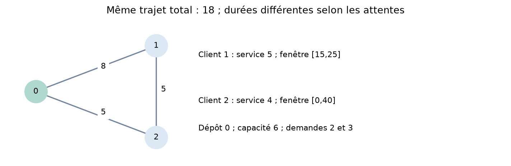
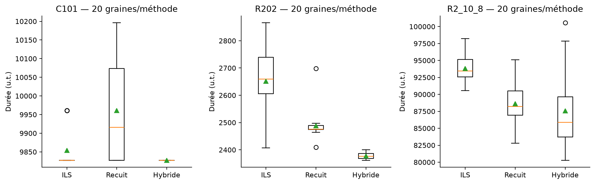
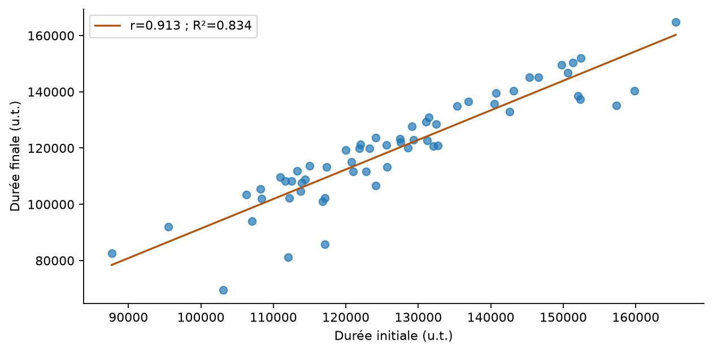
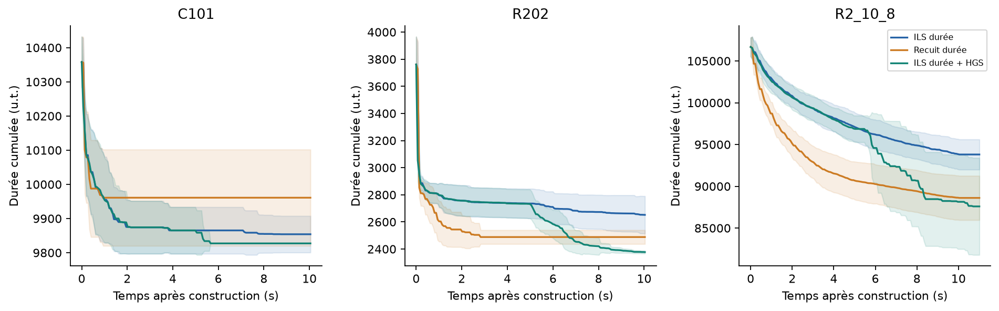

# Livrable final — CVRPTW : minimisation de la durée totale

**CESI — Algorithmique et optimisation — 13 novembre 2026**

Nous cherchons des tournées livrant chaque client exactement une fois, respectant la capacité, les fenêtres strictes et la fermeture du dépôt. Notre objectif est la **somme des durées des tournées**, avec trajets, attentes et services, pour des départs fixés à zéro. Le temps d’exécution du solveur est mesuré séparément.

La méthode associe notre constructeur et notre ILS à un HGS externe fourni par **PyVRP 0.12.2**, explicitement attribué à ses auteurs. Les expériences utilisent les données Solomon et Gehring–Homberger, sans les modifier. Les temps de trajet restent statiques ; la prise en compte d’un trafic dépendant de l’heure demeure une extension non démontrée.

Le rapport présente successivement le problème, sa formulation, l’algorithme, le protocole, les statistiques descriptives et les limites. Les fichiers individuels permettent de vérifier les solutions et les calculs.

## 1. Du réseau routier à la durée d’une tournée

Le dépôt et les clients forment les sommets d’un graphe orienté ; un arc représente un trajet possible. Les temps de trajet sont $c_{ij}$, les demandes $q_i$, les services $s_i$ et les fenêtres $[e_i,l_i]$. Une solution est une liste de tournées ; le dépôt 0 est implicite au départ et au retour.

Deux ordres de visite peuvent parcourir la même distance et produire des attentes différentes. Sur l’exemple suivant, le trajet total vaut 18 et les services totalisent 9 dans les deux cas. L’attente vaut 7 dans l’ordre 1 puis 2, contre 1 dans l’autre : les durées sont 34 et 28. Le deuxième ordre est meilleur pour notre objectif.




## 2. Modélisation mathématique du CVRPTW en durée

Nous formalisons le **CVRPTW statique étudié ici** : un dépôt unique, des véhicules homogènes, des livraisons indivisibles, une tournée au plus par véhicule et des trajets fixes et symétriques. L'attente avant ouverture est autorisée. Le début du service doit appartenir à la fenêtre du client et le retour doit respecter la fermeture du dépôt. Les bornes sont inclusives. Le trafic variable, les ramassages, les dépôts multiples et les flottes hétérogènes ne font pas partie des expériences réalisées.

**Ensembles et indices.** Le nombre de clients est l'entier $n\ge1$. Leur ensemble est $C=\{1,\ldots,n\}$. Le nombre maximal de véhicules est l'entier $K\ge0$ et leur ensemble d'indices est $\mathcal K=\{1,\ldots,K\}$. Ainsi, $n$ et $K$ sont des nombres ; $C$ et $\mathcal K$ sont des ensembles. L'écriture $\forall i\in C$ signifie « pour chaque client i appartenant à C ». Elle ne désigne pas une boucle « tant que ».

Nous représentons le dépôt physique par deux sommets : $o$ pour le départ et $r$ pour le retour. Cette duplication permet de distinguer les heures de départ et de retour ; elle n'ajoute pas un deuxième dépôt réel. Les sommets et arcs autorisés sont :

$$V=C\cup\{o,r\},$$
$$A=(\{o\}\times C)\cup\{(i,j)\in C\times C:i\ne j\}\cup(C\times\{r\}).$$

Les véhicules peuvent aller du départ à un client, entre deux clients distincts, puis d'un client au retour. Aucune boucle sur un même sommet n'est autorisée. Aucun arc n'entre dans o et aucun arc ne quitte r.

**Paramètres.** Pour chaque client $i\in C$, soient $q_i,s_i,e_i,l_i\in\mathbb R_{\ge0}$ : sa demande est $q_i$, sa durée de service $s_i$ et sa fenêtre de début de service $[e_i,l_i]$. Soient $Q,H\in\mathbb R_{>0}$ la capacité commune et la fermeture du dépôt. Comme dans les données acceptées par `Instance`, nous supposons $0\le e_i\le l_i\le H$ pour tout $i\in C$. Pour chaque arc $(i,j)\in A$, soient $d_{ij},c_{ij}\in\mathbb R_{\ge0}$ sa distance et son temps de trajet. Les départs sont fixés au temps zéro. Dans les benchmarks du projet, temps de trajet et distances ont les mêmes valeurs numériques ; le modèle distingue néanmoins leurs rôles et leurs unités.

**Variables de décision et domaines.**

$$x_{ij}^k\in\{0,1\}\quad\forall(i,j)\in A,\ \forall k\in\mathcal K.$$

Pour chaque arc et chaque véhicule, x vaut un si le véhicule emprunte cet arc, et zéro sinon.

$$y_i^k\in\{0,1\}\quad\forall i\in C,\ \forall k\in\mathcal K,\qquad
u_k\in\{0,1\}\quad\forall k\in\mathcal K.$$

La variable y vaut un si le client i est affecté au véhicule k. La variable u vaut un si le véhicule k est utilisé.

$$t_i\in\mathbb R_{\ge0}\quad\forall i\in C,\qquad
R_k\in\mathbb R_{\ge0}\quad\forall k\in\mathcal K.$$

La variable t est l'heure de **début du service**, pas l'heure d'arrivée. La variable R est l'heure de retour au dépôt. Les bornes horaires sont imposées ci-dessous.

Enfin, $f_{ij}^k\in\mathbb R_{\ge0}$, pour chaque $(i,j)\in A$ et chaque $k\in\mathcal K$, est un flot artificiel assurant la connexion au dépôt. Il représente un outil mathématique, pas la marchandise dans le camion.

### 2.1. Fonction objectif : minimiser la durée totale

$$\boxed{\min T=\sum_{k\in\mathcal K}R_k}.$$

Chaque véhicule part à zéro. $R_k$ est donc sa durée de tournée, retour au dépôt compris ; $R_k=0$ s’il n’est pas utilisé. Nous minimisons la somme des temps mobilisés, et non le retour du dernier véhicule $\max_kR_k$ ni le temps de calcul du programme.

Pour une solution réalisable, cette durée se décompose en :

$$T=\sum_{k\in\mathcal K}\sum_{(i,j)\in A}c_{ij}x_{ij}^k+\sum_{i\in C}s_i+\sum_{i\in C}w_i,$$

où $w_i$ est l’attente avant le début du service, calculée à partir des horaires. La somme des services est constante pour une instance : elle est comptée mais ne constitue pas un gain que l’algorithme peut supprimer. Trajets et attentes peuvent varier. Les véhicules restent limités par la flotte disponible, sans priorité lexicographique ni coût fixe ajouté.

### 2.2. Contraintes et lecture opérationnelle

**C1 — Affecter chaque client exactement une fois.**

$$\sum_{k\in\mathcal K}y_i^k=1\qquad\forall i\in C.$$

Pour chaque client i, la somme des affectations vaut un : un seul véhicule réalise l'intégralité de sa livraison. Aucun client ne peut être oublié ou réparti entre plusieurs camions.

**C2 — Assurer une entrée et une sortie avec le véhicule affecté.**

$$\sum_{j:(j,i)\in A}x_{ji}^k=y_i^k,
\qquad\sum_{j:(i,j)\in A}x_{ij}^k=y_i^k
\qquad\forall i\in C,\ \forall k\in\mathcal K.$$

Pour chaque client et chaque véhicule, une affectation impose exactement une entrée et une sortie. Sans affectation, ce véhicule n'emprunte aucun arc entrant ou sortant de ce client. Les indices des sommes sont limités aux arcs autorisés de A.

**C3 — Partir du dépôt et y revenir, au plus une fois par véhicule.**

$$\sum_{j\in C}x_{oj}^k=u_k,
\qquad\sum_{i\in C}x_{ir}^k=u_k
\qquad\forall k\in\mathcal K.$$

Chaque véhicule utilisé effectue un départ et un retour. Un véhicule inutilisé n'en effectue aucun. On autorise donc l'utilisation de moins de K camions. La borne $\sum_{k\in\mathcal K}u_k\le K$ est automatiquement satisfaite, puisque u est binaire et que $\mathcal K$ contient K véhicules.

**C4 — Respecter la capacité de chaque camion.**

$$\sum_{i\in C}q_iy_i^k\le Qu_k
\qquad\forall k\in\mathcal K.$$

Pour chaque véhicule, la somme des quantités affectées ne dépasse pas Q. Cette somme est la charge à emporter au départ pour des livraisons pures. Elle diminue ensuite pendant la tournée ; il n'y a aucun ramassage. Le code peut donc contrôler la même contrainte en additionnant les demandes de la tournée. Les unités de demande ne sont pas multipliées par dix.

**C5 — Commencer le service dans la fenêtre du client.**

$$e_i\le t_i\le l_i\qquad\forall i\in C.$$

Pour chaque client, le début du service se situe entre ouverture et fermeture, bornes comprises. Une arrivée avant l'ouverture est possible avec attente. La fin $t_i+s_i$ peut dépasser $l_i$ : notre projet n'impose pas une fenêtre sur la fin du service.

**C6 — Respecter l'ordre temporel des trajets et services.**

Posons $s_{\max}=\max_{i\in C}s_i$, $c_{\max}=\max_{(i,j)\in A}c_{ij}$ et $M=H+s_{\max}+c_{\max}$. Cette borne est valide sous les hypothèses d'horizon précédentes.

$$t_j\ge c_{oj}-M(1-x_{oj}^k)
\qquad\forall j\in C,\ \forall k\in\mathcal K.$$

Pour chaque client j et chaque véhicule k, si l'arc du dépôt vers j est utilisé, le service ne commence pas avant la fin du trajet depuis le départ au temps zéro.

$$t_j\ge t_i+s_i+c_{ij}-M(1-x_{ij}^k)
\qquad\forall i,j\in C,\ i\ne j,\ \forall k\in\mathcal K.$$

Pour chaque paire de clients distincts et chaque véhicule, emprunter l'arc de i vers j impose de terminer le service chez i puis le trajet avant de commencer chez j. Si cet arc n'est pas utilisé, M désactive l'implication. Une borne par arc pourrait renforcer une résolution exacte sans changer les règles métier.

Les contraintes imposent des horaires réalisables ; minimiser la somme des retours sélectionne une durée minimale pour les tournées retenues. Une fois l'ordre fixé, `verify()` recalcule les horaires au plus tôt : arrivée = fin précédente + trajet ; début = maximum entre arrivée et ouverture ; fin = début + service.

**C7 — Fixer le retour et respecter la fermeture du dépôt.**

$$R_k\ge t_i+s_i+c_{ir}-M(1-x_{ir}^k),$$
$$R_k\le t_i+s_i+c_{ir}+M(1-x_{ir}^k)
\qquad\forall i\in C,\ \forall k\in\mathcal K,$$
$$0\le R_k\le Hu_k\qquad\forall k\in\mathcal K.$$

Pour chaque client et chaque véhicule, si i est le dernier client visité, les deux premières inégalités fixent le retour à la fin de son service plus le trajet vers le dépôt. Le retour doit être au plus H. Pour un véhicule inutilisé, R vaut zéro. Un retour exactement à H est autorisé.

**C8 — Interdire les cycles de clients isolés du dépôt.**

$$0\le f_{ij}^k\le nx_{ij}^k
\qquad\forall(i,j)\in A,\ \forall k\in\mathcal K,$$
$$f_{ir}^k=0\qquad\forall i\in C,\ \forall k\in\mathcal K.$$

Le flot artificiel ne passe que sur un arc utilisé. Il fournit une unité par client et n'a plus rien à transporter lors du retour au dépôt.

$$\sum_{j:(j,i)\in A}f_{ji}^k-\sum_{j:(i,j)\in A}f_{ij}^k=y_i^k
\qquad\forall i\in C,\ \forall k\in\mathcal K,$$
$$\sum_{j\in C}f_{oj}^k=\sum_{i\in C}y_i^k
\qquad\forall k\in\mathcal K.$$

Chaque client affecté consomme une unité reçue du dépôt. Le dépôt en émet autant que de clients affectés au véhicule. Un cycle isolé ne peut pas satisfaire cette consommation : en additionnant les équations de ses clients, tous les flots internes s'annulent alors qu'une consommation strictement positive resterait nécessaire. Le flot empêche ainsi les sous-tournées, même lorsque des temps tronqués sont nuls.

**Convention numérique et représentation dans le programme.** Les références DIMACS utilisent chaque arc euclidien tronqué à une décimale. `algo/data.py` calcule sa valeur entière à l'échelle dix et multiplie fenêtres et services par dix. Les coûts affichés sont reconvertis. Les dépôts o et r du PLNE correspondent tous deux à l'indice 0 du code ; les retours sont ajoutés implicitement aux listes de tournées. Les contraintes restent obligatoires, quelle que soit la métaheuristique choisie.


**Pourquoi le grand M est valide.** Les bornes $0\le t_i,t_j\le H$ impliquent $t_i+s_i+c_{ij}-t_j\le H+s_{\max}+c_{\max}$. Cette valeur désactive donc la propagation d'un arc non utilisé. Des bornes par arc peuvent renforcer le solveur exact sans modifier les solutions autorisées. Le modèle contient de l'ordre de $Kn^2$ variables d'arcs/flots et contraintes : l'exact sert ici aux petits cas.

## 3. Complexité et vérification du modèle

Le problème généralise le TSP : avec un seul véhicule, des fenêtres larges, des services nuls et une capacité non bloquante, minimiser la durée revient à minimiser le coût d’un circuit du TSP. Cette réduction est polynomiale : l’optimisation est NP-difficile. Les contraintes de temps et de capacité rendent l’exploration pratique plus exigeante ; elles ne donnent pas une garantie d’optimalité à une métaheuristique.

Le PLNE de `controle/plne.py` est réellement résolu par HiGHS avec le coût placé sur les variables de retour $R_k$. Sur dix petits cas de 3 à 5 clients, nous comparons son résultat à une énumération indépendante des tournées et partitions. Les deux méthodes prouvent les mêmes optimums en durée. Un cas comprend des arcs nuls pour vérifier que le flot empêche les cycles isolés.

| instance         |   n | optimum   | returned   | gap_pct   | calculation_s   |
|:-----------------|----:|:----------|:-----------|:----------|:----------------|
| exact-duration-0 |   3 | 69,400    | 69,400     | 0,000     | 0,138           |
| exact-duration-1 |   4 | 77,600    | 77,600     | 0,000     | 0,137           |
| exact-duration-2 |   5 | 107,100   | 107,100    | 0,000     | 0,654           |
| exact-duration-3 |   3 | 86,200    | 86,200     | 0,000     | 0,057           |
| exact-duration-4 |   4 | 88,200    | 88,200     | 0,000     | 0,147           |
| exact-duration-5 |   5 | 106,100   | 106,100    | 0,000     | 0,788           |
| exact-duration-6 |   3 | 96,400    | 96,400     | 0,000     | 0,089           |
| exact-duration-7 |   4 | 74,900    | 74,900     | 0,000     | 0,138           |
| exact-duration-8 |   5 | 109,100   | 109,100    | 0,000     | 0,652           |
| exact-duration-9 |   3 | 66,000    | 66,000     | 0,000     | 0,041           |

Ces dix cas contrôlent la formulation ; ils ne démontrent pas l’optimalité des solutions à 100–1 000 clients.

## 4. Algorithme et lien avec le code

### 4.1. Construire, perturber, intensifier et conserver le meilleur

Le constructeur utilise des insertions regret-2 respectant capacité et horaires. Les surcoûts de trajet guident les positions ; parmi douze constructions complètes, la meilleure est sélectionnée selon sa **durée réelle**. La construction est mesurée et ajoutée au temps total.

Notre ILS copie la solution courante, tente quatre perturbations réalisables, puis une descente locale échantillonnée et bornée. Les mouvements sont relocate, swap, inversion 2-opt et échange de fins de tournées 2-opt*. Chaque mouvement recalcule les horaires complets des tournées touchées : une économie d’arcs ne suffit pas à prouver une amélioration de durée.

La candidate est acceptée si sa durée reste dans une tolérance de 0,5 % autour du record. Toute amélioration stricte met à jour une copie de l’archive. Après cent cycles sans record, la recherche repart de cette archive. Le budget mural est contrôlé entre les blocs de mouvements ; un bloc commencé peut légèrement dépasser la limite, et le temps réel est publié.

Le recuit utilise les mêmes mouvements et le même évaluateur temporel. Une hausse de durée $\Delta>0$ peut être acceptée avec $\exp(-\Delta/\theta)$ ; la température décroît géométriquement avec le temps consommé. L’archive réalisable reste distincte de l’état courant.

### 4.2. Évaluer effectivement la durée

`route_eval` reçoit une tournée, les matrices, demandes, services et fenêtres ; il renvoie la faisabilité, la durée et la charge. La ligne `max` compte l’attente ; la dernière addition compte le retour au dépôt. Les unités internes sont des dixièmes ; les sorties affichées sont divisées par dix.

```python
@njit(cache=True)
def route_eval(seq, length, travel, distance, demand, service, early, late, capacity, horizon):
    """Renvoie faisabilité, durée de la tournée et charge, en unités internes.

    distance conserve la signature commune des mouvements ; elle n'entre pas
    dans le coût. Le retour au dépôt et toutes les attentes sont comptabilisés.
    """
    clock = load = 0.0
    previous = 0
    for pos in range(length):
        client = seq[pos]
        load += demand[client]
        clock = max(clock + travel[previous, client], early[client])
        if clock > late[client] + 1e-8 or load > capacity + 1e-8:
            return False, 0.0, load
        clock += service[client]
        previous = client
    if length:
        clock += travel[previous, 0]
    return clock <= horizon + 1e-8, clock, load
```

### 4.3. Hybridation avec un moteur externe

Le profil hybride transmet le résultat de notre ILS au HGS de PyVRP 0.12.2, sans lire de référence et sans modifier les contraintes. Le HGS maintient une population de solutions, sélectionne des parents par tournois, effectue un croisement SREX et applique une recherche locale comprenant notamment SwapStar. Des états de travail pénalisés peuvent être explorés ; seules des solutions finales réalisables sont conservées.

Le coût du véhicule est configuré avec `unit_distance_cost=0`, `unit_duration_cost=1` et `start_late=0`. Ce dernier paramètre fixe le départ à zéro : décaler le départ pour masquer l’attente ne correspondrait pas au modèle. Le coût retourné est confronté à la somme des durées recalculées par notre contrôleur indépendant.

Le partage évalué est 5 s d’ILS puis 5 s de HGS. Ce réglage constitue une base expérimentale pour l’objectif durée ; une configuration performante en distance n’est pas automatiquement validée en durée.


### 4.4. Modifications et vérifications

| Modification | Motif | Vérification |
|---|---|---|
| Objectif PLNE sur les retours $R_k$ | Minimiser la durée cumulée | Concordance de dix optimums avec une énumération indépendante |
| Évaluateur temporel des mouvements | Inclure attente, service et retour | Deux ordres de même trajet mais de durées 34/28 sont distingués |
| Sélection initiale et archive en durée | Éviter une acceptation restée en distance | Coûts confrontés à `verify`, archive non dégradée |
| HGS : coût durée et départ fixé | Aligner le moteur externe sur le modèle | Test d’une attente obligatoire que le départ ne peut masquer |
| Nouvelles références temporelles | Éviter de renommer les gaps distance | Tournées de référence réévaluées, qualification explicite |
| Nouvelle campagne et statistique descriptive | Mesurer l’effet réel de la méthode | Données individuelles, graines, sources figées et effectifs conservés |

L’implémentation propre de l’ILS, les adaptateurs et la vérification sont dans le projet ; le moteur génétique externe appartient à PyVRP. Les commentaires du code expliquent les fonctions et les points sensibles.

## 5. Protocole et références des benchmarks en durée

Nous utilisons les 56 Solomon à 100 clients et les 300 Gehring–Homberger de 200, 400, 600, 800 et 1 000 clients : **356 instances**. Les matrices de temps conservent la convention des fichiers DIMACS : arcs euclidiens tronqués à une décimale, horaires et services à la même échelle. Les durées sont exprimées en unités du benchmark, pas en minutes réelles démontrées.

La campagne de couverture comporte **472 pipelines hybrides** : une graine sur toutes les instances, une seconde à 100/1 000 clients. Le lot de stabilité compare ILS, recuit et hybride sur C101, R202 et R2_10_8, avec **20 graines par couple instance/méthode**, soit 180 résolutions. Six résolutions hybrides appartiennent déjà à la couverture : le total distinct est **646**, pas 652. Toutes sont exécutées pour l’objectif durée.

Chaque méthode dispose de dix secondes de recherche. Construction et préparation externe sont comptées en plus ; la compilation est préchauffée séparément. Les essais sont répartis sur six processus à une affinité CPU enregistrée, avec les bibliothèques de calcul limitées à un thread. Graines, ordre, versions et sources exécutées sont figés dans le protocole.

Les trois cas répétés représentent un cas groupé, un cas aléatoire et une grande instance historiquement difficile. Ce choix ne rend pas le lot représentatif de toutes les situations. Les méthodes reçoivent la même construction pour une même instance et graine ; celle-ci est effectivement recalculée et facturée dans chaque résolution.

### 5.1. Ce que signifie la référence

Les fichiers `.sol` DIMACS donnent des tournées de référence sélectionnées pour la **distance**. Nous recalculons leur durée, avec les mêmes services, fenêtres et départs à zéro. Ce plan est un **témoin réalisable**, dont l’optimalité en durée n’est pas établie. Son utilisation n’introduit pas de connaissance dans le solveur : il est lu après la résolution.

L’écart au témoin est :

$$E=100\frac{T_{\mathrm{obtenu}}-T_{\mathrm{témoin}}}{T_{\mathrm{témoin}}}.$$

Un écart négatif signifie que la solution est plus courte en durée que ce témoin ; cela ne signifie pas qu’un optimum a été battu. Nous ne présentons pas cet indicateur comme un gap à une BKS temporelle. Les anciens pourcentages calculés en distance ne qualifient pas l’objectif actuel.

### 5.2. Borne inférieure et véritable gap

Pour les petits cas, une preuve d’optimalité permet un véritable gap $100(T/T^*-1)$. Pour les grandes instances, nous utilisons aussi une borne simple :

$$L=\sum_i s_i+\operatorname{MST}(G,c)\le T^*.$$

L’union des tournées rejoint le dépôt et tous les clients ; son temps de trajet est au moins celui d’un arbre couvrant minimal. L’attente est non négative et les services sont obligatoires. Ainsi $100(T/L-1)$ borne supérieurement le gap à l’optimum, mais peut être très pessimiste. Il ne s’agit pas d’une BKS. Les trois notions — optimum prouvé, borne inférieure et plan témoin — restent séparées dans les tableaux.

## 6. Résultats et statistique descriptive

### 6.1. Couverture, qualité temporelle et temps de calcul

Les 646 résolutions comprennent 646 solutions réalisables et 0 échecs. Le tableau de couverture donne le même poids à chaque instance après moyenne de ses graines disponibles. L’écart moyen au plan témoin vaut **-17.169 %** et le gain moyen depuis la construction **13.522 %**. Ces deux indicateurs ont des références différentes.

|   Clients |   Instances |   Essais |   Réalisables | Durée (u.t.)   | Écart témoin (%)   | Gain initial (%)   | Calcul (s)   |
|----------:|------------:|---------:|--------------:|:---------------|:-------------------|:-------------------|:-------------|
|       100 |          56 |      112 |           112 | 4579,108       | -17,916            | 13,706             | 10,044       |
|       200 |          60 |       60 |            60 | 11330,003      | -25,192            | 18,709             | 10,143       |
|       400 |          60 |       60 |            60 | 25359,123      | -20,323            | 16,795             | 10,558       |
|       600 |          60 |       60 |            60 | 48790,418      | -17,716            | 14,811             | 11,336       |
|       800 |          60 |       60 |            60 | 80274,655      | -13,451            | 11,137             | 12,611       |
|      1000 |          60 |      120 |           120 | 119817,274     | -8,467             | 5,988              | 14,279       |

Les moyennes favorables ne suppriment pas les cas difficiles. Voici les six instances dont la durée moyenne dépasse le plus celle du plan témoin ; elles restent dans tous les tableaux de leur périmètre.

| instance   |    n | mean_duration   | reference_duration   | mean_delta_reference_pct   | mean_calculation_s   |
|:-----------|-----:|:----------------|:---------------------|:---------------------------|:---------------------|
| C1_10_6    | 1000 | 167151,950      | 133754,700           | 24,969                     | 14,510               |
| C1_8_1     |  800 | 118110,800      | 97704,100            | 20,886                     | 12,607               |
| C2_10_7    | 1000 | 128157,000      | 106940,000           | 19,840                     | 14,004               |
| C2_10_2    | 1000 | 126639,150      | 109395,800           | 15,762                     | 14,420               |
| C1_6_1     |  600 | 78992,900       | 68564,200            | 15,210                     | 11,290               |
| C2_10_1    | 1000 | 122295,950      | 106856,600           | 14,449                     | 13,862               |

Le pire essai individuel est C1_10_6, graine 4102 : **+26.767 %** au témoin. Il ne doit pas être confondu avec une moyenne d’instance.

Ces écarts positifs montrent une marge d’amélioration au budget de dix secondes. Ils ne sont ni cachés par la moyenne générale ni transformés en zéros. Le témoin reste une solution réalisable et non un optimum démontré en durée.


### 6.2. Population, variables et données tabulaires

Une ligne d’essai représente une instance, une graine, une méthode et un budget. Le nom de l’instance et la méthode sont qualitatifs ; le nombre de clients est discret ; durée, attente et temps de calcul sont quantitatifs ; la faisabilité est booléenne. Une graine sert à identifier une exécution, pas à expliquer causalement sa performance.

Les cases manquantes des indicateurs de qualité d’un échec ne valent jamais zéro. La colonne d’erreur est normalement vide pour une réussite. Nous contrôlons les colonnes indispensables sur les essais réalisables avant de calculer les statistiques.

### 6.3. Position, dispersion et quantiles

Pour N valeurs observées, la moyenne est $\bar x=N^{-1}\sum x_i$. La médiane partage la série ordonnée en deux moitiés ; elle est moins sensible que la moyenne aux valeurs élevées. Le mode est une valeur la plus fréquente ; pour une série continue sans répétition, il peut ne pas y avoir de mode distinct utile.

Nous employons la variance descriptive $v=N^{-1}\sum(x_i-\bar x)^2$ et l’écart-type $\sigma=\sqrt v$, avec `ddof=0`. La variance corrigée divisée par N−1 répondrait à une autre convention et n’est pas mélangée ici. L’étendue vaut maximum moins minimum ; l’IQR vaut $Q_3-Q_1$. Les quantiles sont calculés par interpolation linéaire Pandas, convention annoncée pour rendre les résultats reproductibles.

Les tableaux suivants portent sur les **vingt répétitions d’une même instance et méthode**. Les colonnes détaillées, y compris les quantiles 2,5 %, 10 %, 30 %, 70 %, 90 % et 97,5 %, sont conservées en CSV.

| instance   | method          |   n | mean      | median    | std      | minimum   | q0.25     | q0.75     | maximum    | iqr      |
|:-----------|:----------------|----:|:----------|:----------|:---------|:----------|:----------|:----------|:-----------|:---------|
| C101       | ILS durée + HGS |  20 | 9827,300  | 9827,300  | 0,000    | 9827,300  | 9827,300  | 9827,300  | 9827,300   | 0,000    |
| C101       | ILS durée       |  20 | 9854,040  | 9827,300  | 53,480   | 9827,300  | 9827,300  | 9827,300  | 9961,000   | 0,000    |
| C101       | Recuit durée    |  20 | 9960,965  | 9915,800  | 140,925  | 9827,300  | 9827,300  | 10073,600 | 10195,900  | 246,300  |
| R202       | ILS durée + HGS |  20 | 2377,305  | 2376,750  | 10,907   | 2361,400  | 2367,875  | 2386,900  | 2399,800   | 19,025   |
| R202       | ILS durée       |  20 | 2651,955  | 2659,650  | 138,383  | 2407,500  | 2605,375  | 2739,850  | 2865,600   | 134,475  |
| R202       | Recuit durée    |  20 | 2488,380  | 2476,100  | 51,308   | 2409,000  | 2474,500  | 2488,925  | 2697,700   | 14,425   |
| R2_10_8    | ILS durée + HGS |  20 | 87594,075 | 85859,000 | 5803,493 | 80273,000 | 83718,000 | 89652,825 | 100546,600 | 5934,825 |
| R2_10_8    | ILS durée       |  20 | 93806,260 | 93459,750 | 1806,187 | 90535,300 | 92558,050 | 95147,150 | 98220,100  | 2589,100 |
| R2_10_8    | Recuit durée    |  20 | 88610,995 | 88195,800 | 2647,555 | 82803,900 | 86916,400 | 90490,425 | 95106,800  | 3574,025 |

Sur C101, les vingt résultats hybrides ont une moyenne de 9827.300 et une médiane de 9827.300 u.t., avec un écart-type de 0.000. Cette stabilité observée ne garantit pas tous les essais futurs. Sur R2_10_8, la moyenne vaut 87594.075 contre une médiane de 85859.000 u.t. ; l’histogramme permet de lire l’influence des durées les plus élevées.




La boîte contient les observations entre Q1 et Q3 et son trait central est la médiane ; le marqueur représente la moyenne. Les moustaches atteignent les dernières observations dans les bornes Q1−1,5 IQR et Q3+1,5 IQR. Les autres points sont potentiellement atypiques : ils ne sont pas supprimés.

Une moyenne supérieure à la médiane peut signaler l’influence de grandes valeurs, mais l’interprétation doit être confrontée à l’histogramme. Une série constante n’a pas une dispersion normale non dégénérée. Avec vingt valeurs et des contraintes produisant des plateaux, nous ne supposons pas automatiquement une loi normale et n’appliquons pas les probabilités d’une gaussienne sans justification.

Les graphiques globaux suivants représentent les moyennes de **356 instances différentes**. Ils décrivent l’hétérogénéité du catalogue et ne remplacent pas l’étude entre graines d’un même cas.


### 6.4. Covariance, corrélation et moindres carrés

Pour éviter de confondre l’effet du budget et de la taille, cette étude utilise une observation par instance à 1 000 clients, la graine 4101 et dix secondes de recherche : 60 couples. X est la durée de construction et Y la durée finale du profil hybride.

$$\operatorname{Cov}(X,Y)=N^{-1}\sum_i(x_i-\bar x)(y_i-\bar y),\quad r=\frac{\operatorname{Cov}(X,Y)}{\sigma_X\sigma_Y}.$$

La droite $\widehat y=ax+b$ minimise $\sum_i(y_i-ax_i-b)^2$, avec $a=\operatorname{Cov}(X,Y)/v_X$ et $b=\bar y-a\bar x$. La pente mesure l’association observée des durées ; l’interception ne s’interprète pas comme une durée réelle à extrapoler hors des données.

Les calculs donnent **r = 0.9131**, **a = 1.0512**, **b = -13752.4000** et **R² = 0.8338**. Ils décrivent ce lot, sans démontrer un effet causal du moteur ni une garantie prédictive sur une instance nouvelle.



La décomposition SCT = SCR + SCE sépare la variabilité totale, la part associée à la droite ajustée et les résidus. Avec une interception, $R^2=1-\mathrm{SCE}/\mathrm{SCT}=r^2$ en régression linéaire simple. Un R² élevé ne signifie pas que la méthode a causé cette proportion d’amélioration.

### 6.5. Convergence et comparaison des méthodes

Nous alignons les traces sur le temps après construction. Chaque trace est une fonction en escalier du meilleur coût connu ; après l’arrêt d’un essai, sa dernière valeur est conservée jusqu’à l’horizon commun. La fin de la courbe moyenne est vérifiée contre la moyenne des durées finales du même lot. La zone représente ± un écart-type descriptif entre graines, et non un intervalle de confiance.



| instance   | method          |   runs |   feasible | duration   | std      | mean_calculation_s   | delta   |
|:-----------|:----------------|-------:|-----------:|:-----------|:---------|:---------------------|:--------|
| C101       | ILS durée + HGS |     20 |         20 | 9827,300   | 0,000    | 10,040               | 0,000   |
| C101       | ILS durée       |     20 |         20 | 9854,040   | 53,480   | 10,026               | 0,272   |
| C101       | Recuit durée    |     20 |         20 | 9960,965   | 140,925  | 10,026               | 1,360   |
| R202       | ILS durée + HGS |     20 |         20 | 2377,305   | 10,907   | 10,047               | -62,067 |
| R202       | ILS durée       |     20 |         20 | 2651,955   | 138,383  | 10,030               | -57,684 |
| R202       | Recuit durée    |     20 |         20 | 2488,380   | 51,308   | 10,031               | -60,295 |
| R2_10_8    | ILS durée + HGS |     20 |         20 | 87594,075  | 5803,493 | 15,541               | -23,303 |
| R2_10_8    | ILS durée       |     20 |         20 | 93806,260  | 1806,187 | 14,828               | -17,864 |
| R2_10_8    | Recuit durée    |     20 |         20 | 88610,995  | 2647,555 | 14,803               | -22,413 |

Sur ce lot de vingt graines par cas, l’hybride présente la durée moyenne la plus faible pour les trois cas. Les distributions se recouvrent, notamment sur la grande instance : cette observation descriptive ne constitue pas un test de significativité ni une preuve de supériorité sur tout le catalogue.

Ces moyennes et dispersions comparent des méthodes à effort de recherche égal. Nous ne retenons pas seulement le meilleur essai ; un mécanisme plus complexe peut régresser sur un cas. Les trois cas ont été choisis pour leur contraste et ne permettent pas une conclusion universelle de supériorité.

## 7. Reproduction, limites et conclusion

Le changement porte sur le modèle, le coût des mouvements, l’acceptation, l’archive, le HGS et les mesures. Une simple substitution du mot « distance » par « temps » aurait laissé le solveur optimiser le mauvais critère. Les cas de test distinguent explicitement ces deux objectifs.

La campagne montre le comportement observé en durée sur les 356 instances et la stabilité sur trois cas répétés. Les limites restent : temps de trajet statiques, tailles plafonnées à 1 000 clients, budget de dix secondes, peu de graines sur la couverture globale et absence d’optimum temporel officiel pour les grandes instances. La borne MST peut être faible. Les services constants peuvent réduire les pourcentages relatifs sans prouver que les trajets et attentes sont proches de leurs meilleurs niveaux : leur décomposition doit accompagner les résultats.

Les fichiers `results/time_objective/catalogue/runs/` contiennent les solutions, temps et traces. Le protocole et les sources effectivement exécutées sont conservés. `scripts/analyze_duration.py` recalcule les contraintes, les références et les statistiques ; `scripts/valider_duree.py` contrôle la remise. Le notebook recalcule les analyses et exemples, sans relancer les 646 résolutions.

```powershell
python -m pip install -r requirements.txt
python cli.py C101 --method ils_hgs --seconds 10 --seed 4101
python -m streamlit run web/app.py
python scripts/analyze_duration.py
python scripts/valider_duree.py
python -m pytest tests -q --junitxml=livraison/TESTS.xml
```

L’objectif de la CLI est la durée par défaut. Les routines historiques en distance restent explicites pour les contrôles de non-régression ; leurs anciens résultats ne sont pas utilisés comme des benchmarks temporels.

## Références

- Sujet CESI, *Algorithmique et optimisation*, énoncé : minimisation de la durée totale d’une tournée ; extension annoncée au trafic horaire.
- Support CESI, *Corbeille d’exercices — Statistiques descriptives*, exercices 1–8 : indicateurs, quantiles, covariance/Pearson, moindres carrés, R² et représentations.
- [PyVRP, code source version 0.12.2](https://github.com/PyVRP/PyVRP/tree/v0.12.2) : moteur HGS externe, durée, fenêtres et paramètres de véhicules.
- [Documentation PyVRP : temps et durées](https://pyvrp.org/notebooks/duration_constraints.html) ; les propriétés utilisées sont également vérifiées dans la version 0.12.2 installée.
- [Règles officielles DIMACS VRPTW](https://dimacs.rutgers.edu/programs/implementation-challenges/vehicle-routing/implementation-challenge-vehicle-routing/vrp-with-time-windows) : objectif de référence en distance, flotte maximale et convention des arcs.
- [Données PyVRP/Instances](https://github.com/PyVRP/Instances), révision figée dans `data/manifest.json`.