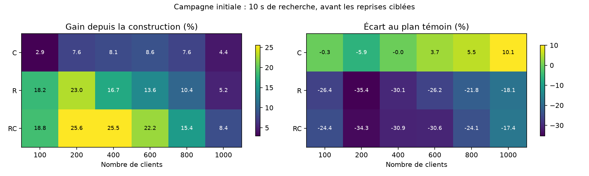
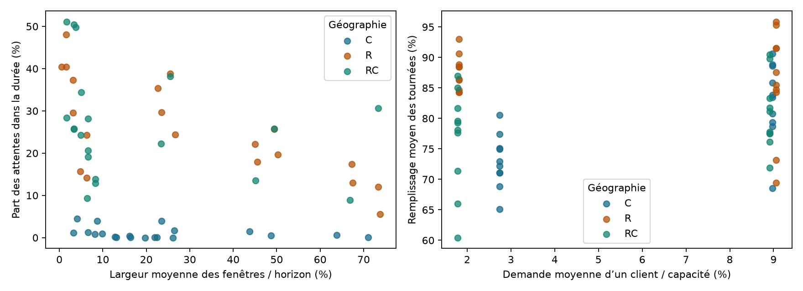

### 6.11. Scénarios géographiques, fenêtres et capacités

**Population comparable.** Cette analyse utilise la campagne initiale à dix secondes de recherche : 356 instances, une observation par instance après moyenne de ses graines. Elle ne mélange pas ces mesures avec l'archive à budgets différents. C désigne les clients groupés, R les clients répartis aléatoirement et RC une organisation mixte. Les six familles C1/C2/R1/R2/RC1/RC2 combinent ces structures et des paramètres temporels et de capacité différents. Nous mesurons les caractéristiques des fichiers originaux, plutôt que supposer que l'indice 2 élargit uniformément toutes les contraintes. Les données ne sont pas modifiées pour construire ces scénarios.

**Indicateurs de difficulté.** Une durée brute plus élevée n'implique pas une mauvaise solution : les nombres de clients et les services diffèrent. Nous examinons aussi le gain par rapport à la construction de la même instance, la part d'attente et le calcul réel. L'écart au témoin reste descriptif : des différences entre familles peuvent venir de la pertinence temporelle variable de leurs références distance, et non seulement de la difficulté intrinsèque.

Le gain depuis la construction est $G=100(T_{\mathrm{construction}}-T_{\mathrm{finale}})/T_{\mathrm{construction}}$. Par exemple, un gain de 19,32 % signifie une diminution de durée de 19,32 % depuis le départ construit ; ce n'est pas un gap de 19,32 % par rapport au BKS. Pour cet indicateur, une valeur positive élevée est une amélioration. La colonne « Écart témoin » utilise une autre référence et doit être interprétée séparément.

| Géographie   |   Instances | Écart témoin (%)   | Gain construction (%)   | Part attente (%)   | Attente témoin (%)   | Calcul moyen (s)   |
|:-------------|------------:|:-------------------|:------------------------|:-------------------|:---------------------|:-------------------|
| C            |         117 | 2,224              | 6,633                   | 0,371              | 2,501                | 11,507             |
| R            |         123 | -26,335            | 14,610                  | 12,221             | 56,824               | 11,511             |
| RC           |         116 | -27,011            | 19,318                  | 11,424             | 54,690               | 11,517             |

**Lecture des cartes de chaleur.** Chaque case représente la moyenne d'instances de la même géographie et de la même taille. Le panneau gauche indique le gain depuis la construction : une valeur positive correspond à une baisse de durée. Le panneau droit indique l'écart au plan témoin : une valeur négative correspond à une durée inférieure à celle du témoin, sans preuve de nouvel optimum temporel. Les deux échelles sont distinctes et leurs couleurs ne doivent pas être comparées directement.

**Intérêt et continuité.** Le tableau global résume les trois géographies ; les cartes séparent ensuite les tailles pour éviter de confondre structure spatiale et nombre de clients. Elles montrent les cas où la recherche améliore beaucoup son départ, ainsi que ceux où le témoin reste meilleur. Cette lecture conduit à examiner les fenêtres et la capacité, qui participent aussi à la faisabilité des mouvements.

**Fenêtres et capacité : définitions mesurées.** La largeur d'une fenêtre est $l_i-e_i$ ; sa moyenne divisée par H donne une ouverture relative à l'horizon. Ce ratio ne mesure ni la position des fenêtres, ni leur compatibilité avec les trajets. Le ratio moyen $q_i/Q$ mesure la part de camion occupée par un client. La borne $\lceil\sum_i q_i/Q\rceil$ donne un minimum de véhicules lié uniquement aux quantités ; les fenêtres peuvent imposer davantage de tournées. Enfin, le remplissage observé est $\sum_i q_i/(mQ)$ pour m véhicules utilisés, puis moyenné sur les graines.

| Famille   |   Instances | Q min    | Q max    | H min    | H max    | Largeur fenêtre moyenne (u.t.)   | Fenêtre/H (%)   | Demande/Q (%)   | Remplissage (%)   |
|:----------|------------:|:---------|:---------|:---------|:---------|:---------------------------------|:----------------|:----------------|:------------------|
| C1        |          59 | 200,000  | 200,000  | 1236,000 | 1824,000 | 365,145                          | 24,228          | 9,000           | 85,921            |
| C2        |          58 | 700,000  | 700,000  | 3390,000 | 3914,000 | 949,779                          | 25,605          | 2,700           | 81,507            |
| R1        |          62 | 200,000  | 200,000  | 230,000  | 1925,000 | 311,556                          | 31,229          | 8,600           | 83,119            |
| R2        |          61 | 1000,000 | 1000,000 | 1000,000 | 7697,000 | 1424,473                         | 35,564          | 1,724           | 79,900            |
| RC1       |          58 | 200,000  | 200,000  | 240,000  | 1821,000 | 208,800                          | 22,200          | 8,908           | 85,679            |
| RC2       |          58 | 1000,000 | 1000,000 | 960,000  | 7284,000 | 891,451                          | 23,700          | 1,782           | 72,551            |

**Lecture des nuages.** Chaque point est une des soixante instances à 1 000 clients, après moyenne de ses graines. À gauche, nous rapprochons l'ouverture relative moyenne des fenêtres de la part d'attente finale. À droite, nous rapprochons la demande relative à la capacité du remplissage effectif. Les couleurs distinguent C, R et RC. La taille et le budget de recherche sont fixes, mais les autres caractéristiques restent différentes.

**Intérêt et limites.** Ces nuages relient les contraintes du modèle au comportement observé. Une capacité élevée autorise certains regroupements sans les garantir ; les horaires peuvent empêcher de remplir un camion. Des fenêtres longues peuvent aussi laisser subsister des attentes selon leur position et l'ordre des visites. Il s'agit d'associations descriptives, pas d'une expérience modifiant une seule contrainte : géographie, services, horizon et demandes peuvent se confondre. Nous ne concluons donc pas à un effet causal isolé de Q ou de la largeur des fenêtres. Les limites de l'approche et les réglages contrôlés de la section précédente complètent cette lecture.

**Lecture du bilan.** Pour RC, le gain moyen depuis la construction vaut 19.32 %, la part d’attente 11.42 % et l’écart au témoin -27.01 %. Pour R, le gain moyen depuis la construction vaut 14.61 %, la part d’attente 12.22 % et l’écart au témoin -26.33 %. Pour C, le gain moyen depuis la construction vaut 6.63 %, la part d’attente 0.37 % et l’écart au témoin +2.22 %. Ces valeurs décrivent la campagne initiale et ses départs ; elles ne classent pas universellement la difficulté des familles. Les tableaux détaillés par taille et famille permettent de revenir aux instances avant de proposer une modification.

**Association et causalité.** Sur les soixante cas à 1 000 clients, la corrélation de Pearson entre ouverture relative des fenêtres et part d'attente vaut -0.269, et celle entre demande relative à Q et remplissage vaut 0.227. Ces associations modestes ne suffisent pas à isoler un effet causal des contraintes. La colonne d'attente du témoin rappelle aussi que les plans de référence n'ont pas été sélectionnés pour minimiser ce temps : leurs écarts de durée peuvent différer fortement selon les familles.
