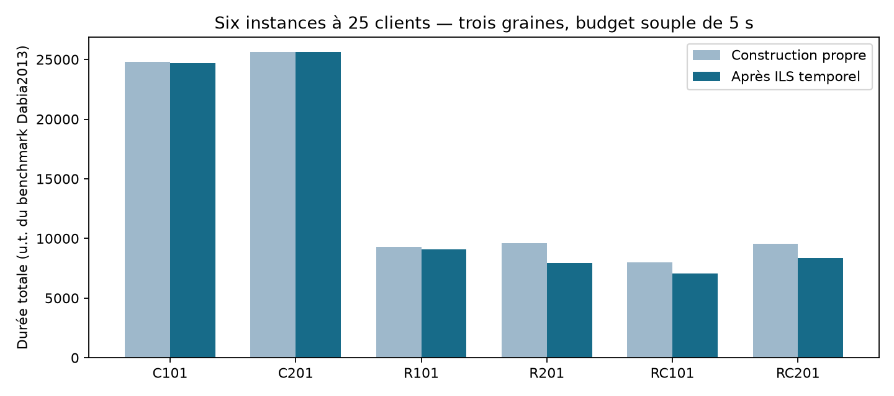
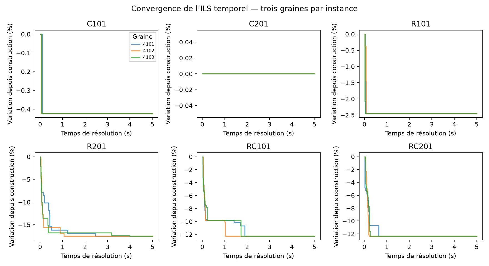

### 6.13. Extension temporelle : pilote Dabia2013 à objectif compatible

**Pourquoi cette extension ?** Les fichiers de référence DIMACS des campagnes
précédentes optimisent les trajets. Leur durée recalculée permet une comparaison
descriptive, mais pas un gap à une BKS en durée. Nous conservons ces expériences
et ajoutons un pilote distinct, avec un objectif et des références temporels
compatibles. Aucun ancien pourcentage n'est renommé en nouveau gap.

**Données et périmètre.** Six instances de Dabia2013 à **25 clients** représentent
C1, C2, R1, R2, RC1 et RC2. Les 18 fichiers instance/fonctions temporelles/BKS
sont téléchargés sans modification depuis la révision
`331ec306b7908e0c9a264d1fc1341a938340ab79` de MAMUT-routing. Le manifeste conserve
les URL et empreintes SHA256. Il s'agit de dérivés temporels de Solomon, pas des
fichiers DIMACS statiques à 100 clients portant parfois le même nom. Les unités
de temps natives de Dabia sont conservées sans appliquer notre conversion
DIMACS par dix. Les durées brutes des deux jeux ne doivent pas être mélangées.

**Adaptation mathématique.** Le temps d'arrivée sur un arc est désormais une
fonction de son heure de départ :

$$
\alpha_{ij}(t)=t+\tau_{ij}(t).
$$

Pour une tournée $p=(v_1,\ldots,v_m)$ partant à $D_p$, les horaires sont :

$$
A_{v_1}=\alpha_{0v_1}(D_p),\quad
B_{v_j}=\max(A_{v_j},e_{v_j}),\quad
F_{v_j}=B_{v_j}+s_{v_j},
$$
$$
A_{v_{j+1}}=\alpha_{v_jv_{j+1}}(F_{v_j}),\quad
R_p=\alpha_{v_m0}(F_{v_m}).
$$

Les débuts de service respectent $B_i\le l_i$, les charges et la flotte restent
bornées, et le retour respecte la fermeture du dépôt. Le départ est cette fois
**une décision**, dans le domaine autorisé par les données. L'objectif devient :

$$
\boxed{\min T_{TD}=\sum_{p}(R_p-D_p)}
=T_{\mathrm{trajets}}+T_{\mathrm{attentes}}+T_{\mathrm{services}}.
$$

Ce changement est nécessaire pour respecter le benchmark. Il ne s'agit pas de
réétiqueter le modèle statique $\min\sum_kR_k$ à départs nuls. Le PLNE de la
section 2 reste un modèle **statique**, non un solveur exact de cette extension.
Les fonctions temporelles sont évaluées en double précision selon le contrat
canonique `td-fold/2`, avec prise en compte des changements de vitesse pendant
les trajets ; elles ne sont pas remplacées par une matrice de temps constants.

**Algorithme réellement exécuté et attribution.** Dans `algo/dabia.py`, notre
code effectue l'insertion séquentielle, la descente locale avec relocate, swap,
2-opt et 2-opt*, les perturbations/redémarrages ILS et la conservation de la
meilleure solution. Chaque ordre de tournée proposé est évalué avec son départ
optimal par **MAMUT-routing-lib 0.12.0**, bibliothèque externe également utilisée
comme contrôleur canonique final. Ce calcul d'horaire n'est pas présenté comme
une invention ou une implémentation personnelle. Ce pilote n'utilise **ni le
HGS statique PyVRP ni un nouveau solveur exact externe**. Un cache par instance
réutilise les évaluations de tournées identiques. L'acceptation locale exige une
amélioration supérieure à $10^{-8}$ unités ; cette tolérance de recherche ne
modifie ni les données ni le coût de validation du contrôleur.

**Vérification.** Les coûts de référence sont relus et vérifiés après la recherche,
jamais utilisés pour construire ou arrêter la solution. Une seconde simulation
avant reconstruit trajets, attentes et services à partir des départs retenus ;
elle utilise une tolérance diagnostique de $10^{-7}$ pour les arrondis. La
validation normative reste le contrôleur MAMUT sans epsilon. Les tests couvrent
aussi les doublons, clients absents, capacité, variations de trajet selon le
départ, conservation des clients par les mouvements et monotonie de l'archive.

**Protocole du pilote.** Après six résolutions préliminaires conservées, un second
lot de **18 résolutions enregistrées** couvre six instances et trois graines
(4101–4103), avec cinq secondes de budget souple par résolution. Cela représente
24 résolutions enregistrées au total sur ces deux lots, pas 24 instances. Le lot
ci-dessous est le second seulement. Les trois workers réduisent le délai du lot,
mais chaque CPU est mesuré dans le processus qui résout l'instance. Le chargement,
la construction, la recherche et la simulation finale sont comptés ; le
démarrage de l'interpréteur et le contrôle ultérieur du témoin sont exclus.

**Résultats mesurés.** Les 18 solutions sont réalisables et leur coût canonique
est exactement égal à celui de la BKS correspondante : gap moyen et maximal
**0 %**, sans valeur négative et sans plafonnement. Ce zéro est une égalité
effective des coûts canoniques de nos solutions et des références.
Les écarts-types sont nuls sur ces trois graines ; cela ne garantit pas la même
stabilité sur des instances plus grandes.

| Instance | Clients | Graines | Durée moyenne (u.t. Dabia) | BKS Duration | Gap moyen (%) | Écart-type durée | CPU moyen (s) |
|---|---:|---:|---:|---:|---:|---:|---:|
| C101 | 25 | 3 | 24709.177158 | 24709.177158 | +0.000000 | 0.000000 | 4.917 |
| C201 | 25 | 3 | 25606.020742 | 25606.020742 | +0.000000 | 0.000000 | 5.005 |
| R101 | 25 | 3 | 9079.419193 | 9079.419193 | +0.000000 | 0.000000 | 4.953 |
| R201 | 25 | 3 | 7932.168491 | 7932.168491 | +0.000000 | 0.000000 | 5.000 |
| RC101 | 25 | 3 | 7038.613082 | 7038.613082 | +0.000000 | 0.000000 | 5.010 |
| RC201 | 25 | 3 | 8375.471792 | 8375.471792 | +0.000000 | 0.000000 | 5.016 |

Les CPU totaux observés ne dépassent pas **5.031 s**, et les temps écoulés
totaux ne dépassent pas **5.042 s**. Ces mesures respectent deux minutes sur
ce pilote ; ce n'est pas une garantie sur toute machine ou toute taille.



**Lecture et intérêt.** Chaque paire de barres compare le coût construit et le
coût final moyen des trois graines, avec les unités propres à Dabia. Le service
reste obligatoire dans les deux coûts. C201 est déjà au coût de référence après
construction ; l'ILS ne lui apporte donc aucun gain mesuré. Sur R201, RC101 et
RC201, les baisses depuis la construction valent respectivement environ
17,50 %, 12,24 % et 12,36 %. Cette comparaison mesure l'apport de la recherche
combinée, pas l'effet isolé de chacun des quatre mouvements.



**Lecture et continuité.** Les courbes en escalier tracent uniquement les records
enregistrés, normalisés par le coût de construction, puis prolongés jusqu'au
temps réel de fin. Des courbes superposées sont possibles. Cette figure complète
le tableau final en montrant la progression de la recherche ; elle ne démontre
ni optimalité globale ni généralisation à 100 ou 1 000 clients.

**Statut des références et limites.** Les six fichiers indiquent historiquement
une preuve d'optimalité, mais C101, R201 et RC201 portent une note de réévaluation
du coût après le passage à `td-fold/2`, avec recertification encore en attente.
Nous conservons donc le libellé prudent **gap à une BKS Duration compatible**,
sans revendiquer six preuves nouvelles d'optimalité. Le contrôleur, ses versions
et les notes originales sont enregistrés. Ce pilote de développement ne couvre
que six instances choisies à 25 clients et ne remplace pas les campagnes statiques
à 100–1 000 clients. Aucun résultat à 50/100 clients Dabia ni à 1 000 clients
temporels n'a été exécuté dans cette étape. L'ablation des opérateurs et une
validation sur un lot non utilisé pour la mise au point restent à faire.

**Sources et reproduction.** Données :
[MAMUT Dabia2013](https://github.com/ANR-MAMUT/MAMUT-routing/tree/331ec306b7908e0c9a264d1fc1341a938340ab79/benchmarks/TDVRPTW/Dabia2013).
Méthodologie d'origine : Dabia et al. (2013) et Lera-Romero et al. (2020).
Contrôleur externe : [MAMUT-routing-lib](https://github.com/ANR-MAMUT/MAMUT-routing-lib),
version 0.12.0. Sources de nos essais, données, références et diagnostics sont
dans `results/dabia2013/` et `data/dabia2013/`.

Depuis le dossier du projet, environnement optionnel indépendant :

```powershell
py -3.12 -m venv .venv_dabia
.\.venv_dabia\Scripts\python.exe -m pip install -r requirements-dabia.txt
.\.venv_dabia\Scripts\python.exe -m pytest tests/test_dabia.py -q
.\.venv_dabia\Scripts\python.exe scripts/validate_dabia.py
.\.venv_dabia\Scripts\python.exe scripts/benchmark_dabia.py --instances R201 --seconds 5 --label demo_dabia
```

La dernière commande affiche directement le coût, la BKS en durée, le gap signé,
le CPU et le temps réel. Chaque relance crée un dossier numéroté si nécessaire.
Les anciennes commandes `test_instances.py` continuent à résoudre le modèle
statique ; leur écart au témoin ne devient pas un gap Dabia.
