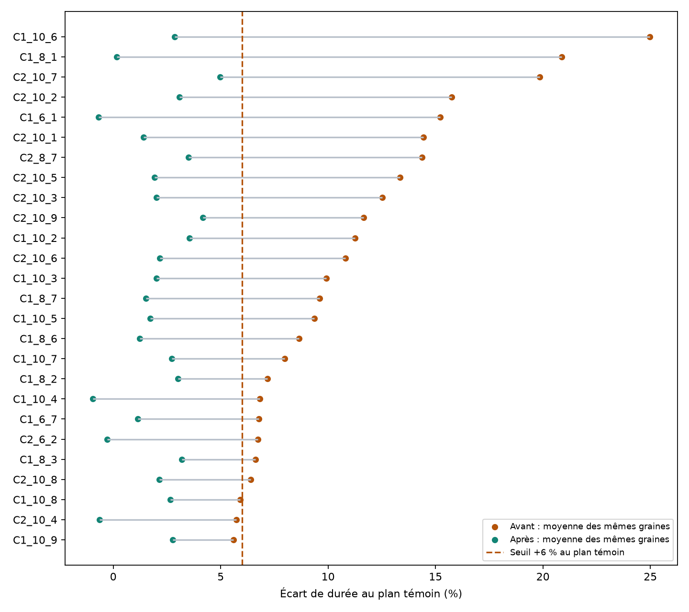

### 6.9. Optimisation ciblée des dépassements en durée

**Périmètre.** Les 23 instances dépassant +6 % en moyenne et trois autres ayant un essai individuel au-dessus de +6 % ont été sélectionnées après l'audit initial. Les 26 instances représentent 43 couples instance–graine. Cette sélection est une mise au point sur les difficultés observées, pas un nouveau test indépendant sur tout le catalogue.

**Modifications réellement exécutées.** Le prototype `algo/duration_refine.py` compare des constructions Clarke–Wright et insertion séquentielle, puis les améliore avec la recherche locale externe de PyVRP 0.12.2. Les voisinages spatiaux et temporels sont élargis de 40 à 60, 80 et 120 clients. Jusqu'à quatre départs diversifient les constructions. Le réservoir de tournées est maintenant évalué en **durée** : un partitionnement choisit des tournées déjà réalisables en couvrant chaque client exactement une fois, sous la borne de flotte. Le mode historique distance reste explicite et les tests vérifient que deux ordres de même distance sont correctement départagés selon leurs attentes.

**Objectif et validité.** Les départs restent fixés à zéro et le coût reste la somme des trajets, attentes et services. Aucune référence n'est transmise au solveur. Chaque résultat final est contrôlé indépendamment sur les données originales. Une optimalité éventuelle du partitionnement concerne uniquement les tournées disponibles dans le réservoir, pas le CVRPTW complet.

**Budgets.** Le premier prototype demande au plus dix secondes de calcul au total, après préchauffage ; les appels natifs terminent avant d'être contrôlés, donc le temps observé et tout dépassement sont conservés. Les essais encore au-dessus du seuil peuvent être prolongés par le HGS en durée. Dans ce cas, le temps cumulé inclut intégralement la construction et la recherche du premier prototype, plus la continuation et sa préparation. Ces essais plus longs sont identifiés ; ils ne sont pas présentés comme des résultats à dix secondes. La campagne initiale allouait dix secondes à la recherche seule, avec construction ajoutée : les deux conventions restent visibles.

**Résultats par instance.** Les colonnes avant/après utilisent les mêmes graines disponibles. Le pire essai est affiché pour ne pas masquer un dépassement par une moyenne favorable.

| Instance   |   Clients |   Essais |   Réalisables | Avant moyen (%)   | Prototype moyen (%)   | Après moyen (%)   | Pire après (%)   | Calcul cumulé moyen (s)   |
|:-----------|----------:|---------:|--------------:|:------------------|:----------------------|:------------------|:-----------------|:--------------------------|
| C1_10_2    |      1000 |        2 |             2 | 11,258            | 3,889                 | 3,544             | 4,002            | 15,203                    |
| C1_10_3    |      1000 |        2 |             2 | 9,914             | 2,019                 | 2,019             | 2,292            | 4,744                     |
| C1_10_4    |      1000 |        2 |             2 | 6,827             | -0,957                | -0,957            | -0,948           | 4,419                     |
| C1_10_5    |      1000 |        2 |             2 | 9,350             | 1,717                 | 1,717             | 2,609            | 4,596                     |
| C1_10_6    |      1000 |        2 |             2 | 24,969            | 5,336                 | 2,867             | 3,882            | 25,113                    |
| C1_10_7    |      1000 |        2 |             2 | 7,988             | 2,724                 | 2,724             | 2,913            | 4,796                     |
| C1_10_8    |      1000 |        2 |             2 | 5,911             | 2,665                 | 2,665             | 3,058            | 4,583                     |
| C1_10_9    |      1000 |        2 |             2 | 5,600             | 2,778                 | 2,778             | 2,885            | 4,564                     |
| C1_6_1     |       600 |        1 |             1 | 15,210            | -0,678                | -0,678            | -0,678           | 2,030                     |
| C1_6_7     |       600 |        1 |             1 | 6,767             | 1,139                 | 1,139             | 1,139            | 1,956                     |
| C1_8_1     |       800 |        1 |             1 | 20,886            | 0,162                 | 0,162             | 0,162            | 2,991                     |
| C1_8_2     |       800 |        1 |             1 | 7,175             | 4,961                 | 3,014             | 3,014            | 23,419                    |
| C1_8_3     |       800 |        1 |             1 | 6,626             | 3,190                 | 3,190             | 3,190            | 3,167                     |
| C1_8_6     |       800 |        1 |             1 | 8,654             | 5,612                 | 1,235             | 1,235            | 23,683                    |
| C1_8_7     |       800 |        1 |             1 | 9,596             | 1,525                 | 1,525             | 1,525            | 3,262                     |
| C2_10_1    |      1000 |        2 |             2 | 14,449            | 1,406                 | 1,406             | 1,886            | 5,932                     |
| C2_10_2    |      1000 |        2 |             2 | 15,762            | 5,025                 | 3,080             | 3,109            | 42,467                    |
| C2_10_3    |      1000 |        2 |             2 | 12,525            | 3,988                 | 2,000             | 3,155            | 16,741                    |
| C2_10_4    |      1000 |        2 |             2 | 5,720             | -0,636                | -0,636            | -0,624           | 5,541                     |
| C2_10_5    |      1000 |        2 |             2 | 13,350            | 1,914                 | 1,914             | 2,099            | 5,824                     |
| C2_10_6    |      1000 |        2 |             2 | 10,804            | 2,165                 | 2,165             | 2,289            | 5,902                     |
| C2_10_7    |      1000 |        2 |             2 | 19,840            | 7,245                 | 4,979             | 5,192            | 56,216                    |
| C2_10_8    |      1000 |        2 |             2 | 6,388             | 2,149                 | 2,149             | 2,527            | 5,457                     |
| C2_10_9    |      1000 |        2 |             2 | 11,652            | 4,174                 | 4,174             | 4,547            | 16,070                    |
| C2_6_2     |       600 |        1 |             1 | 6,735             | 4,191                 | -0,294            | -0,294           | 22,782                    |
| C2_8_7     |       800 |        1 |             1 | 14,380            | 4,870                 | 3,506             | 3,506            | 24,522                    |

Sur ce lot ciblé, **43/43 essais sont réalisables et au plus à +6 %**, 0 essais restent au-dessus et 0 essais sont en échec. La moyenne après optimisation est calculée sur chaque instance du lot ; les valeurs individuelles et les chemins des solutions sont conservés dans `results/time_objective/outliers10/AVANT_APRES_ESSAIS.csv`.

**Portée.** Les valeurs précédentes des 646 résolutions ne sont pas remplacées. Ce tableau documente une nouvelle variante sur les cas ciblés et ne constitue ni une nouvelle moyenne indépendante des 356 instances, ni une preuve de gap à un optimum temporel. Le seuil porte toujours sur la durée du plan témoin réévalué. Les valeurs négatives, les temps supplémentaires et les dépassements éventuels sont conservés.

**Lecture du graphique.** Chaque ligne représente une instance du lot ciblé. Le point orange indique son écart moyen avant modification, le point vert son écart moyen après les recherches réellement exécutées. Le segment relie les mêmes graines avant et après ; un déplacement vers la gauche signifie une diminution de durée. La ligne pointillée matérialise le seuil de +6 % par rapport au plan témoin réévalué. Les éventuelles continuations plus longues participent au point final ; leur temps cumulé figure dans le tableau.

**Intérêt et continuité.** Après l'audit des dépassements, ce graphique rend visible le progrès et permet de repérer les cas restant proches du seuil. Il complète le tableau sans remplacer la colonne du pire essai : un point moyen sous la ligne ne suffirait pas à valider toutes les graines. Il concerne les 26 instances sélectionnées, et non l'ensemble du catalogue ni un optimum temporel connu.

**Vérification du code.** La suite complète exécutée après ajout du prototype compte 168 tests réussis, 0 échecs et 0 tests ignorés. Le détail est conservé dans `results/time_objective/outliers10/tests.xml`. Les tests comprennent notamment la sélection en durée lorsque les distances sont identiques, la faisabilité du prototype et les contrôles historiques de non-régression.

**Diagnostic du partitionnement.** Sur 43 appels au réservoir, 21 améliorent directement la durée de l'archive avant la dernière recherche locale. Le plus grand gain de cette étape vaut 1888.8 unités de durée. Ce diagnostic compare l'entrée et la sortie de l'étape dans les traces ; il ne remplace pas une étude d'ablation complète à budget identique.

#### Pourquoi les durées diminuent et ce que nous conservons

Les constructions alternatives offrent plusieurs répartitions des clients au lieu de dépendre des seules insertions regret-2. La recherche locale externe réévalue les enchaînements temporels et explore un voisinage progressivement plus large. Le partitionnement peut ensuite choisir une combinaison de tournées que la sélection d'une solution complète unique ne proposerait pas. Ces changements restent guidés par la durée totale : moins de véhicules n'est pas un objectif prioritaire ; un regroupement n'est retenu que s'il améliore la durée et respecte les contraintes.

Le gain final est vérifiable physiquement : les temps de service restent inchangés, et la différence de durée provient exclusivement des trajets et des attentes. Le tableau suivant décompose trois cas contrastés, en moyenne sur leurs graines disponibles. Il distingue ce que les résultats démontrent de l'attribution à un opérateur : sans ablation complète, nous ne pouvons pas donner une part causale précise de l'amélioration à chaque changement.

| Instance   | Trajets avant   | Trajets après   | Attentes avant   | Attentes après   | Services inchangés   |
|:-----------|:----------------|:----------------|:-----------------|:-----------------|:---------------------|
| C1_10_6    | 70491,950       | 46912,100       | 6660,000         | 677,100          | 90000,000            |
| C1_8_6     | 33106,500       | 26377,600       | 824,400          | 319,800          | 72000,000            |
| C2_10_7    | 37587,700       | 22080,750       | 569,300          | 183,300          | 90000,000            |

**Recherche supplémentaire sous le seuil de 6 %.** Une deuxième prolongation a ciblé 13 essais encore au-dessus de +4 %. Chacun reçoit vingt secondes de HGS, avec 120 voisins et un autre décalage de graine. 10 essais améliorent leur parent, 3 restent sans gain et 0 échouent. Le tableau `CONTINUATIONS_ET_GAINS.csv` conserve chaque résultat. Plusieurs paramètres changent ensemble : ce lot mesure l'effet de cette continuation, sans isoler l'effet du voisinage de celui du budget ou de la graine.

**Conservation des meilleurs résultats.** Les tournées retenues sont enregistrées dans `results/time_objective/best_duration/runs/`, avec leur source et la liste des tentatives. Une candidate ne remplace l'archive que si elle améliore strictement la durée ; une tentative sans progrès laisse donc la meilleure tournée intacte. Son temps de calcul reste cependant ajouté au cumul. Les tableaux `INDEX_MEILLEURS_ESSAIS.csv` et `INDEX_MEILLEURES_INSTANCES.csv` décrivent les 43 essais ciblés et leurs 26 instances.

**Couverture complète.** Les index `COUVERTURE_472_ESSAIS.csv` et `COUVERTURE_356_INSTANCES.csv` reprennent aussi les résultats initiaux des cas non retestés. Ils constituent une archive des meilleures solutions observées, avec des budgets différents et toutes les sources identifiées. Ils ne remplacent pas la campagne initiale à budget fixé. Pour un cas ciblé, le temps total d'archive comprend l'essai initial et toutes les recherches supplémentaires, y compris celles sans gain. Les comparateurs ILS et recuit restent leurs mesures historiques ; ils ne sont pas remplacés par les solutions du profil renforcé.
