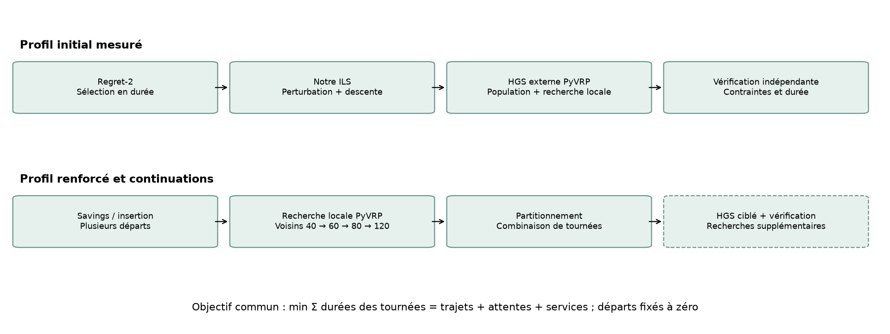

### Comprendre les méthodes : principe général et application au projet

Une **heuristique constructive** fabrique une première solution sans garantie de meilleure qualité possible. Une **recherche locale** l'améliore par des transformations limitées. Une **métaheuristique**, comme l'ILS, le recuit ou le HGS, organise l'exploration pour limiter les blocages. Une **méthode exacte** apporte une preuve lorsque sa résolution aboutit ; sa taille et son temps de calcul limitent ici son utilisation. Ces rôles sont complémentaires.

Dans tout ce qui suit, la qualité finale est $T(S)=\sum_k T_k$, somme des trajets, attentes et services avec départs à zéro. Les scores intermédiaires d'une construction peuvent utiliser une économie d'arcs pour guider les choix ; ils ne remplacent pas cet objectif. Chaque solution retenue doit satisfaire couverture unique, capacité, fenêtres, flotte maximale et fermeture du dépôt.

**Vue d'ensemble des deux profils effectivement mesurés.**

**Lecture du schéma.** La ligne supérieure correspond à la campagne initiale : le constructeur fournit une solution, notre ILS l'améliore, puis le HGS externe poursuit la recherche avant validation indépendante. La ligne inférieure correspond au profil renforcé : plusieurs constructions alimentent une recherche locale externe et un réservoir de tournées ; le partitionnement choisit une combinaison réalisable. Le HGS de cette ligne représente les continuations ciblées, déclenchées dans des expériences supplémentaires, et non un appel obligatoire dans chaque exécution courte. Les pointillés signalent cette continuation optionnelle ; le contrôle indépendant, lui, reste systématique, avec ou sans HGS. Les deux chaînes se terminent par le même contrôleur et le même objectif en durée.

**Intérêt et continuité.** Ce schéma relie le modèle mathématique aux composants du programme. Il évite d'attribuer au profil initial les mécanismes ajoutés ensuite. Les paragraphes suivants expliquent chaque bloc ; les extraits de code et les statistiques montrent ensuite leur mise en œuvre et leurs effets observés. Les budgets et les différences de profils restent identifiés dans les résultats.

**1. Construction par regret-2 — placer d'abord les clients qui risquent de devenir difficiles.**

En général, une insertion gloutonne place le client dont l'ajout paraît le moins coûteux. Le regret-2 considère aussi le coût d'attendre : pour un client i, si ses deux meilleures possibilités coûtent $b_i^{(1)}$ et $b_i^{(2)}$, son regret vaut $r_i=b_i^{(2)}-b_i^{(1)}$. Un regret élevé invite à le placer avant que sa meilleure possibilité ne disparaisse. Par exemple, un client ayant des coûts 2 et 12 est plus fragile qu'un client ayant des coûts 3 et 4.

Dans `algo/kernels.py::repair_fast`, nous calculons la meilleure position réalisable dans chaque tournée, puis comparons ces possibilités entre tournées. Les clients ayant moins de possibilités ont priorité ; les autres sont départagés par leur regret. Un score d'ouverture d'une nouvelle tournée participe au classement constructif. `algo/duration.py::construct` essaie douze constructions et sélectionne la solution complète de plus faible durée, recalculée par `verify`. L'intérêt est de construire un départ réalisable en anticipant les clients contraints ; l'insertion reste une heuristique et peut produire un départ médiocre.

**2. Clarke–Wright — regrouper des clients en économisant des retours au dépôt.**

Le principe des économies commence avec une tournée par client. Relier directement i et j peut supprimer deux passages par le dépôt. L'économie spatiale est $g_{ij}=d_{i0}+d_{0j}-d_{ij}$. Si les distances au dépôt valent 8 et 5, et la liaison directe 5, l'économie vaut 8. Les paires offrant de fortes économies sont examinées en premier.

Dans `algo/savings.py::savings_construct`, nous ne fusionnons que des extrémités de tournées distinctes, après vérification de la capacité et de tous les horaires ; l'ordre inverse est aussi essayé si nécessaire. Le profil renforcé introduit du bruit dans le classement aux départs suivants pour diversifier les regroupements. Les économies de distance guident la construction, mais `algo/duration_refine.py` évalue et conserve les solutions améliorées selon leur durée complète. L'intérêt est de proposer rapidement des regroupements différents de ceux du regret-2 ; une économie de trajet n'est jamais, à elle seule, une preuve de gain temporel.

**3. Insertion séquentielle — remplir progressivement une tournée.**

Le principe consiste à choisir un premier client, puis à insérer les suivants aux positions jugées intéressantes tant que les contraintes restent satisfaites. Lorsqu'aucune insertion n'est possible, une nouvelle tournée est ouverte. Avec des fenêtres horaires, il faut examiner le décalage des services suivants, pas seulement les arcs ajoutés. Cette famille est notamment étudiée par [Solomon, 1987](https://pubsonline.informs.org/doi/10.1287/opre.35.2.254).

Notre variante `algo/sequential.py::sequential_insert` commence, dans le réglage retenu, avec un client éloigné du dépôt. Elle combine le surcoût de trajet et le décalage temporel d'insertion avec `time_weight=0.5`, puis tient compte de l'éloignement du client avec `saving_weight=1`. Les horaires au plus tard autorisés vérifient que l'insertion ne bloque pas les clients suivants. Un bruit dépendant de la graine diversifie les choix. Cette construction fournit un autre départ au profil renforcé ; nous ne présentons pas cette adaptation comme une reproduction exacte de tous les réglages de Solomon.

**4. Recherche locale — améliorer une solution en modifiant quelques visites.**

Pour une solution S, un voisinage $N(S)$ est l'ensemble des solutions atteignables avec les mouvements autorisés. Une descente cherche une candidate $S'\in N(S)$ telle que $\Delta=T(S')-T(S)<0$, puis recommence. Un optimum local ne garantit pas l'optimum global : une amélioration peut nécessiter un mouvement absent du voisinage, ou une dégradation intermédiaire. Une descente échantillonnée ne prouve même pas avoir examiné tous les voisins.

| Mouvement | Principe général | Utilité et précaution en CVRPTW |
|---|---|---|
| Relocate | Retirer un client et l'insérer ailleurs | Rééquilibrer les tournées ; recalculer charges et horaires des tournées touchées |
| Swap | Échanger deux clients à leurs positions | Changer une affectation sans retirer de visite ; vérifier la propagation des horaires |
| 2-opt | Inverser une portion d'une tournée | Modifier l'ordre ; une inversion peut devenir interdite par les fenêtres |
| 2-opt* | Échanger les fins de deux tournées | Réorganiser plusieurs affectations simultanément ; vérifier les deux tournées obtenues |
| SWAP* | Retirer un client de chaque tournée et rechercher leurs nouvelles positions dans l'autre | Explorer davantage de possibilités qu'un échange aux positions initiales |

Notre `algo/duration_moves.py::walk` implémente les quatre premiers mouvements et recalcule les durées des tournées modifiées. SWAP* appartient à la recherche locale externe de PyVRP, utilisée par le HGS et le profil renforcé. Deux clients géographiquement proches peuvent avoir des créneaux incompatibles : le voisinage externe prend aussi en compte des indications d'attente et de retard. Nous avons testé 40, 60, 80 puis 120 voisins ; élargir ce choix ouvre des mouvements, mais augmente leur coût. Ces mécanismes externes sont documentés dans le [code PyVRP 0.12.2 des voisinages](https://github.com/PyVRP/PyVRP/blob/v0.12.2/pyvrp/search/neighbourhood.py).

**5. ILS — perturber, améliorer, puis choisir où poursuivre.**

L'Iterated Local Search part d'une solution, applique une recherche locale, perturbe l'état retenu, puis améliore la candidate. Un critère d'acceptation choisit la solution servant de nouveau point de départ. La perturbation doit être suffisante pour sortir d'un blocage, tout en conservant une partie de la structure utile. Ce cadre est décrit par [Lourenço, Martin et Stützle](https://arxiv.org/abs/math/0102188).

Dans `algo/duration.py::search`, notre ILS tente jusqu'à quatre perturbations réalisables, suivies d'une descente échantillonnée. La candidate peut devenir le nouvel état si elle reste à moins de 0,5 % du meilleur coût connu. L'archive est mise à jour uniquement en cas d'amélioration stricte. Après cent cycles sans record, la recherche repart de cette archive. Nous conservons donc séparément l'état exploré et la meilleure solution. L'ILS appartient à la campagne initiale et au profil hybride initial ; le profil `duration_refined` utilise une orchestration différente, fondée sur plusieurs constructions et une intensification externe.

**6. Recuit simulé — accepter parfois une dégradation contrôlée.**

Le recuit accepte une amélioration et peut accepter une hausse $\Delta>0$ avec la probabilité $\exp(-\Delta/\theta)$, où $\theta>0$ est la température. Une température élevée facilite les déplacements dégradants ; son refroidissement concentre progressivement la recherche. À titre d'exemple, pour $\Delta=2$ et $\theta=4$, la probabilité vaut environ 0,607, contre 0,135 si $\theta=1$. Accepter une hausse ne signifie pas abandonner le meilleur résultat déjà trouvé.

Notre variante de comparaison emploie les mêmes quatre mouvements que l'ILS. La température décroît avec le temps consommé : $\theta(f)=0.02\,T_0/n\times0.005^f$, où $f$ est la fraction du budget utilisée et $T_0$ le coût initial dans les unités internes. Les mouvements irréalisables sont rejetés avant l'acceptation, et l'archive reste réalisable. Le recuit est un comparateur expérimental distinct ; il n'est pas ajouté au profil renforcé par simple changement d'étiquette. Ses performances doivent être évaluées sur les répétitions, car une bonne graine ne suffit pas.

**7. HGS — combiner une population de solutions et une recherche locale.**

Une recherche génétique hybride conserve plusieurs solutions. Elle sélectionne des parents, combine leurs structures, améliore les enfants localement et gère leur insertion dans la population. Préserver de la diversité limite la concentration sur des solutions presque identiques. Des états temporairement pénalisés peuvent aider l'exploration ; une réparation cherche à les rendre réalisables. L'archive finale conserve une solution réalisable.

Notre adaptateur `algo/hgs_tuning.py::solve` utilise le **moteur externe PyVRP 0.12.2**. Sa population reçoit notre solution et des départs aléatoires ; le croisement SREX échange des structures de tournées, puis la recherche locale améliore les enfants. Nous configurons `unit_distance_cost=0`, `unit_duration_cost=1` et `start_late=0` pour aligner le moteur sur notre objectif. Nous mesurons les itérations, les temps et les coûts, puis validons indépendamment la solution retournée. Le HGS intervient après l'ILS dans le profil initial, et lors des continuations ciblées du profil renforcé. Le moteur génétique et ses opérateurs sont attribués à [PyVRP 0.12.2](https://github.com/PyVRP/PyVRP/blob/v0.12.2/pyvrp/GeneticAlgorithm.py) ; notre travail porte sur la construction, l'intégration, les réglages, le contrôle et l'évaluation.

**8. Partitionnement de tournées — recombiner des solutions déjà trouvées.**

Plusieurs solutions peuvent contenir de bonnes tournées différentes. Plutôt que choisir un parent entier, un partitionnement sélectionne une combinaison dans un réservoir fini $\mathcal P$. Une tournée p possède une durée $\tau_p$, et $a_{ip}=1$ si elle dessert le client i. La variable binaire $z_p$ indique si elle est choisie :

$$\min\sum_{p\in\mathcal P}\tau_p z_p,\qquad
\sum_{p\in\mathcal P}a_{ip}z_p=1\quad\forall i\in C,\qquad
\sum_{p\in\mathcal P}z_p\le K,\qquad z_p\in\{0,1\}.$$

Dans `algo/route_pool.py::RoutePool`, seules les tournées de solutions complètes vérifiées alimentent le réservoir. Pour un même ensemble de clients, l'ordre réalisable de plus faible durée est conservé. SciPy/HiGHS résout ensuite ce modèle restreint avec une limite de temps ; la meilleure archive sert de repli. Par exemple, si un parent contient une bonne tournée `[1,2]` et un autre une bonne tournée `[3,4]`, le modèle peut sélectionner les deux, à condition de couvrir exactement les clients et de respecter la flotte. La capacité et les horaires sont déjà contrôlés par tournée et le résultat complet est revérifié. Une preuve éventuelle concerne uniquement ce réservoir ; une tournée absente peut encore améliorer le problème complet.

**9. Pourquoi associer ces méthodes et comment interpréter les gains.**

Les constructions diversifient les points de départ ; la recherche locale exploite leurs améliorations accessibles ; le partitionnement combine leurs tournées ; le HGS poursuit l'exploration lorsqu'un effort supplémentaire est retenu. Notre contrôleur indépendant applique ensuite les mêmes règles à tous les profils. Le PLNE complet de la section précédente sert aux petites instances pour vérifier la formulation et prouver leurs optimums ; le partitionnement est plus réduit, car ses tournées sont déjà connues.

L'objectif reste la durée totale à chaque sélection finale. Les mécanismes théoriques justifient les essais, mais les résultats de notre projet proviennent uniquement des exécutions conservées. La section 6.9 mesure les gains et les temps, distingue les tentatives sans progrès et décompose trajets, attentes et services. Une amélioration observée d'un profil combiné ne permet pas, sans ablation, d'attribuer tout le gain à un seul opérateur. Nous conservons la meilleure solution réalisable et le coût de toutes les tentatives, y compris lorsqu'elles ne progressent pas.
