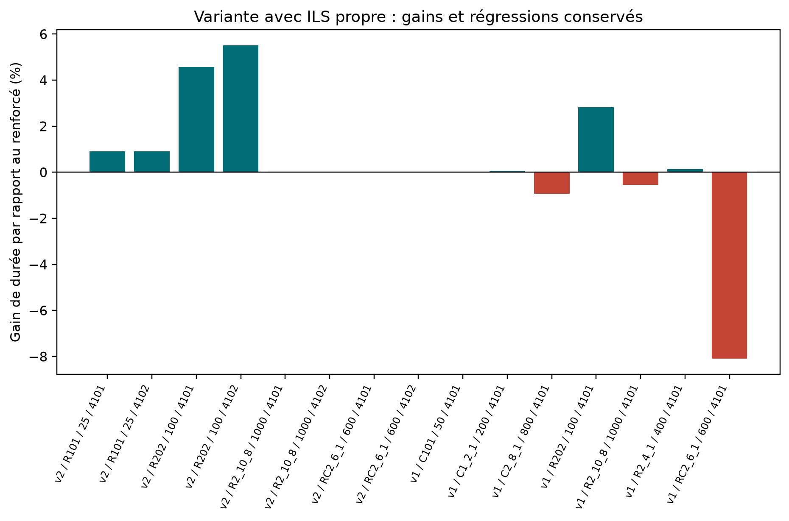
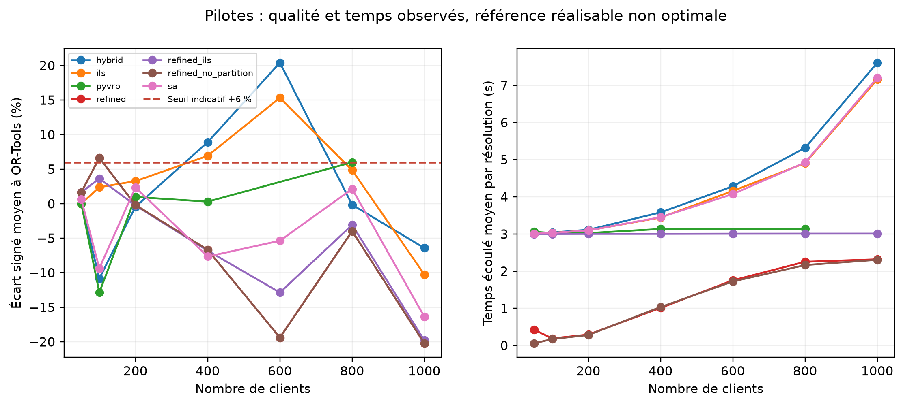

### 6.13. Validation statique progressive et ablation des contributions

**Question expérimentale.** Nous conservons les 646 recherches historiques et
les meilleurs résultats à budgets différents. Ce complément vérifie séparément
les petites tailles, un comparateur indépendant en durée et les contributions
de notre code. Il ne remplace pas une campagne complète uniforme.

**Référence.** OR-Tools 9.15.6755 construit ses propres solutions, sans recevoir
notre ILS, une BKS ou les tournées améliorées par HGS. La dimension temporelle
ajoute trajet et service ; le slack représente les attentes. Les départs sont
fixés à zéro, les coûts d'arcs sont nuls et chaque span temporel a un coefficient
de 1. Son objectif est donc exactement la somme des retours. Le coût natif est
comparé à notre contrôleur complet après chaque résolution.

Nous calculons $100(T/T_{ref}-1)$ contre la meilleure solution **OR-Tools du
même lot et de la même instance**, jamais contre notre propre meilleur résultat.
Il s'agit d'une référence réalisable indépendante, sans certificat d'optimalité.
Les écarts négatifs et nuls sont conservés. Une référence faible peut produire
un écart très négatif : cela ne démontre pas un gap à l'optimum sous 6 %.
Les colonnes `certified_gap_pct` restent vides lorsqu'aucune preuve n'existe.
La borne services + arbre couvrant est sauvegardée séparément et peut être faible.

**Compatibilité publiée.** Phonin et al. (2025) incluent le retour dans
l'équation (9). Les conventions de précision, d'intégralité temporelle et de
flotte empêchent néanmoins de certifier une comparaison directe pour tous les
cas. Sur C101/25, les mêmes tournées valent 2623,50 avec notre troncature et
2624,014190590107 en précision complète, contre 2624,01 publiés. Ce contrôle
numérique n'est pas une preuve d'optimalité. Cinq recherches indépendantes à
25 clients et une réévaluation du plan C101/100 sont archivées dans
`results/final_static/reference_audit/`. Aucun gap officiel Phonin n'est fabriqué.

**Données.** Les tailles 25 et 50 sont les préfixes standards des instances
Solomon à 100 clients déjà figées : valeurs des clients conservées et empreintes
parent/enfant enregistrées. Les archives Dorronsoro ont répondu HTTP 403 ; nous
ne déclarons donc pas avoir obtenu leurs octets originaux. Les tailles 100 à
1000 utilisent les fichiers Solomon/Gehring–Homberger déjà vérifiés.

**Campagnes réellement exécutées.**

| campagne               |   instances |   resolutions |   faisables |   sans_solution |   recherche_s |   reference_s |
|:-----------------------|------------:|--------------:|------------:|----------------:|--------------:|--------------:|
| pilote25               |           3 |            24 |          24 |               0 |             2 |             6 |
| couverture_progressive |           7 |            63 |          61 |               2 |             3 |            10 |
| confirmation_ils_v2    |           4 |            32 |          32 |               0 |             3 |            10 |

Les constructions ne disposent pas artificiellement d'un temps de recherche.
ILS/recuit/hybride/PyVRP reçoivent un budget de recherche auquel s'ajoutent
préparation et construction. Le renforcé et ses variantes ont un budget total
souple ; un appel natif commencé peut finir après l'échéance. Tous les temps
réels et CPU sont dans les CSV, y compris les dépassements. Préchauffage et
chargement sont hors chronomètre des résolutions. Le premier pilote a chevauché
des tests automatisés : ses temps ne servent pas à prouver une accélération.
Les deux lots suivants sont exécutés séquentiellement, sans autre campagne
lancée par nous en parallèle.

**Origine des contributions.**

| Profil | Notre code | Bibliothèques externes |
|---|---|---|
| Construction | Regret-2, choix parmi douze solutions selon la durée | NumPy/Numba pour les calculs |
| ILS autonome | Perturbations, quatre mouvements, acceptation, archive, redémarrages | Numba compile nos fonctions ; aucun HGS ni Local Search PyVRP |
| Recuit | Voisinage propre, température, acceptation et archive | Numba ; aucun HGS |
| PyVRP seul | Adaptation des données, objectif et vérification | Population native, HGS et recherche locale PyVRP |
| Hybride initial | Construction et ILS, orchestration, vérification | Continuation HGS PyVRP |
| Renforcé | Constructions savings/séquentielle, planning, réservoir et modèle de partitionnement | Local Search PyVRP ; résolution du MILP par HiGHS |
| Renforcé sans partitionnement | Même planning et réservoir, sans sélection MILP | Local Search PyVRP |
| Renforcé + ILS | Planning renforcé puis ILS propre dans le temps restant | Local Search PyVRP et HiGHS pendant la première phase |
| Référence indépendante | Encodage de l'objectif et contrôle après résolution | OR-Tools construit et optimise sa solution |

Le partitionnement est une technique classique de recherche opérationnelle,
pas une invention revendiquée. Notre implémentation construit les colonnes,
déduplique les ensembles de clients en gardant leur meilleur ordre faisable,
et impose couverture exacte et flotte bornée. HiGHS choisit les tournées ;
l'optimalité éventuelle est limitée au réservoir. Sur les trois premiers cas,
le retrait du partitionnement ne change pas la durée : aucun gain ne lui est
attribué sur ce petit lot. Les colonnes `partition_gain` donnent le gain avant/
après MILP sur un même réservoir ; une différence globale peut aussi provenir
du temps restant pour la dernière recherche locale.

**Coûts observés dans la couverture progressive, une graine par cas.**
Les nombres ci-dessous sont des durées complètes en unités du benchmark.
Une cellule « échec » signifie qu'aucune solution réalisable n'a été trouvée dans
le budget, pas un coût nul. Chaque coût disponible a passé le contrôleur.

| instance   |    n |      ils |       sa |    pyvrp |    hybrid |   refined |   refined_no_partition |   refined_ils |   ortools |
|:-----------|-----:|---------:|---------:|---------:|----------:|----------:|-----------------------:|--------------:|----------:|
| C101       |   50 |  4955.10 |  4987.10 |  4955.10 |   4955.10 |   5036.50 |                5036.50 |       5036.50 |   4955.10 |
| C1_2_1     |  200 | 21478.90 | 21290.20 | 21001.70 |  20707.50 |  20760.70 |               20760.70 |      20747.90 |  20801.00 |
| C2_8_1     |  800 | 91915.00 | 89533.50 | 92914.60 |  87526.00 |  84183.40 |               84180.00 |      84970.50 |  87667.40 |
| R202       |  100 |  2796.90 |  2476.00 |  2380.20 |   2436.00 |   2913.10 |                2913.10 |       2831.00 |   2731.90 |
| R2_10_8    | 1000 | 96861.60 | 90255.80 | échec    | 100994.00 |  86097.40 |               86097.40 |      86564.50 | 107932.40 |
| R2_4_1     |  400 | 24748.90 | 21373.70 | 23213.90 |  25206.00 |  21598.70 |               21598.70 |      21569.20 |  23145.50 |
| RC2_6_1    |  600 | 55553.80 | 45584.00 | échec    |  57999.50 |  38827.00 |               38827.00 |      41971.70 |  48169.30 |

PyVRP seul ne trouve pas de solution à trois secondes sur RC2_6_1 et R2_10_8.
L'initialisation par une solution faisable explique pourquoi nos profils
hybrides peuvent retourner une solution sur ces mêmes cas. Cela ne prouve pas
une infériorité générale de PyVRP à des budgets plus longs.

**Modification testée et correction d'une régression.** Le renforcé peut
terminer avant sa limite. La première variante réservait la moitié du budget
à notre ILS : elle améliorait R202 mais coupait des constructions/voisinages
utiles à 600–1000 clients. Ses régressions restent dans `couverture_progressive`.
La version 2 conserve le planning complet, puis utilise uniquement le temps
réellement restant. L'archive de chaque appel ne peut alors dégrader sa solution
d'entrée. Les résultats de cette confirmation à deux graines sont distincts :

| instance   |    n | method      |   attempts |   feasible |   mean_duration |   std_duration |   best_duration |   mean_delta |   mean_wall_s |   max_cpu_s |
|:-----------|-----:|:------------|-----------:|-----------:|----------------:|---------------:|----------------:|-------------:|--------------:|------------:|
| R101       |   25 | refined     |          2 |          2 |        1306.500 |          0.000 |        1306.500 |        0.911 |         0.214 |       0.391 |
| R101       |   25 | refined_ils |          2 |          2 |        1294.700 |          0.000 |        1294.700 |        0.000 |         3.002 |       3.016 |
| R202       |  100 | refined     |          2 |          2 |        2858.350 |         54.750 |        2803.600 |        4.629 |         0.192 |       0.203 |
| R202       |  100 | refined_ils |          2 |          2 |        2714.550 |         65.350 |        2649.200 |       -0.635 |         3.001 |       3.000 |
| R2_10_8    | 1000 | refined     |          2 |          2 |       83433.950 |       2663.450 |       80770.500 |      -22.448 |         2.409 |       2.531 |
| R2_10_8    | 1000 | refined_ils |          2 |          2 |       83433.950 |       2663.450 |       80770.500 |      -22.448 |         3.011 |       3.000 |
| RC2_6_1    |  600 | refined     |          2 |          2 |       38974.600 |        147.600 |       38827.000 |      -19.088 |         1.767 |       1.781 |
| RC2_6_1    |  600 | refined_ils |          2 |          2 |       38974.600 |        147.600 |       38827.000 |      -19.088 |         3.006 |       3.016 |

Les écarts-types descriptifs ci-dessus utilisent `ddof=0`. Deux graines ne
suffisent pas pour établir une supériorité statistique générale ; l'étude
historique à vingt graines reste séparée. Sur R202, graine 4101, la durée passe
de 2913,10 à 2779,90 et l'écart à OR-Tools de +6,63 % à +1,76 %. À 600 et 1000,
la version 2 conserve les coûts du renforcé sur les deux graines mesurées.
Le surcoût CPU sans gain doit également être pris en compte : la variante
reste expérimentale et ne remplace pas automatiquement le profil par défaut.

**Lecture du graphique.** Chaque barre compare une paire instance–graine du
même lot, avec le renforcé comme dénominateur. Une barre positive indique une
réduction de durée ; une barre négative indique une régression. Les étiquettes
et le CSV des paires permettent de distinguer la première variante et sa
correction. Ce graphique explique le changement de planning ; il ne compare
pas des coûts pris dans des campagnes différentes.

**Lecture du graphique.** Le panneau gauche représente l'écart à OR-Tools ;
la ligne +6 % est un repère de qualité. Le panneau droit représente le temps
écoulé mesuré. Un point correspond ici à une instance et une graine par taille,
dans le seul lot progressif ; il n'établit ni une loi de complexité ni un
classement universel. Les échecs restent dans le tableau de faisabilité et
ne sont pas remplacés par des pourcentages. La comparaison qualité–temps
complète ainsi les boîtes à moustaches historiques.

**Fichiers et limites.** `results/final_static/TOUS_LES_ESSAIS.csv` rassemble
les essais avec leur campagne, coût, faisabilité, CPU, temps écoulé, source et
référence. Chaque lot possède statistiques, protocole et sources figées.
Les solutions, échecs et reprises sont conservés ; les copies et réévaluations
ne sont pas comptées comme de nouvelles recherches. Le bilan de conformité est
`docs/BILAN_CONFORMITE_FINAL.md`. Nous ne garantissons pas moins de 6 % à un
optimum temporel inconnu, ni la qualité obtenue à trois secondes sur tous les
matériels. Les variantes à temps de trajet variable restent hors du modèle.

**Tentative exacte à 25 clients.** Le PLNE C101/25 a été lancé avec une limite
de dix secondes : statut `time_limit`, 10,55 secondes mesurées, 33 200 variables
et 34 525 contraintes. Son incumbent vaut 8297,90 et sa borne inférieure
1020,60 ; le gap interne HiGHS reste 87,70 %. Ce résultat est conservé dans
`results/final_static/exact/C101_25_10s.json`. Il ne certifie pas l'optimum et
ne sert pas de référence de qualité à notre métaheuristique. Les dix cas de
3–5 clients restent les preuves exactes contrôlées par énumération. Ce contraste
explique l'intérêt pratique des heuristiques, sans conclure que toute méthode
exacte serait incapable de résoudre C101/25 avec un modèle ou budget différent.

Sources : [Phonin et al., 2025](https://www.mdpi.com/2305-6290/9/3/85),
[OR-Tools VRPTW](https://developers.google.com/optimization/routing/vrptw),
[PyVRP 0.12.2](https://github.com/PyVRP/PyVRP/tree/v0.12.2).
