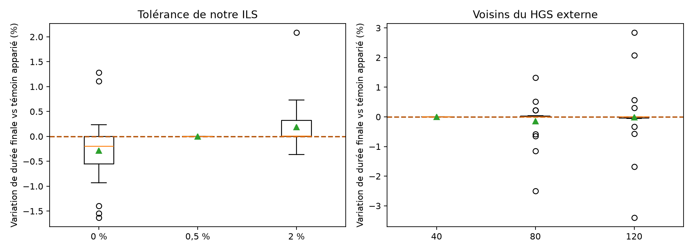

### 6.10. Sensibilité contrôlée : un facteur à la fois

**Question.** Une amélioration obtenue en changeant ensemble le budget, le voisinage et la graine ne permet pas d'isoler le rôle d'un réglage. Nous ajoutons une étude OFAT (*one factor at a time*) sur un profil hybride précisément défini : notre construction regret-2 et notre ILS, suivis du HGS externe PyVRP. Le partitionnement et le constructeur renforcé ne participent pas à cette expérience ; nous ne lui attribuons donc pas les performances du profil `duration_refined`.

**Plan fixé avant exécution.** Six instances sont retenues : C103, R203 et RC103 à 100 clients ; C2_10_10, R1_10_5 et RC2_10_5 à 1 000 clients. Trois nouvelles graines, 8301–8303, donnent dix-huit couples instance–graine. La configuration témoin est une tolérance ILS de 0,5 % et 40 voisins HGS. Nous changeons uniquement la tolérance vers 0 % ou 2 %, ou uniquement le voisinage vers 80 ou 120. Ces cinq configurations produisent 90 profils évalués ; le témoin commun n'est pas compté deux fois.

**Contrôle des départs et des temps.** Chaque profil dispose de deux secondes d'ILS puis deux secondes de HGS, avec les mêmes données, la même graine appariée et un unique cœur CPU. La construction commune est réellement exécutée une fois par couple instance–graine. Les voisins HGS sont comparés à partir du même préfixe ILS enregistré, vérifié par empreinte ; modifier le voisinage ne modifie donc pas son entrée. Quand la tolérance change, le préfixe ILS est recalculé. Les phases communes sont mutualisées, et leur temps mesuré est facturé dans chaque profil. Le total publié est la **somme recomposée de phases réellement chronométrées**, construction et préparation comprises, pas le chronométrage continu de 90 pipelines indépendants. Le temps physique de chaque tâche et les réutilisations sont aussi enregistrés. L'ordre des tâches est mélangé et fixé dans le protocole.

Le réglage de voisins concerne uniquement le HGS externe ; le voisinage de notre ILS reste fixe. PyVRP borne le nombre effectif à $\min(k,n-1)$ : le réglage nominal 120 correspond donc à 99 voisins pour les cas à 100 clients, et à 120 pour les cas à 1 000 clients. Cette valeur effective est conservée dans le tableau individuel.

**Indicateur apparié.** Pour chaque couple, $D=100(T_{\mathrm{réglage}}/T_{\mathrm{témoin\ de\ réglage}}-1)$. Ici le témoin est la configuration algorithmique à 0,5 % / 40 voisins, pas le plan BKS. Un D négatif indique une amélioration. Nous moyennons d'abord les graines de chaque instance, puis les six instances à poids égal. Les écarts aux plans de référence restent dans le fichier individuel sous leur qualification habituelle, distincte d'un gap à l'optimum temporel.

| Réglage       |   Paires |   Instances | Variation durée finale (%)   | Variation ILS seul (%)   |   Meilleurs |   Égaux |   Moins bons | Total recomposé (s)   |
|:--------------|---------:|------------:|:-----------------------------|:-------------------------|------------:|--------:|-------------:|:----------------------|
| baseline      |       18 |           6 | 0,000                        | 0,000                    |           0 |      18 |            0 | 5,930                 |
| neighbors_120 |       18 |           6 | -0,013                       | 0,000                    |           5 |       9 |            4 | 6,040                 |
| neighbors_80  |       18 |           6 | -0,143                       | 0,000                    |           4 |       9 |            5 | 6,071                 |
| tolerance_0   |       18 |           6 | -0,286                       | 0,496                    |          11 |       4 |            3 | 5,934                 |
| tolerance_002 |       18 |           6 | 0,186                        | 0,445                    |           4 |       5 |            9 | 5,920                 |

**Lecture des boîtes.** Chaque boîte rassemble les variations appariées des dix-huit couples instance–graine. Le panneau gauche change la tolérance de notre ILS ; le panneau droit change le voisinage du moteur externe. La ligne zéro représente la configuration témoin, identique à elle-même. Sous zéro, le réglage améliore la durée finale ; au-dessus, il la dégrade. La médiane et la dispersion complètent la moyenne du tableau. Les points extrêmes sont conservés.

**Intérêt et continuité.** Après les optimisations combinées de la section 6.9, cette figure examine un réglage à la fois. Les améliorations et régressions sont comparées au même départ, et les résultats propres à l'ILS sont distingués du résultat après HGS. La dispersion inclut des graines et des instances différentes ; elle n'est pas un intervalle de confiance. Trois graines et six cas ne suffisent pas à établir un meilleur réglage universel. L'effet du budget n'est pas étudié, puisqu'il reste fixe ; nous n'attribuons pas ces résultats aux recherches plus longues de l'archive.

**Faisabilité et portée.** 90/90 profils sont réalisables, avec 0 échecs conservés. Cette campagne est exploratoire, séparée des 646 résolutions initiales et de l’archive des meilleures solutions. Un mauvais résultat au budget court reste publié et n’est pas remplacé par une reprise longue.

**Interprétation mesurée.** Le réglage `tolerance_0` donne une variation moyenne de -0.286 %, avec 11 améliorations, 4 égalités et 3 régressions sur 18 paires. Le réglage `neighbors_80` donne une variation moyenne de -0.143 %, avec 4 améliorations, 9 égalités et 5 régressions sur 18 paires. Le réglage `neighbors_120` donne une variation moyenne de -0.013 %, avec 5 améliorations, 9 égalités et 4 régressions sur 18 paires. Le réglage `tolerance_002` donne une variation moyenne de +0.186 %, avec 4 améliorations, 5 égalités et 9 régressions sur 18 paires. Ces différences ne justifient pas un changement automatique du profil par défaut : une confirmation sur un lot distinct serait nécessaire.

**Attribution du gain.** Avec une tolérance nulle, le coût moyen du préfixe ILS varie ici de +0.496 % : il est donc moins bon que celui du témoin avant l'appel externe. Le résultat final après HGS varie de -0.286 %. Cette différence montre une interaction entre le départ produit et la recherche externe ; elle ne démontre pas que notre ILS autonome est meilleur. Les voisins 80/120 ne changent pas ce préfixe, ce que confirment leurs empreintes identiques. Leurs différences finales concernent bien le réglage du HGS sur ces entrées.
