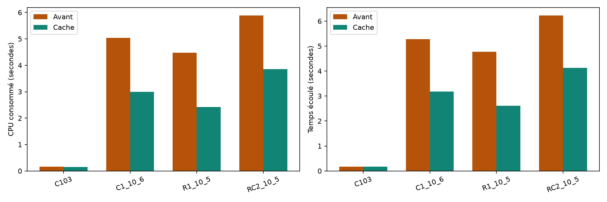
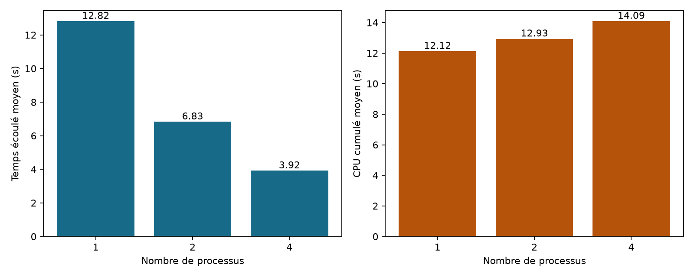

### 6.12. Réduction du temps CPU et étude du parallélisme

**Trois temps à distinguer.** La durée des tournées est notre objectif métier, exprimé en unités du benchmark. Le temps écoulé du programme mesure l'attente de l'utilisateur en secondes. Le temps CPU mesure le travail utilisateur et noyau des processeurs. Le parallélisme peut réduire l'attente tout en consommant davantage de CPU : quatre processus occupés chacun dix secondes peuvent représenter environ quarante secondes CPU. Réduire le temps de calcul est un critère de performance, sans remplacer l'objectif de durée ni les contraintes de validité.

**Profilage et modification retenue.** Dans le profil renforcé, la proximité des clients était triée à nouveau à chaque demande de voisins, alors que les données d'une instance restent identiques. Sur le cas instrumenté C1_10_6, les tris NumPy passent de 22 à 1 après ajout du cache. `DurationLocalSearch.neighbors` conserve un ordre stable couvrant les voisinages prévus et réutilise ses préfixes pour 40, 60, 80 et 120 voisins. Une demande plus grande reconstruit cet ordre ; une autre instance reçoit un nouveau cache. Le transfert des voisins vers le moteur est également évité lorsque leur nombre effectif ne change pas. Les tests comparent les listes à celles de PyVRP, y compris après agrandissement et aux bornes de taille.

Cette optimisation est développée dans notre orchestration Python ; la recherche locale reste fournie par PyVRP. Nous ne supprimons pas les vérifications pour gagner du temps. Les données, les opérateurs, les graines et l'objectif restent identiques.

**Comparaison à travail fixé.** C103, C1_10_6, R1_10_5 et RC2_10_5 sont testées avec les graines 8301–8303. Chaque version effectue les mêmes quatre départs et le même programme de recherche : 24 résolutions, soit douze paires. L'ordre avant/après alterne ; le préchauffage est exclu. Le plafond de sécurité de soixante secondes n'est jamais atteint. Les coûts et le nombre d'étapes sont identiques dans les douze paires, et toutes les solutions sont réalisables. Le profilage instrumenté sert à localiser les coûts ; les temps comparatifs ci-dessous sont mesurés sans ce profilage.

Le CPU est mesuré par `time.process_time`, qui inclut les threads natifs du processus, et le temps écoulé par `time.perf_counter`. Le tableau donne les moyennes des trois graines par instance. Le gain CPU vaut $100(1-\overline{C}_{\mathrm{après}}/\overline{C}_{\mathrm{avant}})$ ; il ne s'agit pas d'un gap de tournée au BKS.

| Instance   |   Clients | CPU avant (s)   | CPU après (s)   | Réduction CPU (%)   | Écoulé avant (s)   | Écoulé après (s)   |
|:-----------|----------:|:----------------|:----------------|:--------------------|:-------------------|:-------------------|
| C103       |       100 | 0,167           | 0,146           | 12,500              | 0,166              | 0,167              |
| C1_10_6    |      1000 | 5,036           | 2,995           | 40,538              | 5,280              | 3,177              |
| R1_10_5    |      1000 | 4,479           | 2,417           | 46,047              | 4,771              | 2,615              |
| RC2_10_5   |      1000 | 5,891           | 3,854           | 34,571              | 6,231              | 4,123              |

Sur les douze paires, la somme des temps CPU diminue de **39.57 %**, à coût de tournée identique. Cette valeur concerne le profil renforcé et ce lot ; elle ne s’applique pas rétroactivement à toutes les campagnes ou au moteur ILS autonome.

**Lecture du graphique.** Chaque paire de barres compare les mêmes trois graines, avec le même travail et les mêmes coûts finaux. À gauche, la hauteur est le CPU consommé ; à droite, le temps attendu par l'utilisateur. La baisse montre l'effet du cache, sans retirer de clients, de mouvements ou de contrôles. Les petites durées restent sensibles à la granularité des compteurs Windows et au bruit de la machine.

**Intérêt et continuité.** Après l'analyse des paramètres de recherche, cette figure étudie une accélération de l'implémentation conservant le calcul. Le cache réduit le travail répété ; le parallélisme étudié ensuite répartit ce travail sur plusieurs cœurs et répond à une autre question.

**Parallélisme testé.** Un portefeuille de quatre départs indépendants, graines 9301–9304, résout chaque instance C1_10_6, R1_10_5 et RC2_10_5. Les mêmes tâches, avec quatre départs internes chacune, sont exécutées sur un, deux puis quatre processus, avec deux répétitions et des affinités CPU enregistrées. Cela représente dix-huit portefeuilles et 72 recherches individuelles. Le meilleur résultat du portefeuille est conservé et validé ; les coûts par graine sont identiques entre les niveaux de parallélisme dans ce lot. Cette comparaison garde le travail constant : elle ne donne pas quatre fois plus de départs au mode parallèle.

Le CPU total additionne le parent et tous ses workers. Sous Windows, des handles conservés permettent de lire `GetProcessTimes` après l'arrêt des workers : le tableau des lots inclut donc aussi leurs imports, préchauffages et fermetures. Mesurer uniquement le CPU du parent aurait sous-estimé la consommation. Les tableaux par instance ci-dessous utilisent un pool déjà initialisé ; le premier chargement de l'instance et sa validation restent inclus. Les valeurs moyennes portent sur trois instances et deux répétitions, soit six portefeuilles par réglage.

|   Processus |   Portefeuilles | Écoulé moyen (s)   | CPU cumulé moyen (s)   | Accélération écoulée   | Variation CPU (%)   |
|------------:|----------------:|:-------------------|:-----------------------|:-----------------------|:--------------------|
|           1 |               6 | 12,820             | 12,122                 | 1,000                  | 0,000               |
|           2 |               6 | 6,834              | 12,935                 | 1,876                  | 6,702               |
|           4 |               6 | 3,919              | 14,089                 | 3,271                  | 16,219              |

**Lecture des deux panneaux.** Le panneau gauche mesure le délai pour terminer les mêmes quatre recherches et valider leur meilleure solution. Le panneau droit additionne le travail CPU des processus pendant ce portefeuille. Les unités sont des secondes dans les deux cas, mais leur sens diffère : les valeurs du panneau droit ne doivent pas être divisées par le nombre de processus. Tous les résultats de durée restent identiques à travail égal dans cette expérience.

**Intérêt et choix.** Le cache réduit le CPU de chaque recherche ; multiplier les processus réduit surtout la latence. Dans le lot mesuré, le mode séquentiel optimisé reste le choix économe en CPU, tandis que plusieurs processus conviennent si le délai de réponse est prioritaire. L'autorisation du multithreading ne signifie donc pas qu'utiliser tous les cœurs minimise la consommation CPU. Notre expérimentation emploie plusieurs processus pour isoler les états et les graines sous CPython 3.12 ; ce n'est pas l'activation automatique de threads dans PyVRP.

**Démarrage et fermeture inclus.** Chaque lot suivant exécute les trois instances avec le même portefeuille. Le temps total part de la création du pool et se termine après son arrêt ; il exclut seulement le lancement initial de l'interpréteur parent, commun au protocole. Les temps CPU des workers couvrent leur vie entière. Le coût du démarrage peut réduire l'intérêt du parallélisme pour une seule petite instance.

|   Processus |   Lots | Démarrage moyen (s)   | Lot complet écoulé (s)   | Lot complet CPU (s)   |
|------------:|-------:|:----------------------|:-------------------------|:----------------------|
|           1 |      2 | 1,684                 | 40,542                   | 38,016                |
|           2 |      2 | 1,787                 | 22,728                   | 42,008                |
|           4 |      2 | 1,921                 | 14,167                   | 49,297                |

**Portée et reproductibilité.** Les anciens résultats restent conservés avec leurs temps écoulés d'origine ; nous ne leur attribuons pas un CPU non mesuré. La mesure CPU actuelle concerne les nouvelles campagnes `cpu_optimization/`. Les sources avant/après, mesures par graine, coûts, contraintes et temps complets sont archivés. L'amélioration n'est pas une preuve de minimum CPU global, ni une garantie d'accélération identique sur tout ordinateur. À budget limité, le cache peut aussi laisser explorer davantage de solutions ; ce bénéfice de qualité nécessiterait une campagne distincte à budget fixé. Les meilleurs résultats précédents ne sont pas remplacés par les essais de performance.

Sources techniques : [Python, horloges de mesure](https://docs.python.org/3.12/library/time.html#time.process_time), [Windows, temps des processus](https://learn.microsoft.com/en-us/windows/win32/api/processthreadsapi/nf-processthreadsapi-getprocesstimes). Les opérateurs externes restent attribués à PyVRP 0.12.2.

**Tests de non-régression.** La suite enregistrée après optimisation compte 171 tests réussis, 0 échecs et 0 tests ignorés. Elle inclut les comparaisons des voisinages calculés et cachés ; son fichier XML est conservé avec les mesures CPU.
