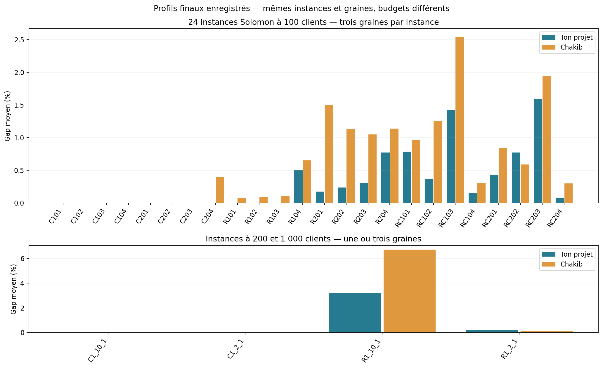

# Consigne, benchmark et comparaison avec livrable_final.rar

## Ce que le sujet impose réellement

Selon la consigne copiée par l'utilisateur : **au moins 20 instances différentes**, avec des scénarios variés, comparaison aux meilleures solutions connues, gaps, temps, robustesse, sensibilité et interprétation argumentée. **Aucune liste nominative et aucun nombre de répétitions par instance ne sont imposés.** Tester toutes les instances Solomon ou faire 30 runs par instance ne sont pas des obligations de ce texte.

La formulation du barème « gap supérieur à 7–10 % » ne précise pas l'agrégation utilisée. On publie donc moyenne, pire gap et nombres sous les seuils, sans déduire une note garantie.

VRPLIB est une bibliothèque de lecture/écriture ; elle ne fixe pas un protocole d'expérimentation. [Documentation officielle](https://github.com/PyVRP/VRPLIB). Les références locales proviennent de PyVRP/Instances, révision `7474b068a8effa7f39448b241314b615c9271525`. [Convention officielle](https://github.com/PyVRP/Instances/blob/7474b068a8effa7f39448b241314b615c9271525/VRPTW/README.md) : distance totale, trajets et durées tronqués à une décimale. Une BKS n'est pas nécessairement un optimum démontré.

## Périmètres et répétitions

Les deux profils finaux contiennent les **mêmes 28 instances et les mêmes 80 couples instance/graine** : 24 Solomon à 100 clients × 3 graines (11, 22, 33), deux instances à 200 clients × 1 graine (11), deux à 1 000 clients × 3 graines. Ce plan dépasse le minimum de 20 instances et fait varier familles et tailles. Les répétitions à 200 clients restent insuffisantes pour mesurer leur dispersion.

Ton extension couvre en plus 356 instances et 1 000 trajectoires ; son sous-ensemble Solomon complet couvre 56 instances et 160 runs. Ces lots restent séparés. Voir [les 56 Solomon](COMPARAISON_SOLOMON.md). Les fichiers C105, C205, R105, R205, RC105, RC205 de l'archive servent au développement et au métier, sans être ajoutés au profil final.

## Comparabilité et méthode

Les 28 fichiers d'instances et les 28 références sont identiques octet pour octet. Les 160 solutions (80 par projet) et les 28 BKS ont été recalculées par un contrôleur Python de cet audit : couverture, capacité, flotte, fenêtres de début de service, retour au dépôt et distance. Aucun code provenant de l'archive n'a été importé ou exécuté.

| Composant | Ton projet | Archive Chakib |
| --- | --- | --- |
| Construction | Regret-2, jusqu'à 12 tentatives | Regret-2, 12 tentatives |
| Exploration | ALNS, 6 retraits avec poids adaptatifs | Retrait/réinsertion, 4 retraits tirés uniformément |
| Réparation | Regret-2 ou regret-3 | Regret-2 |
| Température initiale | 2 % du coût de construction | 3 % du coût de construction |
| Refroidissement | Selon le temps consommé | Cycles de 2 500 itérations, réchauffement |
| Recherche locale | Pendant la recherche et décomposition des grands cas | Descente finale avec --polish |
| Arrêt principal | Budget de temps | Budget d'itérations |
| Exécution enregistrée | 4 processus avec affinités CPU | Campagnes séquentielles |

La méthode de l'archive partage une structure destruction/réparation de grand voisinage, avec recuit. Le tirage uniforme des retraits ne constitue pas l'adaptation des poids présente dans ton moteur. Les conventions permettent de comparer les coûts, mais les budgets, la construction des profils et les conditions de mesure diffèrent : aucune conclusion de supériorité à budget égal ou de vitesse intrinsèque n'est démontrée.

## Résultats des deux profils finaux

| Projet | Runs valides | Gap moyen (%) | Médiane (%) | Écart-type (points) | Pire gap (%) | Sous 7 % | Temps moyen enregistré (s) |
| --- | --- | --- | --- | --- | --- | --- | --- |
| Ton projet | 80 | 0.407 | 0.000 | 0.740 | 3.379 | 80 | 6.527 |
| Archive Chakib | 80 | 0.811 | 0.195 | 1.409 | 6.861 | 80 | 22.543 |

Sur les 80 couples instance/graine, ton coût est inférieur dans **42** cas, égal dans **29** cas, supérieur dans **9** cas. Ce bilan descriptif n'est pas un test statistique sur des observations indépendantes : les répétitions d'une instance et certaines structures géographiques sont liées.

## Tableau complet par instance

Le nombre de runs est identique pour les deux projets. Δ désigne ton gap moyen moins celui de Chakib, en points : une valeur négative favorise ton profil.

| Instance | Clients | Runs/projet | Graines | BKS | Ton gap moyen (%) | Chakib (%) | Δ (points) | Ton pire (%) | Pire Chakib (%) | Ton temps (s) | Chakib (s) |
| --- | --- | --- | --- | --- | --- | --- | --- | --- | --- | --- | --- |
| C101 | 100 | 3 | 11, 22, 33 | 827.300 | 0.000 | 0.000 | 0.000 | 0.000 | 0.000 | 5.000 | 1.978 |
| C102 | 100 | 3 | 11, 22, 33 | 827.300 | 0.000 | 0.000 | 0.000 | 0.000 | 0.000 | 5.000 | 2.295 |
| C103 | 100 | 3 | 11, 22, 33 | 826.300 | 0.000 | 0.000 | 0.000 | 0.000 | 0.000 | 5.001 | 2.681 |
| C104 | 100 | 3 | 11, 22, 33 | 822.900 | 0.000 | 0.000 | 0.000 | 0.000 | 0.000 | 5.000 | 3.251 |
| C1_10_1 | 1000 | 3 | 11, 22, 33 | 42444.800 | 0.002 | 0.000 | 0.002 | 0.006 | 0.000 | 25.025 | 295.381 |
| C1_2_1 | 200 | 1 | 11 | 2698.600 | 0.000 | 0.000 | 0.000 | 0.000 | 0.000 | 6.001 | 5.978 |
| C201 | 100 | 3 | 11, 22, 33 | 589.100 | 0.000 | 0.000 | 0.000 | 0.000 | 0.000 | 5.000 | 2.534 |
| C202 | 100 | 3 | 11, 22, 33 | 589.100 | 0.000 | 0.000 | 0.000 | 0.000 | 0.000 | 5.000 | 3.498 |
| C203 | 100 | 3 | 11, 22, 33 | 588.700 | 0.000 | 0.000 | 0.000 | 0.000 | 0.000 | 5.000 | 4.456 |
| C204 | 100 | 3 | 11, 22, 33 | 588.100 | 0.000 | 0.397 | -0.397 | 0.000 | 0.595 | 5.000 | 4.585 |
| R101 | 100 | 3 | 11, 22, 33 | 1637.700 | 0.000 | 0.073 | -0.073 | 0.000 | 0.183 | 5.000 | 3.152 |
| R102 | 100 | 3 | 11, 22, 33 | 1466.600 | 0.000 | 0.089 | -0.089 | 0.000 | 0.150 | 5.001 | 2.969 |
| R103 | 100 | 3 | 11, 22, 33 | 1208.700 | 0.000 | 0.099 | -0.099 | 0.000 | 0.207 | 5.001 | 2.999 |
| R104 | 100 | 3 | 11, 22, 33 | 971.500 | 0.508 | 0.652 | -0.144 | 0.515 | 0.803 | 5.001 | 2.872 |
| R1_10_1 | 1000 | 3 | 11, 22, 33 | 53026.100 | 3.186 | 6.715 | -3.530 | 3.379 | 6.861 | 25.020 | 221.760 |
| R1_2_1 | 200 | 1 | 11 | 4667.200 | 0.219 | 0.152 | 0.066 | 0.219 | 0.152 | 6.001 | 6.281 |
| R201 | 100 | 3 | 11, 22, 33 | 1143.200 | 0.172 | 1.505 | -1.333 | 0.490 | 2.021 | 5.000 | 2.903 |
| R202 | 100 | 3 | 11, 22, 33 | 1029.600 | 0.233 | 1.133 | -0.900 | 0.301 | 1.768 | 5.000 | 3.565 |
| R203 | 100 | 3 | 11, 22, 33 | 870.800 | 0.306 | 1.049 | -0.743 | 0.735 | 2.079 | 5.001 | 4.402 |
| R204 | 100 | 3 | 11, 22, 33 | 731.300 | 0.770 | 1.140 | -0.369 | 1.190 | 2.913 | 5.001 | 5.575 |
| RC101 | 100 | 3 | 11, 22, 33 | 1619.800 | 0.784 | 0.961 | -0.177 | 0.982 | 1.161 | 5.001 | 2.412 |
| RC102 | 100 | 3 | 11, 22, 33 | 1457.400 | 0.368 | 1.251 | -0.883 | 1.105 | 1.324 | 5.001 | 2.602 |
| RC103 | 100 | 3 | 11, 22, 33 | 1258.000 | 1.420 | 2.544 | -1.123 | 1.781 | 3.577 | 5.000 | 2.968 |
| RC104 | 100 | 3 | 11, 22, 33 | 1132.300 | 0.150 | 0.306 | -0.156 | 0.397 | 0.495 | 5.001 | 2.515 |
| RC201 | 100 | 3 | 11, 22, 33 | 1261.800 | 0.425 | 0.837 | -0.412 | 1.149 | 1.411 | 5.000 | 2.871 |
| RC202 | 100 | 3 | 11, 22, 33 | 1092.300 | 0.772 | 0.586 | 0.186 | 0.998 | 1.181 | 5.000 | 3.609 |
| RC203 | 100 | 3 | 11, 22, 33 | 923.700 | 1.595 | 1.945 | -0.350 | 1.884 | 2.176 | 5.000 | 4.776 |
| RC204 | 100 | 3 | 11, 22, 33 | 783.500 | 0.077 | 0.298 | -0.221 | 0.115 | 0.779 | 5.001 | 4.458 |

## Conclusions et travail nécessaire

Le lot principal satisfait le minimum numérique d'instances. Aucune nouvelle campagne n'est nécessaire pour atteindre un nombre de runs prétendument obligatoire : le sujet n'en fixe pas. Les deux profils finaux restent sous 7 % sur leurs 80 essais. Ton extension plus large comporte néanmoins des dépassements (pire gap 15,262 %) : ces résultats doivent rester visibles et ne sont pas annulés par le bon bilan du petit lot.

Pour renforcer l'étude, choisir à l'avance davantage de graines sur un sous-ensemble varié, notamment à 200 clients, et comparer les méthodes sur une même machine avec des budgets identiques. Une étude de temps à budget imposé mesure surtout le budget : une analyse de montée en charge doit aussi examiner les itérations, le coût par opération ou le temps nécessaire pour atteindre une qualité fixée. Ce sont des améliorations méthodologiques proposées, pas des obligations chiffrées supplémentaires.

Les anciens lots et continuations de l'archive ne sont pas cumulés comme nouveaux essais indépendants. Le profil Chakib sélectionné suit explicitement `threshold_report.py` : 74 états à 100/200 clients repris puis polis, et 6 recherches à 1 000 clients. Le tien contient 80 nouvelles résolutions avec leurs continuations. Aucun solveur n'a été relancé.
