**Projet CESI — Algorithmique et optimisation**

**ILS et recuit simulé sur mouvements directs, contraintes strictes**

## 1. Contexte, objectif et démarche

Une entreprise de livraison doit affecter ses clients à des camions et choisir leur ordre de visite. Réduire les déplacements n'a de sens que si chaque livraison reste réalisable : quantité transportable, créneau du client et retour au dépôt. Ce travail s'inscrit dans le contexte CesiCDP et de la mobilité durable porté par le sujet ADEME. Les données utilisées sont des benchmarks abstraits ; aucune conversion de leurs distances en émissions réelles de CO₂ n'est revendiquée.

Nous étudions le **CVRPTW**, problème de tournées avec capacité et fenêtres temporelles. La démarche relie une modélisation explicite, une implémentation Python, un vérificateur indépendant et un protocole expérimental. La méthode principale est la **recherche locale itérée (ILS)**. Un **recuit simulé sur mouvements directs** sert de comparaison. Le PLNE précise les contraintes et fournit des références exactes sur de petits cas.

Les résultats de cette édition proviennent de nouvelles expériences. La campagne principale comporte **28 instances et 1 120 essais appariés**, avec 20 graines par instance et par méthode. Les anciennes sorties ALNS sont conservées dans l'historique du dépôt et ne sont pas attribuées à l'ILS. Les cas déjà observés restent des instances connues : l'étude n'est pas une validation aveugle.

```text
Étude vérifiée : 1120 essais ; 28 instances.
```

## 2. Formalisation du problème et contraintes

### 2.1. Données, représentation et hypothèses

Soit $n\in\mathbb N^*$ le nombre de clients, et soit $C=\{1,\ldots,n\}$ leur ensemble. Soit $K\in\mathbb N$ le nombre maximal de véhicules disponibles, et soit $\mathcal K=\{1,\ldots,K\}$ leur ensemble d'indices. Le dépôt physique est noté 0 dans le programme. Pour tout client $i\in C$, soient $q_i\ge0$ sa demande, $s_i\ge0$ la durée de service et $[e_i,l_i]$ sa fenêtre de début de service. Soient $Q>0$ la capacité commune des véhicules et $H>0$ la fermeture du dépôt.

Pour tous points distincts i et j, soient $d_{ij}\ge0$ la distance et $c_{ij}\ge0$ le temps de trajet. Les matrices sont fixes et symétriques dans le périmètre du projet. Les fenêtres satisfont $0\le e_i\le l_i\le H$, pour tout $i\in C$. Les départs sont au temps zéro. Chaque demande est indivisible et chaque véhicule réalise au plus une tournée.

Une solution est une liste de tournées ordonnées. Par exemple, `[[1,3],[2,4]]` représente les circuits dépôt → 1 → 3 → dépôt et dépôt → 2 → 4 → dépôt. Les dépôts sont implicites dans le code. Une liste décrit un ordre de passage ; ses horaires sont recalculés.


**Lecture du schéma.** Les données définissent les possibilités et les contraintes. Une solution propose les ordres de visite. L'évaluation recalcule ensuite couverture, charges, horaires et coût. Une apparence géographiquement satisfaisante ne suffit pas à établir la faisabilité.

### 2.2. Arrivée, attente, service et deux objectifs

Fixons un véhicule $k\in\mathcal K$ et deux visites successives i puis j de sa tournée, où $j\in C$. Soient $a_j$ l'arrivée, $t_j$ le début du service et $b_j$ sa fin. Avec $t_0=s_0=0$ au départ du dépôt, les horaires au plus tôt sont :

$$a_j=t_i+s_i+c_{ij},\qquad t_j=\max(a_j,e_j),\qquad b_j=t_j+s_j.$$

Ces égalités s'appliquent aux visites successives de chaque tournée, et non simultanément à tous les arcs du graphe. Pour tout client j visité, l'attente est $w_j=t_j-a_j\ge0$. Le service respecte la fenêtre si $e_j\le t_j\le l_j$. Une arrivée anticipée est autorisée ; commencer exactement à la fermeture l'est aussi. La fin du service peut dépasser $l_j$, sous réserve de respecter la suite et le retour au dépôt.


**Lecture du schéma.** Dans l'exemple, le trajet finit à 8, le camion attend jusqu'à 15 puis sert jusqu'à 20. La fenêtre [15 ; 25] borne le début du service. La zone orange explique pourquoi distance parcourue et durée complète ne sont pas des indicateurs interchangeables.

```text
[[1, 2]] : distance 18.0 ; durée 34.0 ; attente 7.0
[[2, 1]] : distance 18.0 ; durée 28.0 ; attente 1.0
```

Dans l'exemple à deux clients, les deux ordres parcourent 18 unités. L'ordre [1,2] dure 34 unités et l'ordre [2,1] en dure 28 : la différence vient de l'attente. Les services totalisent 9 unités dans les deux cas.

Pour tout véhicule $k\in\mathcal K$, soit $E_k$ l'ensemble des arcs effectivement parcourus dans sa tournée, retour compris, et soit $R_k$ son heure de retour ; posons $R_k=0$ si le véhicule est inutilisé. Les deux objectifs sont :

$$D=\sum_{k\in\mathcal K}\sum_{(i,j)\in E_k}d_{ij},\qquad F_{\mathrm{durée}}=\sum_{k\in\mathcal K}R_k.$$

Le benchmark minimise D, sans priorité au nombre de camions. La somme des durées comprend trajets, services et attentes. Elle diffère également du makespan, qui est le maximum des retours des véhicules utilisés. Cette édition compare les deux méthodes sur la distance ; aucune BKS en durée n'est utilisée pour les classer.

### 2.3. Formulation PLNE complète et lecture des contraintes

Nous formalisons le **même CVRPTW que celui du projet** : un dépôt unique, des véhicules homogènes, des livraisons indivisibles, une tournée au plus par véhicule et des trajets fixes et symétriques. L'attente avant ouverture est autorisée. Le début du service doit appartenir à la fenêtre du client et le retour doit respecter la fermeture du dépôt. Les bornes sont inclusives. Le trafic variable, les ramassages, les dépôts multiples et les flottes hétérogènes ne font pas partie des expériences réalisées.

**Ensembles et indices.** Le nombre de clients est l'entier $n\ge1$. Leur ensemble est $C=\{1,\ldots,n\}$. Le nombre maximal de véhicules est l'entier $K\ge0$ et leur ensemble d'indices est $\mathcal K=\{1,\ldots,K\}$. Ainsi, $n$ et $K$ sont des nombres ; $C$ et $\mathcal K$ sont des ensembles. L'écriture $\forall i\in C$ signifie « pour chaque client i appartenant à C ». Elle ne désigne pas une boucle « tant que ».

Nous représentons le dépôt physique par deux sommets : $o$ pour le départ et $r$ pour le retour. Cette duplication permet de distinguer les heures de départ et de retour ; elle n'ajoute pas un deuxième dépôt réel. Les sommets et arcs autorisés sont :

$$V=C\cup\{o,r\},$$
$$A=(\{o\}\times C)\cup\{(i,j)\in C\times C:i\ne j\}\cup(C\times\{r\}).$$

Les véhicules peuvent aller du départ à un client, entre deux clients distincts, puis d'un client au retour. Aucune boucle sur un même sommet n'est autorisée. Aucun arc n'entre dans o et aucun arc ne quitte r.

**Paramètres.** Pour chaque client $i\in C$, soient $q_i,s_i,e_i,l_i\in\mathbb R_{\ge0}$ : sa demande est $q_i$, sa durée de service $s_i$ et sa fenêtre de début de service $[e_i,l_i]$. Soient $Q,H\in\mathbb R_{>0}$ la capacité commune et la fermeture du dépôt. Comme dans les données acceptées par `Instance`, nous supposons $0\le e_i\le l_i\le H$ pour tout $i\in C$. Pour chaque arc $(i,j)\in A$, soient $d_{ij},c_{ij}\in\mathbb R_{\ge0}$ sa distance et son temps de trajet. Les départs sont fixés au temps zéro. Dans les benchmarks du projet, temps de trajet et distances ont les mêmes valeurs numériques ; le modèle distingue néanmoins leurs rôles et leurs unités.

**Variables de décision et domaines.**

$$x_{ij}^k\in\{0,1\}\quad\forall(i,j)\in A,\ \forall k\in\mathcal K.$$

Pour chaque arc et chaque véhicule, x vaut un si le véhicule emprunte cet arc, et zéro sinon.

$$y_i^k\in\{0,1\}\quad\forall i\in C,\ \forall k\in\mathcal K,\qquad
u_k\in\{0,1\}\quad\forall k\in\mathcal K.$$

La variable y vaut un si le client i est affecté au véhicule k. La variable u vaut un si le véhicule k est utilisé.

$$t_i\in\mathbb R_{\ge0}\quad\forall i\in C,\qquad
R_k\in\mathbb R_{\ge0}\quad\forall k\in\mathcal K.$$

La variable t est l'heure de **début du service**, pas l'heure d'arrivée. La variable R est l'heure de retour au dépôt. Les bornes horaires sont imposées ci-dessous.

Enfin, $f_{ij}^k\in\mathbb R_{\ge0}$, pour chaque $(i,j)\in A$ et chaque $k\in\mathcal K$, est un flot artificiel assurant la connexion au dépôt. Il représente un outil mathématique, pas la marchandise dans le camion.

**Objectif du benchmark : distance totale.**

$$\min D=\sum_{k\in\mathcal K}\sum_{(i,j)\in A}d_{ij}x_{ij}^k.$$

Nous additionnons les distances des arcs parcourus par tous les véhicules. Le nombre de camions est un maximum autorisé, sans priorité lexicographique ni coût fixe ajouté. La durée totale avec attente est étudiée séparément ; son coût ne doit pas être comparé à une référence en distance.

**C1 — Affecter chaque client exactement une fois.**

$$\sum_{k\in\mathcal K}y_i^k=1\qquad\forall i\in C.$$

Pour chaque client i, la somme des affectations vaut un : un seul véhicule réalise l'intégralité de sa livraison. Aucun client ne peut être oublié ou réparti entre plusieurs camions.

**C2 — Assurer une entrée et une sortie avec le véhicule affecté.**

$$\sum_{j:(j,i)\in A}x_{ji}^k=y_i^k,
\qquad\sum_{j:(i,j)\in A}x_{ij}^k=y_i^k
\qquad\forall i\in C,\ \forall k\in\mathcal K.$$

Pour chaque client et chaque véhicule, une affectation impose exactement une entrée et une sortie. Sans affectation, ce véhicule n'emprunte aucun arc entrant ou sortant de ce client. Les indices des sommes sont limités aux arcs autorisés de A.

**C3 — Partir du dépôt et y revenir, au plus une fois par véhicule.**

$$\sum_{j\in C}x_{oj}^k=u_k,
\qquad\sum_{i\in C}x_{ir}^k=u_k
\qquad\forall k\in\mathcal K.$$

Chaque véhicule utilisé effectue un départ et un retour. Un véhicule inutilisé n'en effectue aucun. On autorise donc l'utilisation de moins de K camions. La borne $\sum_{k\in\mathcal K}u_k\le K$ est automatiquement satisfaite, puisque u est binaire et que $\mathcal K$ contient K véhicules.

**C4 — Respecter la capacité de chaque camion.**

$$\sum_{i\in C}q_iy_i^k\le Qu_k
\qquad\forall k\in\mathcal K.$$

Pour chaque véhicule, la somme des quantités affectées ne dépasse pas Q. Cette somme est la charge à emporter au départ pour des livraisons pures. Elle diminue ensuite pendant la tournée ; il n'y a aucun ramassage. Le code peut donc contrôler la même contrainte en additionnant les demandes de la tournée. Les unités de demande ne sont pas multipliées par dix.

**C5 — Commencer le service dans la fenêtre du client.**

$$e_i\le t_i\le l_i\qquad\forall i\in C.$$

Pour chaque client, le début du service se situe entre ouverture et fermeture, bornes comprises. Une arrivée avant l'ouverture est possible avec attente. La fin $t_i+s_i$ peut dépasser $l_i$ : notre projet n'impose pas une fenêtre sur la fin du service.

**C6 — Respecter l'ordre temporel des trajets et services.**

Posons $s_{\max}=\max_{i\in C}s_i$, $c_{\max}=\max_{(i,j)\in A}c_{ij}$ et $M=H+s_{\max}+c_{\max}$. Cette borne est valide sous les hypothèses d'horizon précédentes.

$$t_j\ge c_{oj}-M(1-x_{oj}^k)
\qquad\forall j\in C,\ \forall k\in\mathcal K.$$

Pour chaque client j et chaque véhicule k, si l'arc du dépôt vers j est utilisé, le service ne commence pas avant la fin du trajet depuis le départ au temps zéro.

$$t_j\ge t_i+s_i+c_{ij}-M(1-x_{ij}^k)
\qquad\forall i,j\in C,\ i\ne j,\ \forall k\in\mathcal K.$$

Pour chaque paire de clients distincts et chaque véhicule, emprunter l'arc de i vers j impose de terminer le service chez i puis le trajet avant de commencer chez j. Si cet arc n'est pas utilisé, M désactive l'implication. Une borne par arc pourrait renforcer une résolution exacte sans changer les règles métier.

Le PLNE impose l'existence d'horaires réalisables, sans exiger systématiquement les horaires au plus tôt pour l'objectif distance. Une fois l'ordre fixé, `verify()` recalcule les horaires au plus tôt : arrivée = fin précédente + trajet ; début = maximum entre arrivée et ouverture ; fin = début + service.

**C7 — Fixer le retour et respecter la fermeture du dépôt.**

$$R_k\ge t_i+s_i+c_{ir}-M(1-x_{ir}^k),$$
$$R_k\le t_i+s_i+c_{ir}+M(1-x_{ir}^k)
\qquad\forall i\in C,\ \forall k\in\mathcal K,$$
$$0\le R_k\le Hu_k\qquad\forall k\in\mathcal K.$$

Pour chaque client et chaque véhicule, si i est le dernier client visité, les deux premières inégalités fixent le retour à la fin de son service plus le trajet vers le dépôt. Le retour doit être au plus H. Pour un véhicule inutilisé, R vaut zéro. Un retour exactement à H est autorisé.

**C8 — Interdire les cycles de clients isolés du dépôt.**

$$0\le f_{ij}^k\le nx_{ij}^k
\qquad\forall(i,j)\in A,\ \forall k\in\mathcal K,$$
$$f_{ir}^k=0\qquad\forall i\in C,\ \forall k\in\mathcal K.$$

Le flot artificiel ne passe que sur un arc utilisé. Il fournit une unité par client et n'a plus rien à transporter lors du retour au dépôt.

$$\sum_{j:(j,i)\in A}f_{ji}^k-\sum_{j:(i,j)\in A}f_{ij}^k=y_i^k
\qquad\forall i\in C,\ \forall k\in\mathcal K,$$
$$\sum_{j\in C}f_{oj}^k=\sum_{i\in C}y_i^k
\qquad\forall k\in\mathcal K.$$

Chaque client affecté consomme une unité reçue du dépôt. Le dépôt en émet autant que de clients affectés au véhicule. Un cycle isolé ne peut pas satisfaire cette consommation : en additionnant les équations de ses clients, tous les flots internes s'annulent alors qu'une consommation strictement positive resterait nécessaire. Le flot empêche ainsi les sous-tournées, même lorsque des temps tronqués sont nuls.

**Convention numérique et représentation dans le programme.** Les références DIMACS utilisent chaque arc euclidien tronqué à une décimale. `algo/data.py` calcule sa valeur entière à l'échelle dix et multiplie fenêtres et services par dix. Les coûts affichés sont reconvertis. Les dépôts o et r du PLNE correspondent tous deux à l'indice 0 du code ; les retours sont ajoutés implicitement aux listes de tournées. Les contraintes restent obligatoires, quelle que soit la métaheuristique choisie.

**Rôle de l’approche exacte.** Le module `controle/plne.py` implémente cette formulation dans SciPy/HiGHS. Il est exécuté sur dix petits cas dans cette édition ; le tableau publie les statuts, bornes et temps. Les grandes instances sont traitées par ILS et recuit, sans prétendre les résoudre exactement.


## 3. Complexité et rôle de l'approche exacte

### 3.1. Version de décision et appartenance à NP

Soit une instance rationnelle du problème et soit $B\in\mathbb Q_{\ge0}$ un seuil. La question décisionnelle est : existe-t-il une solution réalisable de distance totale au plus B ? Une solution fournit les listes ordonnées des clients. Le vérificateur contrôle les identifiants, l'unicité, les charges, les horaires et le coût en temps polynomial dans la taille de l'entrée. L'encodage des nombres est supposé binaire.

### 3.2. Réduction depuis le voyageur de commerce

Considérons un TSP symétrique à coûts strictement positifs sur un dépôt et n clients, avec seuil B. Construisons une instance CVRPTW avec un véhicule, $q_i=1$ et $s_i=0$ pour tout $i\in C$, et une capacité $Q=n$. Pour tous les arcs, prenons temps et distances égaux aux coûts TSP. Soit $c_{\max}$ le plus grand de ces coûts ; fixons $H=(n+1)c_{\max}$ et toutes les fenêtres à [0,H]. Tout circuit hamiltonien respecte alors capacités et horaires.

Un tour TSP de coût au plus B correspond exactement à une tournée CVRPTW de coût au plus B, et réciproquement. La transformation est polynomiale. La décision générale est NP-complète et l'optimisation NP-difficile. Ce résultat ne signifie pas que tout petit cas est difficile ni qu'une métaheuristique garantit un optimum.

### 3.3. Pourquoi résoudre aussi de petits cas exactement ?

Le module `controle/plne.py` implémente réellement les variables et contraintes du modèle par SciPy/HiGHS. Il restitue une solution réalisable éventuelle, une borne, un statut et le temps réel. Le statut « optimal » est réservé à une preuve du solveur. Une limite de temps avec incumbent ne devient pas une preuve d'optimalité. L'ancien oracle `controle/exact.py` reste un contrôle indépendant par énumération et programmation dynamique sur de très petits cas.


**Lecture du schéma.** La formalisation définit les solutions autorisées. Les petites résolutions exactes servent à vérifier le modèle et à mesurer un écart à un optimum certifié. Les campagnes réalistes évaluent les métaheuristiques par répétitions et références publiées. Ces trois rôles sont complémentaires.

| clients | statut | coût | borne |
| --- | --- | --- | --- |
| 10 | optimal | 198,400 | 198,400 |
| 10 | optimal | 190,300 | 190,300 |
| 12 | time_limit | 242,700 | 223,300 |
| 12 | optimal | 215,800 | 215,800 |
| 4 | optimal | 147,000 | 147,000 |
| 4 | optimal | 113,200 | 113,200 |
| 6 | optimal | 187,700 | 187,700 |
| 6 | optimal | 178,500 | 178,500 |
| 8 | optimal | 187,700 | 187,700 |
| 8 | optimal | 181,700 | 181,700 |

## 4. Méthodes retenues et justification

### 4.1. Solutions réalisables et constructeur commun

Soit $\mathcal S$ l'ensemble des listes de tournées satisfaisant C1–C8. Pour toute solution $S\in\mathcal S$, soit $D(S)$ sa distance totale. Les deux moteurs explorent des solutions complètes de $\mathcal S$ et conservent une archive du meilleur coût trouvé. Ils ne lisent aucune BKS.

La construction utilise regret-2. Pour tout client non affecté i, soient $c_{i,1}\le c_{i,2}$ les surcoûts de ses deux meilleures insertions réalisables dans des tournées distinctes. Lorsque ces alternatives existent, son regret est $r_i=c_{i,2}-c_{i,1}$. Les clients avec trop peu d'alternatives sont prioritaires ; parmi les autres, le constructeur favorise le plus grand regret. Ainsi, des coûts 4 et 20 donnent un regret 16, contre 2 pour des coûts 5 et 7.

La capacité, le début de service et la possibilité de poursuivre la tournée sont contrôlés pour chaque insertion. Douze constructions sont essayées, la première sans bruit, les suivantes avec perturbation des classements. Le meilleur départ réalisable est conservé. Cette insertion est uniquement un constructeur : les recherches ILS et recuit n'utilisent pas la destruction/réparation ALNS.

Dans le benchmark apparié, une construction commune est calculée une fois pour chaque couple instance/graine. Les mêmes tournées sont fournies aux deux méthodes ; son temps est enregistré séparément. Un échec du constructeur est conservé, sans être assimilé à une impossibilité mathématique.

### 4.2. Voisinages directs et contrôles

Pour toute solution $S\in\mathcal S$, nous considérons des voisins obtenus par déplacement, échange, inversion de segment ou échange de fins de tournées. Les modifications retenues conservent la couverture des clients et sont vérifiées sur les tournées affectées. Une faible probabilité permet de déplacer un client vers un véhicule encore inutilisé, sous la limite de flotte ; ouvrir un véhicule ne porte aucun coût fixe.

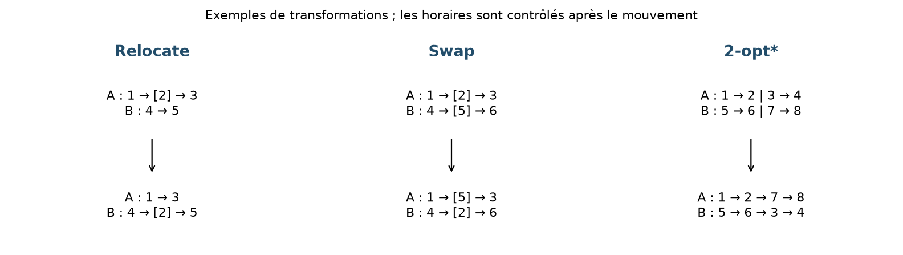

**Lecture du schéma.** Relocate modifie l'affectation d'un client, swap échange deux clients et 2-opt* échange des fins de tournées. L'inversion 2-opt est également implémentée. Une réduction géométrique ne suffit pas : capacité et horaires sont recalculés avant acceptation.

Pour limiter le coût, les propositions privilégient les 24 voisins géographiques d'un client, avec une part de tirages globaux. La recherche locale ILS applique des améliorations strictes, avec un plafond de dix mouvements par appel et de petites chaînes de déplacement. Elle n'est donc pas présentée comme une preuve d'optimalité locale sur tous les voisins possibles.

### 4.3. ILS : perturber puis améliorer

L'ILS effectue une succession de perturbations et d'améliorations locales. La perturbation cherche jusqu'à quatre mouvements directs réalisables, avec un nombre d'essais borné pour chacun. Ces mouvements peuvent augmenter la distance afin de changer l'organisation explorée. La recherche locale cherche ensuite des gains. Les voisinages restent fixes ; il n'y a ni apprentissage de poids de retraits, ni mécanisme tabou, ni procédure VNS.

Pour tout indice de cycle $t\in\mathbb N$, soient $S_t\in\mathcal S$ la solution courante à la fin du cycle t, $S^*\in\mathcal S$ l'archive et $S'\in\mathcal S$ la candidate après amélioration. Soit $\varepsilon=0{,}005$. La règle de poursuite est :

$$S_{t+1}=\begin{cases}S'&\text{si }D(S')\le(1+\varepsilon)D(S^*),\\S_t&\text{sinon.}\end{cases}$$

Pour tout cycle t, l'archive est remplacée si $D(S')<D(S^*)$. La tolérance au record autorise une exploration limitée au voisinage du meilleur coût. Après cent cycles sans nouveau meilleur, la recherche repart de l'archive. Ces réglages sont des choix empiriques fixés pour la campagne, puis examinés dans l'étude séparée de sensibilité.


**Lecture du schéma.** Le constructeur fournit un départ ; les cycles modifient ensuite des tournées complètes. La perturbation fournit de la diversité, la recherche locale affine, la règle de poursuite choisit le prochain départ et l'archive protège le meilleur résultat. Seules les trois dernières étapes sont répétées pendant la recherche.

Nous retenons l'ILS pour sa structure explicable et son adaptation aux mouvements déjà contrôlables du projet. Sa limite attendue est la difficulté de perturber utilement des tournées à fenêtres serrées. Cette justification motive l'expérience ; les résultats doivent déterminer sa qualité réelle.

### 4.4. Recuit simulé sur mouvements directs

Le recuit propose les mêmes types de mouvements sur des solutions complètes. Soient $S\in\mathcal S$ la courante, $S'\in\mathcal S$ une candidate réalisable et $\Delta=D(S')-D(S)$. Pour une température réelle $T>0$, la probabilité d'acceptation est :

$$P(\mathrm{acceptation}\mid\Delta,T)=\begin{cases}1&\text{si }\Delta\le0,\\\exp(-\Delta/T)&\text{si }\Delta>0.\end{cases}$$

Une température élevée rend les hausses de coût plus souvent acceptées. Les solutions violant une contrainte ne sont pas soumises à ce tirage : elles sont rejetées auparavant. Une archive indépendante conserve le meilleur coût, même lorsque la courante se dégrade.

Soit $b>0$ le budget de recherche et soit $\tau\ge0$ le temps déjà consommé. Posons $p(\tau)=\min(1,\tau/b)$. Pour les coûts strictement positifs des benchmarks, la température commence à $T_0=\rho D_0$, avec $\rho=0{,}02$ et $D_0$ le coût de construction, puis suit :

$$T(\tau)=T_0(0{,}005)^{p(\tau)}.$$

Le code protège numériquement les températures nulles et travaille à l'échelle dix, ce qui laisse le rapport $\Delta/T$ inchangé. Le refroidissement dépend du temps, pas du nombre d'améliorations. Au début, il facilite l'exploration ; à la fin, il réduit les détours acceptés.


**Lecture du graphique théorique.** À gauche, pour une même dégradation, la courbe de température élevée donne la plus forte probabilité. Pour une même température, une forte dégradation est moins souvent acceptée. À droite, la température passe de sa valeur initiale à 0,5 % de celle-ci lorsque le budget est consommé. Le refroidissement fait progressivement passer de l'exploration à une acceptation plus sélective. Ces courbes expliquent une règle ; l'étude expérimentale évalue son efficacité.

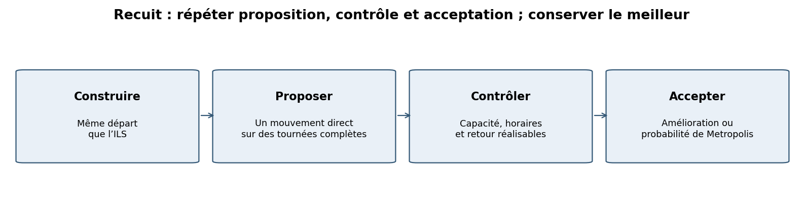

**Lecture du schéma.** Le recuit traite les propositions une à une et décide selon leur différence de coût et la température. L'ILS alterne une perturbation et une amélioration locale bornée. Les deux moteurs partagent le départ et les contraintes, mais leurs unités d'itération n'ont pas le même sens.

## 5. Implémentation, vérification et arrêt

`algo/model.py` définit les données et invariants ; `algo/data.py` applique la convention DIMACS et charge les références dans une fonction séparée. `algo/iterated.py` orchestre ILS et recuit. `algo/direct.py` compile les quatre types de propositions avec Numba ; `algo/kernels.py` fournit la construction et la recherche locale. L'API publique est `algo/solver.py`. `algo/verify.py` recalcule les clients, charges, horaires, retours et coûts sans reprendre les caches de recherche.

L'arrêt dépend du temps réel de recherche, avec une borne de propositions supplémentaire. Dans les expériences appariées, la construction est commune et hors du budget d'amélioration ; elle reste mesurée. Dans la CLI, le budget commence à l'entrée du solveur et inclut la construction si aucun départ n'est fourni. Un calcul atomique commencé avant la fin du budget peut terminer après : le temps effectivement consommé est publié.

Pour une tournée de longueur L, son évaluation complète coûte un temps linéaire en L. Les matrices denses demandent une mémoire quadratique en n. Limiter les voisins réduit les essais mais ne garantit pas une croissance linéaire du temps total. Le constructeur peut être coûteux sur les grands cas ; Numba accélère les boucles sans modifier leur complexité asymptotique.

Les tests contrôlent couverture, capacité, flotte, attente, bornes temporelles, retour, protection de l'archive et concordance entre évaluations. Des tests spécifiques vérifient que la recherche ILS/recuit n'appelle pas le réparateur après initialisation, que les mouvements directs conservent une solution complète, et que le PLNE coïncide avec l'énumération sur de petits cas, y compris avec des arcs nuls.

40 passed, 2 warnings in 18.36s

### 5.1. Lecture du code et déroulement d'un appel

`Settings` regroupe les réglages et refuse les budgets non positifs ou les méthodes inconnues. `construct` crée des tableaux de tournées vides, appelle l'insertion regret-2, calcule le coût de chaque construction complète et garde la meilleure. `encode` traduit les listes Python en tableaux entiers pour Numba ; `decode` restitue les listes à sauvegarder. Les cases vides des tableaux ne sont pas des clients supplémentaires.

Dans `solve`, un départ fourni est vérifié ; sinon le constructeur est appelé. Les matrices de voisinage sont préparées et une copie devient l'archive. Les propositions modifient les tableaux courants ou une copie candidate. Le meilleur résultat est copié avant de poursuivre : cette copie évite qu'une modification ultérieure détruise le record.

```text
ILS :
  construire ou vérifier le départ ; initialiser courant et archive
  jusqu'au budget :
    copier le courant ; chercher jusqu'à quatre perturbations réalisables
    appliquer la recherche locale bornée sur cette copie
    si son coût est dans la tolérance au record : elle devient courante
    si elle améliore le record : copier vers l'archive
    après cent cycles sans record : repartir de l'archive
  vérifier et retourner l'archive

Recuit :
  utiliser le même départ ; initialiser courant et archive
  jusqu'au budget, par lots bornés de propositions :
    calculer la température selon le temps consommé
    proposer un mouvement et contrôler les tournées touchées
    accepter tout gain ; tirer l'acceptation des hausses selon exp(-delta/T)
    conserver une copie de tout nouveau record
  vérifier et retourner l'archive
```

Dans `direct.walk`, le type de mouvement est tiré au hasard. La plupart des partenaires sont des voisins géographiques ; les autres sont tirés globalement. `route_eval` recalcule les horaires au plus tôt et rejette surcharge, retard ou retour tardif. Le mode perturbation s'arrête au premier mouvement réalisable ; le mode recuit enchaîne ses propositions avec la règle d'acceptation. La recherche locale utilise les routines compilées existantes, sans appeler le retrait/réparation pendant les cycles.

Le résultat JSON contient notamment `routes`, `cost`, `runtime_s`, `settings`, `trace`, `accepted` et `metrics`. `iterations` compte des propositions de perturbation ou de recuit ; il ne compte pas tous les candidats évalués à l'intérieur de la recherche locale. Les compteurs ILS et recuit ne servent donc pas de mesure comparable d'effort. `metrics` provient du vérificateur final indépendant.

## 6. Plan d'expérience et définition des statistiques

### 6.1. Instances, répétitions et budgets

Les 24 cas à 100 clients sont les quatre premiers identifiants de chacune des six familles Solomon C1, C2, R1, R2, RC1 et RC2. Les quatre autres sont C1_2_1, R1_2_1, C1_10_1 et R1_10_1. Chaque instance reçoit les vingt graines 101 à 120 et les deux méthodes, soit $28\times20\times2=1120$ essais. Ce lot dépasse les vingt instances variées demandées par le sujet ; celui-ci ne prescrit pas un nombre de répétitions.

Les budgets d'amélioration sont identiques entre méthodes : 5 secondes à 100 clients, 6 à 200 et 25 à 1 000. L'ordre des couples et l'ordre des méthodes dans un couple sont randomisés de façon reproductible. Quatre processus exécutent les couples sur des processeurs logiques distincts ; leurs ressources physiques restent partagées. Les études supplémentaires utilisent un autre processeur logique. La construction, le préchauffage, le chargement et les limites de cette organisation sont explicités, sans comparaison de vitesse intrinsèque avec les anciennes campagnes ou d'autres ordinateurs.

Python : 3.12.7 ; OS : Windows-11-10.0.26200-SP0 ; Processeur : Intel64 Family 6 Model 154 Stepping 3, GenuineIntel ; Cœurs physiques : 8 ; Processeurs logiques : 12 ; RAM (Gio) : 15.7 ; Streamlit : 1.53.1 ; Plotly : 7.1.0. Les versions réellement utilisées sont consignées dans `results/revision_ils/environment.json`.

| Dépendance | Version |
| --- | --- |
| numpy | 1.26.4 |
| pandas | 2.2.2 |
| scipy | 1.13.1 |
| matplotlib | 3.9.2 |
| vrplib | 2.2.0 |
| psutil | 5.9.0 |
| numba | 0.60.0 |
| nbformat | 5.10.4 |
| nbclient | 0.8.0 |
| ipykernel | 6.28.0 |
| nbconvert | 7.16.4 |
| jupyter-client | 8.6.0 |
| pytest | 7.4.4 |
| python-docx | 1.2.0 |
| pymupdf | 1.28.2 |
| tabulate | 0.9.0 |

### 6.2. Qualité, dispersion et comparaison appariée

Soit E l'ensemble des essais prévus et soit $E_F\subseteq E$ celui des essais réalisables disposant d'une référence de distance strictement positive. Pour tout essai $e\in E_F$, soient $D_e$ sa distance et $D_e^{\mathrm{BKS}}$ la référence. Son gap est :

$$g_e=100\left(\frac{D_e}{D_e^{\mathrm{BKS}}}-1\right)\qquad\forall e\in E_F.$$

Une BKS est une meilleure solution publiée, pas nécessairement un optimum prouvé. Un échec ne reçoit pas un gap nul. Soit $m=|E_F|$. Pour $m\ge1$, la moyenne est $\bar g=m^{-1}\sum_{e\in E_F}g_e$ ; pour $m\ge2$, l'écart-type échantillonnal est :

$$s_g=\sqrt{\frac{1}{m-1}\sum_{e\in E_F}(g_e-\bar g)^2}.$$

La médiane et les quartiles décrivent la distribution ; l'écart interquartile est $IQR=Q_3-Q_1$. L'écart-type est exprimé en points de pourcentage. Pour un seuil h, la fréquence de succès est $|\{e\in E_F:g_e<h\}|/|E|$, avec dénominateur explicite. Les seuils sont stricts.

Pour chaque instance i et chaque graine s du protocole, soit $\delta_{i,s}=g_{i,s}^{\mathrm{ILS}}-g_{i,s}^{\mathrm{recuit}}$ lorsque les deux résultats sont réalisables. Une valeur négative favorise l'ILS. Les différences sont appariées ; plusieurs graines d'une instance ne représentent pas plusieurs géographies.

L'incertitude de la différence moyenne est décrite par un bootstrap de 10 000 rééchantillonnages des vingt blocs de graines, en préservant les couples et l'ensemble fixe d'instances. Cette description concerne la variabilité algorithmique sur le benchmark connu ; elle ne constitue pas un intervalle de généralisation à toutes les nouvelles instances. Aucun classement universel n'est déduit d'une seule moyenne.

### 6.3. Pourquoi ces analyses ?

La moyenne mesure le niveau global ; la médiane complète sa lecture en présence de valeurs extrêmes. Les quartiles et l'écart-type décrivent la robustesse entre répétitions. Le pire gap et les fréquences sous les seuils empêchent qu'une bonne moyenne masque des cas défavorables. Les courbes de convergence montrent quand les gains apparaissent et si le budget supplémentaire est encore utile. Les compteurs de propositions sont interprétés selon la méthode, car un cycle ILS et une proposition du recuit ne sont pas équivalents.

## 7. Résultats mesurés du benchmark principal

| Méthode | Essais | Réalisables | Gap moyen (%) | Médiane (%) | Pire gap (%) | Sous 7 % |
| --- | --- | --- | --- | --- | --- | --- |
| ILS | 560 | 560 | 1,199 | 0,311 | 10,768 | 539 |
| Recuit simulé | 560 | 560 | 1,798 | 0,835 | 25,748 | 540 |

Sur 560 paires réalisables, l’ILS obtient une distance strictement inférieure dans 281 cas, identique dans 118 et supérieure dans 161. La différence moyenne appariée ILS − recuit est -0,599 point de gap. L’intervalle bootstrap à 95 % par blocs de graines est [-0,687 ; -0,506] point. Cet intervalle mesure la variabilité des graines sur les 28 instances fixées, sans garantir le même classement sur de nouveaux problèmes.

| Clients | Méthode | Essais | Gap moyen (%) | Pire gap (%) | Recherche (s) | Construction (s) | Total (s) |
| --- | --- | --- | --- | --- | --- | --- | --- |
| 100 | ILS | 480 | 0,967 | 8,519 | 5,000 | 0,012 | 5,012 |
| 100 | Recuit simulé | 480 | 0,889 | 4,676 | 5,001 | 0,012 | 5,012 |
| 200 | ILS | 40 | 0,496 | 2,194 | 6,001 | 0,046 | 6,047 |
| 200 | Recuit simulé | 40 | 0,649 | 2,241 | 6,001 | 0,046 | 6,047 |
| 1000 | ILS | 40 | 4,696 | 10,768 | 25,005 | 3,219 | 28,224 |
| 1000 | Recuit simulé | 40 | 13,863 | 25,748 | 25,004 | 3,219 | 28,223 |

Le classement dépend du périmètre : à 100 clients, le recuit a un gap moyen de 0,889 %, contre 0,967 % pour l’ILS. À 1 000 clients, l’ILS atteint 4,696 %, contre 13,863 % pour le recuit. L’avantage global ILS ne signifie donc pas une supériorité sur chaque taille. R1_10_1 reste difficile : ses vingt résultats ILS ne sont pas tous sous 7 %, et la moyenne ne doit pas masquer cette limite. Les vingt répétitions d’un même cas n’ajoutent pas vingt structures géographiques indépendantes.


**Lecture et portée.** Chaque boîte résume les gaps d'une méthode pour une taille donnée. Le trait central est la médiane, le symbole supplémentaire la moyenne, et la boîte couvre Q1 à Q3. Les points éloignés restent dans les statistiques. La dispersion mélange ici différences entre instances et entre graines ; le détail par instance complète cette vue.


**Lecture et portée.** Chaque point compare les deux méthodes sur une même instance et une même graine. Sous la diagonale, le gap ILS est plus faible ; au-dessus, le recuit est meilleur. Les égalités restent visibles sur la diagonale. Cette figure montre les différences appariées sans transformer les graines en problèmes indépendants.

### 7.1. Détail par instance

| Instance | Méthode | Gap moyen (%) | Écart-type (pt) | Pire gap (%) |
| --- | --- | --- | --- | --- |
| C101 | ILS | 0,000 | 0,000 | 0,000 |
| C101 | Recuit simulé | 0,000 | 0,000 | 0,000 |
| C102 | ILS | 0,000 | 0,000 | 0,000 |
| C102 | Recuit simulé | 0,193 | 0,347 | 0,822 |
| C103 | ILS | 0,030 | 0,054 | 0,121 |
| C103 | Recuit simulé | 0,889 | 0,639 | 2,057 |
| C104 | ILS | 0,011 | 0,030 | 0,122 |
| C104 | Recuit simulé | 0,013 | 0,033 | 0,122 |
| C201 | ILS | 0,000 | 0,000 | 0,000 |
| C201 | Recuit simulé | 0,000 | 0,000 | 0,000 |
| C202 | ILS | 0,000 | 0,000 | 0,000 |
| C202 | Recuit simulé | 0,176 | 0,786 | 3,514 |
| C203 | ILS | 0,044 | 0,198 | 0,883 |
| C203 | Recuit simulé | 0,643 | 0,919 | 2,327 |
| C204 | ILS | 1,000 | 2,134 | 8,519 |
| C204 | Recuit simulé | 1,671 | 1,156 | 4,676 |
| R101 | ILS | 0,016 | 0,018 | 0,037 |
| R101 | Recuit simulé | 0,144 | 0,203 | 0,782 |
| R102 | ILS | 0,160 | 0,231 | 0,825 |
| R102 | Recuit simulé | 0,237 | 0,274 | 1,009 |
| R103 | ILS | 0,370 | 0,319 | 1,051 |
| R103 | Recuit simulé | 0,853 | 0,247 | 1,431 |
| R104 | ILS | 1,406 | 0,971 | 3,376 |
| R104 | Recuit simulé | 2,071 | 0,930 | 3,170 |
| R201 | ILS | 0,203 | 0,436 | 1,426 |
| R201 | Recuit simulé | 0,267 | 0,251 | 0,936 |
| R202 | ILS | 1,309 | 0,807 | 2,865 |
| R202 | Recuit simulé | 0,876 | 0,586 | 2,224 |
| R203 | ILS | 1,496 | 1,471 | 4,341 |
| R203 | Recuit simulé | 0,835 | 0,458 | 2,033 |
| R204 | ILS | 2,830 | 1,329 | 5,196 |
| R204 | Recuit simulé | 0,926 | 0,561 | 2,530 |
| RC101 | ILS | 2,007 | 0,394 | 2,395 |
| RC101 | Recuit simulé | 1,155 | 0,351 | 1,759 |
| RC102 | ILS | 1,388 | 0,166 | 1,516 |
| RC102 | Recuit simulé | 1,576 | 0,544 | 2,436 |
| RC103 | ILS | 3,092 | 1,418 | 5,223 |
| RC103 | Recuit simulé | 1,450 | 0,681 | 3,879 |
| RC104 | ILS | 2,132 | 1,341 | 5,228 |
| RC104 | Recuit simulé | 1,370 | 0,515 | 2,190 |
| RC201 | ILS | 0,203 | 0,252 | 0,793 |
| RC201 | Recuit simulé | 0,933 | 0,416 | 1,537 |
| RC202 | ILS | 1,133 | 0,740 | 2,875 |
| RC202 | Recuit simulé | 1,376 | 0,684 | 2,701 |
| RC203 | ILS | 1,910 | 0,795 | 4,547 |
| RC203 | Recuit simulé | 2,162 | 0,657 | 3,443 |
| RC204 | ILS | 2,459 | 1,621 | 6,522 |
| RC204 | Recuit simulé | 1,514 | 0,873 | 3,076 |

| Famille | Méthode | Gap moyen (%) | Pire gap (%) |
| --- | --- | --- | --- |
| C1 | ILS | 0,010 | 0,122 |
| C1 | Recuit simulé | 0,274 | 2,057 |
| C2 | ILS | 0,261 | 8,519 |
| C2 | Recuit simulé | 0,622 | 4,676 |
| R1 | ILS | 0,488 | 3,376 |
| R1 | Recuit simulé | 0,826 | 3,170 |
| R2 | ILS | 1,459 | 5,196 |
| R2 | Recuit simulé | 0,726 | 2,530 |
| RC1 | ILS | 2,155 | 5,228 |
| RC1 | Recuit simulé | 1,388 | 3,879 |
| RC2 | ILS | 1,426 | 6,522 |
| RC2 | Recuit simulé | 1,496 | 3,443 |

Le regroupement par famille ci-dessus concerne uniquement les cas à 100 clients, pour ne pas y mélanger les deux grandes tailles. Il décrit quatre instances par famille et vingt graines par instance. Les préfixes distinguent des structures géographiques et temporelles ; une moyenne de famille ne supprime pas les différences entre instances. Lire ensemble moyenne, dispersion et pire essai évite de masquer un cas difficile derrière les cas faciles.


**Lecture et portée.** Les barres indiquent les moyennes des vingt graines ; les traits représentent un écart-type de part et d'autre, et non un intervalle de confiance. Une barre faible et peu dispersée indique de bons résultats observés sur cette instance. Les moyennes ne remplacent ni les pires essais ni les taux de faisabilité publiés.

| Instance | Clients | Méthode | Gap moyen (%) | Écart-type (pt) | Pire gap (%) |
| --- | --- | --- | --- | --- | --- |
| C1_10_1 | 1000 | ILS | 0,019 | 0,013 | 0,049 |
| C1_10_1 | 1000 | Recuit simulé | 4,808 | 0,467 | 5,754 |
| C1_2_1 | 200 | ILS | 0,013 | 0,023 | 0,052 |
| C1_2_1 | 200 | Recuit simulé | 0,040 | 0,032 | 0,104 |
| R1_10_1 | 1000 | ILS | 9,373 | 0,787 | 10,768 |
| R1_10_1 | 1000 | Recuit simulé | 22,917 | 1,827 | 25,748 |
| R1_2_1 | 200 | ILS | 0,980 | 0,489 | 2,194 |
| R1_2_1 | 200 | Recuit simulé | 1,257 | 0,435 | 2,241 |

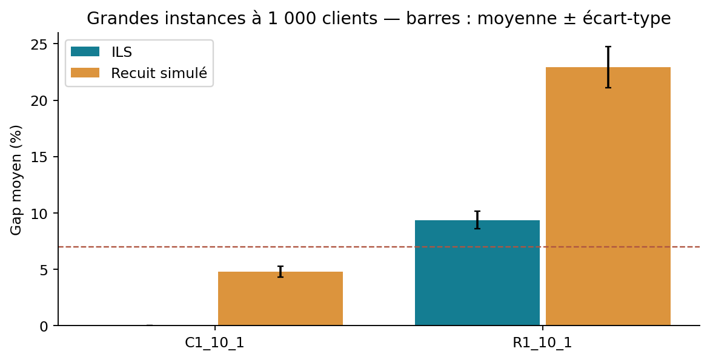

**Lecture et portée.** Ces deux grands problèmes disposent chacun de vingt graines par méthode. Leurs résultats renseignent ces structures précises ; ils ne suffisent pas à garantir un seuil sur toutes les instances de mille clients. Les temps réels et le budget de 25 secondes doivent être lus avec les gaps.

### 7.2. Convergence de l'algorithme au cours du calcul

| Clients | Méthode | Gap initial (%) | Gap final (%) | Gain derniers 20 % (pt) | Records tardifs | Essais |
| --- | --- | --- | --- | --- | --- | --- |
| 100 | ils | 14,953 | 0,967 | 0,034 | 58 | 480 |
| 100 | sa | 14,953 | 0,889 | 0,003 | 29 | 480 |
| 200 | ils | 19,004 | 0,496 | 0,052 | 17 | 40 |
| 200 | sa | 19,004 | 0,649 | 0,087 | 26 | 40 |
| 1000 | ils | 23,562 | 4,696 | 0,289 | 28 | 40 |
| 1000 | sa | 23,562 | 13,863 | 9,699 | 20 | 40 |

Le tableau compare les départs communs aux archives finales. Le gain des derniers 20 % est la baisse moyenne de gap entre 80 % du budget et le résultat final, y compris la dernière opération. « Records tardifs » compte les essais dont le coût final est strictement meilleur que l'archive observée à 80 % du budget. Ces chiffres permettent de distinguer une amélioration encore active d'une courbe devenue presque plate ; ils ne donnent pas une garantie pour un budget supérieur.

Les figures suivantes reconstruisent le meilleur coût en fonction du temps réel par interpolation en escalier des traces enregistrées. Pour chaque taille et méthode, la ligne est la **moyenne des gaps** et la bande l'intervalle interquartile. La valeur initiale est ancrée au temps zéro. Après la fin d'un run, son archive reste constante. Les dernières opérations atomiques sont présentes avec leur temps réel.

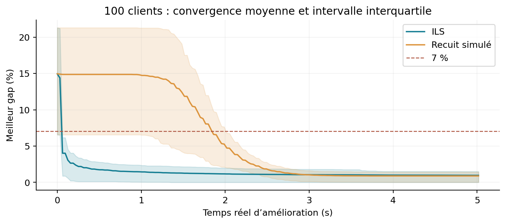

**Interprétation à 100 clients.** Une descente rapide indique des gains précoces ; un plateau signifie qu'aucun meilleur résultat n'est enregistré pendant cet intervalle. La bande décrit la variabilité, sans constituer une preuve d'optimalité ou une garantie pour un prochain run. Les méthodes sont comparées sur le temps, et non sur des compteurs d'itérations de sens différent.


**Interprétation à 200 clients.** Le même traitement porte sur les deux instances et vingt graines chacune. La courbe met en évidence les améliorations disponibles pendant les six secondes et la dispersion entre les trajectoires. La taille et la structure diffèrent des cas à 100 clients : ce n'est pas une expérience où seule la taille varie.

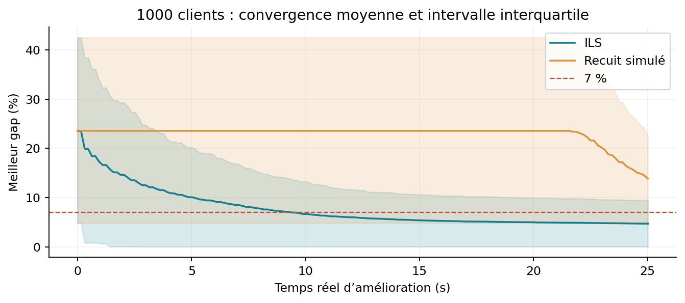

**Interprétation à 1 000 clients.** Une diminution encore présente près de l'échéance suggère qu'un budget plus long mérite une expérience dédiée ; un plateau peut venir d'un manque de mouvements utiles ou du réglage de la recherche. La figure seule ne permet pas de distinguer ces causes. Les deux cas ne représentent pas l'intégralité des grandes instances publiques.

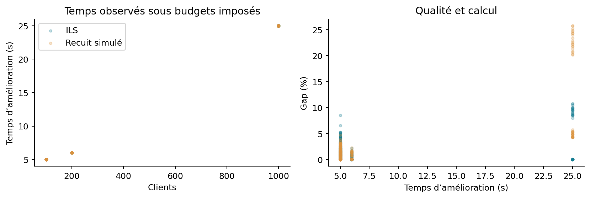

**Lecture et portée.** Les temps sont proches des budgets par construction. Le nuage ne prouve donc pas une loi de complexité empirique en fonction de n. Le second panneau met qualité et durée en regard ; les dépassements atomiques et les conditions de calcul restent explicités.

### 7.3. Temps de calcul avec un effort de propositions fixé

Une expérience supplémentaire impose 50 000 propositions à chaque appel, avec une limite de sécurité de trente secondes, jamais atteinte. Les cas C101, R101, C1_2_1, R1_2_1, C1_10_1 et R1_10_1 reçoivent les graines 101 à 103 et les deux méthodes, soit 36 essais. Les départs sauvegardés de la campagne principale sont réutilisés, la construction et le préchauffage restant hors temps. Les appels sont exécutés séquentiellement sur un processeur logique fixé.

| Clients | Méthode | Essais | Temps moyen (s) | Écart-type (s) | Temps maximal (s) |
| --- | --- | --- | --- | --- | --- |
| 100 | ils | 6 | 0,125 | 0,081 | 0,209 |
| 100 | sa | 6 | 0,008 | 0,000 | 0,009 |
| 200 | ils | 6 | 0,187 | 0,118 | 0,303 |
| 200 | sa | 6 | 0,012 | 0,000 | 0,012 |
| 1000 | ils | 6 | 1,676 | 0,471 | 2,140 |
| 1000 | sa | 6 | 0,312 | 0,052 | 0,400 |

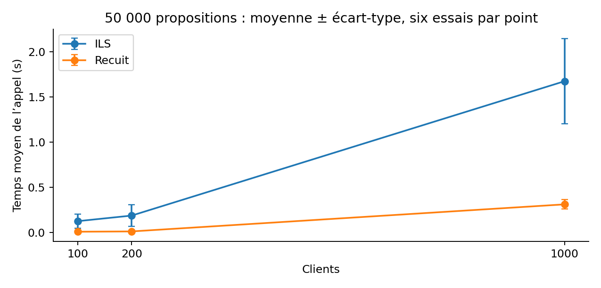

**Lecture et portée.** Le graphique montre le temps nécessaire au nombre fixé de propositions, avec les six observations de chaque taille et méthode. Il complète les budgets imposés de la campagne principale. Une proposition ILS peut déclencher une recherche locale dont les évaluations internes ne sont pas comptées dans ce nombre ; les unités de travail des deux méthodes restent différentes. Le recuit s'arrête ici au compteur avant de parcourir son refroidissement de trente secondes : cette expérience mesure le temps d'appel, pas sa qualité finale. La variation observée dépend à la fois de n, des tournées et des contraintes ; trois tailles et deux familles ne démontrent pas un ordre asymptotique universel.

## 8. Validation exacte, paramètres et changements des contraintes

### 8.1. Confrontation au PLNE sur de petits cas

Dix cas synthétiques reproductibles couvrent 4, 6, 8, 10 et 12 clients, avec deux graines de génération par taille. Leurs fenêtres sont construites autour de tournées réalisables et leur capacité est connue ; ce lot ne représente pas toutes les difficultés possibles. HiGHS reçoit huit secondes par cas. Les deux métaheuristiques reçoivent chacune cinq graines et 0,2 seconde d'amélioration depuis des départs communs.

| Clients | Graine instance | Statut PLNE | Incumbent | Borne inf. | Temps (s) |
| --- | --- | --- | --- | --- | --- |
| 10 | 11 | optimal | 198,400 | 198,400 | 0,153 |
| 10 | 22 | optimal | 190,300 | 190,300 | 0,391 |
| 12 | 11 | time_limit | 242,700 | 223,300 | 8,074 |
| 12 | 22 | optimal | 215,800 | 215,800 | 0,662 |
| 4 | 11 | optimal | 147,000 | 147,000 | 0,009 |
| 4 | 22 | optimal | 113,200 | 113,200 | 0,004 |
| 6 | 11 | optimal | 187,700 | 187,700 | 0,019 |
| 6 | 22 | optimal | 178,500 | 178,500 | 0,018 |
| 8 | 11 | optimal | 187,700 | 187,700 | 0,052 |
| 8 | 22 | optimal | 181,700 | 181,700 | 0,123 |

HiGHS certifie 9 optimums sur les dix cas ; les autres lignes conservent leur statut exact. Une borne inférieure n’est pas une solution, et un incumbent à la limite de temps n’est pas un optimum prouvé. Les gaps à l’optimum sont donc calculés uniquement pour les 90 essais associés aux cas certifiés. Pour ILS, le gap moyen sur ces cas vaut 0,000 %, avec un maximum de 0,000 %. Pour SA, le gap moyen sur ces cas vaut 0,241 %, avec un maximum de 5,413 %. Ces petites instances vérifient la cohérence de la résolution et ne prédisent pas la difficulté des cas à 1 000 clients.

Les gaps aux optimums ne sont calculés que pour les cas où l'optimalité est certifiée. En présence d'une limite de temps, borne et incumbent restent distincts. Une sous-instance n'hérite pas du coût optimal d'un problème plus grand. Ces résultats valident un lien modèle/code et une qualité sur petits cas ; ils ne remplacent pas le benchmark principal.

### 8.2. Sensibilité des réglages des méthodes

Cette étude séparée utilise C105, C205, R105, R205, RC105 et RC205, trois graines et deux secondes par essai. Les variantes modifient un réglage à la fois : intensité de perturbation ILS, tolérance au record, présence de la recherche locale, ou température initiale du recuit. La configuration principale est conservée ; ces diagnostics ne servent pas à sélectionner rétroactivement ses meilleurs résultats.

| Variante | Essais | Réalisables | Gap moyen (%) | Pire gap (%) |
| --- | --- | --- | --- | --- |
| ils_base | 18 | 18 | 0,951 | 3,267 |
| ils_large | 18 | 18 | 3,026 | 10,223 |
| ils_small | 18 | 18 | 0,896 | 3,303 |
| ils_strict | 18 | 18 | 1,163 | 4,411 |
| ils_without_local | 18 | 18 | 8,381 | 23,858 |
| sa_base | 18 | 18 | 1,117 | 3,759 |
| sa_cold | 18 | 18 | 1,349 | 4,812 |
| sa_hot | 18 | 18 | 1,122 | 3,295 |

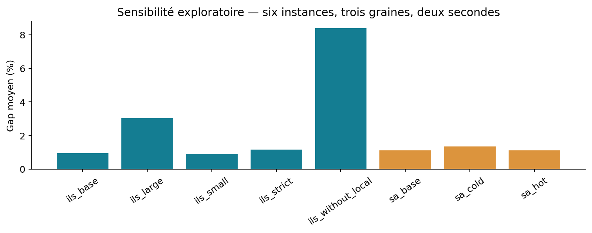

**Lecture et portée.** Une moyenne plus faible indique un meilleur écart observé sur ces dix-huit essais d'une variante. Une perturbation trop faible peut revenir vers la même organisation ; une perturbation plus forte peut rendre les améliorations coûteuses. L'absence de recherche locale teste son rôle dans l'ILS. Une température modifiée agit sur les acceptations du recuit. Ces interprétations sont des mécanismes plausibles ; les chiffres déterminent les observations effectives.

La meilleure moyenne de cette étude exploratoire est obtenue par `ils_small`. Le tableau porte sur six autres instances de développement et trois graines par variante. Il ne démontre pas un réglage universel. La suppression de la recherche locale change le mécanisme de l’ILS, tandis que la température change l’acceptation du recuit. Le protocole principal a été figé avant l’observation de ces résultats ; il n’est pas réajusté après coup. Sans recherche locale, le gap moyen ILS passe de 0,951 % à 8,381 %. Ce contraste appuie le rôle de l’amélioration locale dans cette implémentation. Une perturbation de huit mouvements donne 3,026 %, contre 0,896 % pour un mouvement : davantage de perturbation ne donne pas automatiquement davantage de qualité à budget fixé.

### 8.3. Réaction aux capacités, à la flotte et aux fenêtres

Pour les mêmes six instances et trois graines, sept scénarios font varier un seul facteur à la fois : original ; capacité multipliée par 0,8 ou 1,2 ; largeur des fenêtres clients multipliée par 0,7 ou 1,3 autour de leur centre, avec bornes dans l'horizon ; flotte multipliée par 0,8 ou 1,2 puis arrondie par excès. Les deux méthodes disposent de deux secondes. Une nouvelle construction commune est calculée pour chaque scénario.

La demande totale, les coordonnées et les services restent fixes. Les variantes peuvent être mathématiquement impossibles ou difficiles à construire. Une impossibilité n'est annoncée que lorsqu'une condition nécessaire la prouve ; les autres absences de solution restent des échecs de construction. **Les variantes modifiées n'ont pas de BKS validée : aucun gap à la référence originale n'est annoncé.**

| Scénario | Méthode | Réalisables /18 | Variation distance (%) | Variation durée (%) | Attente moyenne |
| --- | --- | --- | --- | --- | --- |
| capacity_120 | ils | 18 | -0,198 | 0,330 | 1156,039 |
| capacity_120 | sa | 18 | -0,340 | -2,036 | 1318,033 |
| capacity_80 | ils | 18 | 5,845 | 8,212 | 1828,956 |
| capacity_80 | sa | 18 | 6,236 | 7,554 | 2103,139 |
| fleet_120 | ils | 18 | 0,065 | 2,001 | 1207,433 |
| fleet_120 | sa | 18 | 0,075 | -0,961 | 1362,133 |
| fleet_80 | ils | 18 | -0,134 | 2,199 | 1228,350 |
| fleet_80 | sa | 18 | 0,391 | 0,454 | 1419,322 |
| original | ils | 18 | 0,000 | 0,000 | 1131,067 |
| original | sa | 18 | 0,000 | 0,000 | 1410,911 |
| windows_130 | ils | 18 | -3,895 | -4,040 | 1020,517 |
| windows_130 | sa | 18 | -4,169 | -5,929 | 1188,419 |
| windows_70 | ils | 18 | 6,066 | 11,903 | 1792,803 |
| windows_70 | sa | 18 | 5,814 | 11,747 | 2096,792 |

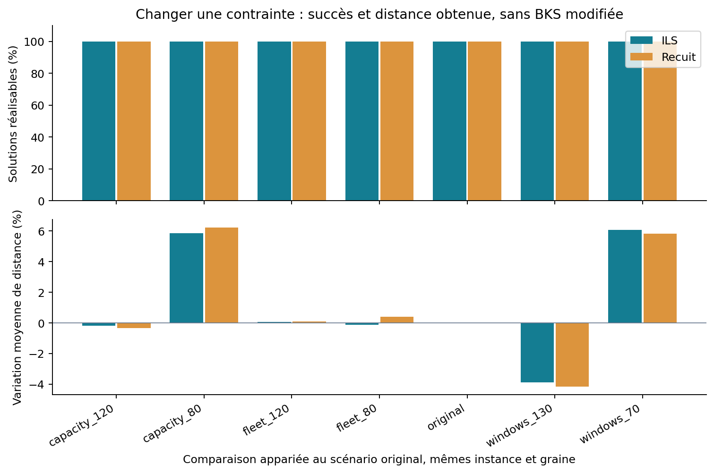

**Lecture et portée.** Les barres indiquent la proportion de solutions réalisables parmi les dix-huit tentatives prévues de chaque scénario et méthode. La faisabilité est évaluée avant les moyennes de distance ou d'attente. Un taux plus faible sous une contrainte renforcée peut révéler une limite du modèle disponible ou du constructeur ; il ne prouve pas à lui seul l'inexistence de solutions.

Les 252 observations se répartissent ainsi : {'feasible': 252}. Quand la capacité ou la flotte diminue, certaines demandes deviennent impossibles à répartir ; quand les fenêtres se resserrent, les insertions compatibles peuvent disparaître. Un échec de construction signifie seulement que le constructeur n’a rien trouvé avec ses douze essais. Le statut `proven_infeasible` n’est réservé qu’à une condition nécessaire effectivement violée. Les moyennes de distance et d’attente ne concernent que les solutions réalisables : leur population peut changer entre scénarios. Elles ne constituent donc pas, seules, une mesure causale de gain ni une preuve d’amélioration de la solution optimale. Le second panneau calcule la variation relative de distance obtenue par rapport au scénario original, pour les mêmes instance, graine et méthode, puis en prend la moyenne. Ce n’est pas un gap à l’optimum. Toutes ces variantes ont fourni un départ réalisable ; ce succès ne signifie pas que les tournées ou leur qualité restent identiques.

Une fenêtre plus large augmente l'ensemble des possibilités mathématiques, mais une métaheuristique sous budget peut malgré tout produire un résultat moins bon sur un essai. Une charge plus proche de Q ou une marge horaire faible dans une solution dépend également de l'algorithme : ces indicateurs ne doivent pas être confondus avec les caractéristiques d'entrée de l'instance.

## 9. Simulation et vérification des solutions

L'interface locale permet de choisir méthode, instance et graine, lancer des expériences, puis rejouer une solution vérifiée. La simulation propose lecture/pause, vitesse et curseur temporel. Elle distingue trajets, attentes et services ; une livraison est terminée à la fin du service. L'inspecteur montre charge initiale/restante, fenêtre, arrivée, début, fin et retour face à la fermeture du dépôt. Les tableaux de contrôle couvrent tous les clients, pas seulement ceux visibles sur la carte.

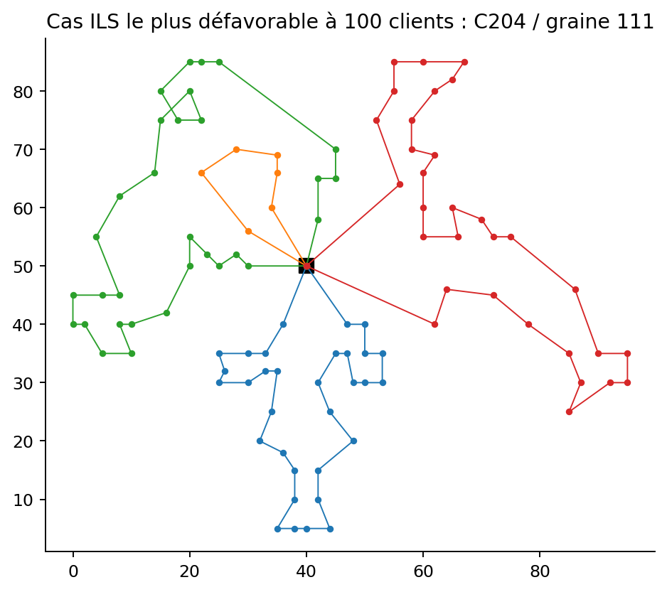

Le run illustré est C204, graine 111 : distance 638,200, référence 588,100, gap 8,519 %. Il est choisi comme pire gap ILS à 100 clients, et non comme meilleur exemple esthétique.

**Lecture de la carte.** Le carré représente le dépôt et les lignes les tournées du run ILS le plus défavorable à 100 clients du lot principal. Choisir ce cas évite de montrer uniquement une réussite favorable. Les segments sont des trajets entre coordonnées de benchmark. Croisements et détours apparents ne prouvent pas un défaut, car les horaires et charges contraignent les affectations.

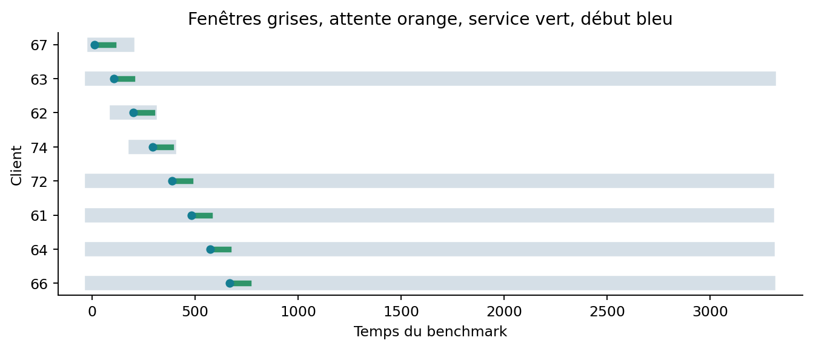

**Lecture du contrôle temporel.** Pour les premiers clients d'une tournée de ce même run, les points bleus sont les débuts de service, à comparer aux fenêtres grises. L'orange représente l'attente et le vert le service. Seul le début doit être dans la fenêtre. L'image illustre quelques clients ; le vérificateur contrôle la solution complète.

La convergence de l'algorithme décrit le calcul qui produit une solution. L'animation des camions rejoue ensuite ses horaires : ce sont deux chronologies distinctes. La simulation n'introduit ni trafic dynamique ni validation routière réelle.

## 10. Limites et améliorations justifiées

Les contraintes strictes rendent beaucoup de propositions irréalisables. L'ILS dépend du nombre de perturbations et de la recherche locale bornée ; le recuit dépend du refroidissement et des types de mouvements accessibles. Les listes de voisins réduisent le travail mais peuvent masquer un échange éloigné. Une bonne performance moyenne ne garantit pas le pire gap d'un futur essai.

Les vingt graines décrivent mieux la variabilité que quelques essais, sans garantir la détection d'événements rares. Les instances partagent des familles et parfois des structures : le bootstrap conditionnel au benchmark ne démontre pas une généralisation à toutes les géographies. Les dix cas exacts restent petits et construits ; les échecs de preuve sous limite de temps font partie du bilan.

Les budgets varient selon la taille. Une véritable étude de montée en charge doit compléter ces mesures par un effort identique, un coût par mouvement ou un temps pour atteindre une qualité fixée. Les processus partagent caches, mémoire, refroidissement et charge système ; aucun rapport de vitesse universel n'est déduit de ce poste.

Les axes suivants sont à tester sur des lots déclarés : mesurer les échecs de perturbation sous fenêtres serrées, enrichir les échanges de petites chaînes, comparer plusieurs tailles de listes de voisins, étudier le temps pour atteindre un seuil et prolonger les grands cas en conservant les résultats initiaux. Les réglages ne doivent pas être ajustés sur le lot final puis présentés comme une validation indépendante.

## 11. Reproduction, traçabilité et démonstration

Le protocole et les sources figées sont dans `results/revision_ils/protocol.json` et `source/`. Chaque run possède son JSON, ses tournées, paramètres, trace, temps et validation. Les départs communs sont dans `initials/`. Les études supplémentaires ont leur propre protocole. Les tableaux complets et empreintes permettent de reconstruire l'analyse. Le notebook exécute ses lectures, figures et petits contrôles ; il ne relance pas les 1 120 recherches à chaque ouverture.

```powershell
.\.venv\Scripts\python.exe -m pytest tests
.\.venv\Scripts\python.exe cli.py C101 --method ils --seconds 2 --seed 101
.\.venv\Scripts\python.exe cli.py C101 --method sa --seconds 2 --seed 101
.\.venv\Scripts\python.exe scripts\run_ils_benchmark.py --workers 4
.\.venv\Scripts\python.exe scripts\run_ils_studies.py
.\.venv\Scripts\python.exe scripts\run_ils_scaling.py
.\.venv\Scripts\python.exe scripts\validate_ils_artifacts.py
.\.venv\Scripts\python.exe scripts\build_ils_report.py
.\.venv\Scripts\python.exe -m streamlit run web/app.py
```

Les reprises conservent les fichiers existants et vérifient le protocole ; elles n'annoncent pas de nouvelles mesures lorsqu'elles relisent des runs terminés. Une reproduction indépendante exige un nouveau dossier de résultats et un protocole explicitement distinct. Pour la soutenance, une petite démonstration suffit : rappeler le contexte et l'objectif, montrer un calcul court, vérifier les contraintes, puis commenter les résultats agrégés et leurs limites.

```text
ILS : distance = 827.3 ; réalisable ; 0.2 s
SA : distance = 827.3 ; réalisable ; 0.2 s
```

## 12. Conclusion

Le bilan d'avancement distingue les réalisations et les pistes restant à évaluer :

| Étape | État dans cette livraison | Suite justifiée |
|---|---|---|
| Modèle et vérificateur | Contraintes formalisées, PLNE implémenté, tests et contrôles indépendants | Étendre les cas limites si de nouvelles contraintes sont ajoutées |
| ILS et recuit | Deux moteurs exécutables, sans ALNS dans la recherche active | Tester d'autres intensités et listes de voisins sur un lot déclaré |
| Étude principale | 28 instances, vingt graines, mesures et convergence sauvegardées | Valider sur de nouvelles instances et prolonger les cas difficiles |
| Études complémentaires | Petits cas exacts, paramètres et contraintes modifiées | Répéter plus largement les sensibilités avant de changer les réglages |
| Restitution | Notebook, rapport, schémas expliqués et simulation contrôlable | Préparer la démonstration sur le poste de soutenance |

Sur les 28 instances fixées et les vingt graines retenues, l’ILS retourne 560/560 solutions réalisables, avec un gap moyen de 1,199 %, contre 1,798 % pour le recuit. Son pire gap est 10,768 % et 539/560 essais restent strictement sous 7 %. Ces valeurs décrivent notre code, les budgets choisis et ce benchmark connu. La comparaison appariée, les courbes de convergence et les tests de contraintes permettent d’en discuter les limites. Le travail suivant doit prioriser les cas les plus éloignés de leur référence et vérifier les pistes sur des instances non utilisées pour le développement.

La valeur du travail vient de l'accord entre la définition du problème, le comportement du code, les contrôles indépendants et les expériences traçables. L'ILS constitue une alternative réellement implémentée à l'ancienne ALNS ; le recuit fournit une comparaison sous les mêmes règles. Les résultats doivent être défendus dans leur périmètre et leurs budgets, sans transformer une moyenne favorable en garantie universelle.

## Références

- CESI, sujet « Algorithmique et optimisation » et consignes du livrable final communiquées par l'utilisateur.
- Lourenço, Martin et Stützle, *Iterated Local Search*, [texte des auteurs](https://arxiv.org/abs/math/0102188).
- Kirkpatrick, Gelatt et Vecchi, *Optimization by Simulated Annealing*, 1983, [publication](https://doi.org/10.1126/science.220.4598.671).
- [PyVRP/Instances — convention VRPTW DIMACS](https://github.com/PyVRP/Instances/blob/7474b068a8effa7f39448b241314b615c9271525/VRPTW/README.md), révision figée dans le manifeste.
- [VRPLIB — lecture des instances et solutions](https://github.com/PyVRP/VRPLIB).
- [SciPy — interface `milp` et statuts de résolution](https://docs.scipy.org/doc/scipy/reference/generated/scipy.optimize.milp.html).
- [Numba — compilation des fonctions numériques](https://numba.readthedocs.io/en/stable/user/jit.html).