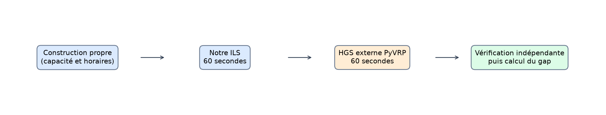
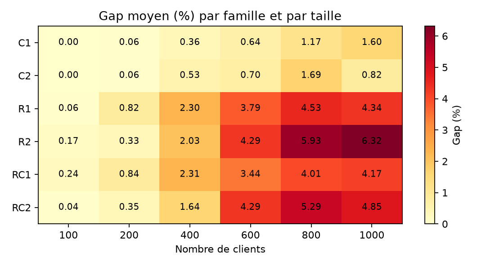
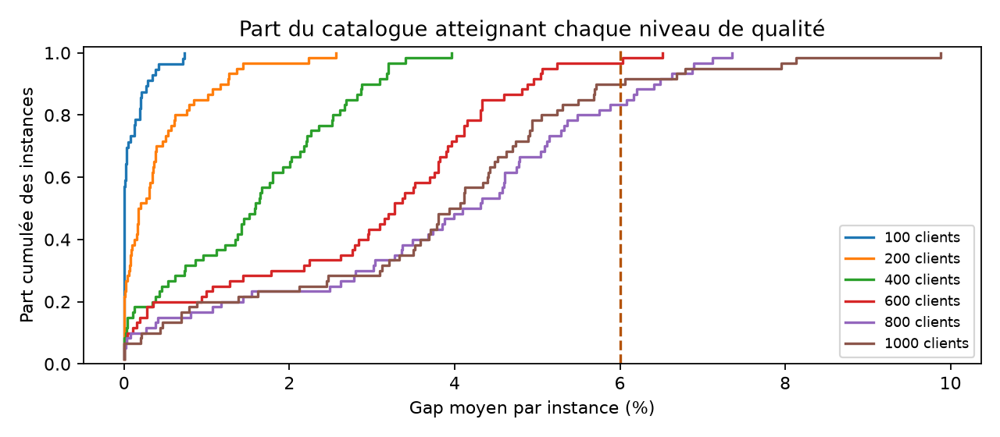
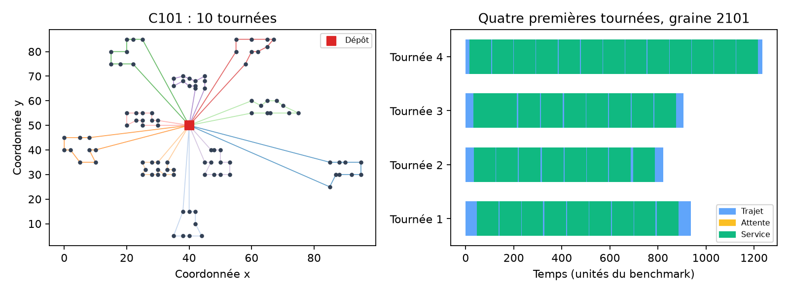

**CESI — Algorithmique et optimisation — Modèle, implémentation et validation expérimentale**

## 1. Problème, contribution et résultat principal

Nous cherchons des tournées qui livrent chaque client une seule fois, respectent la capacité et les fenêtres horaires strictes, puis reviennent au dépôt avant sa fermeture. Pour comparer les solutions aux références DIMACS, l’objectif expérimental est la distance totale. Le nombre de véhicules constitue une borne maximale ; aucun véhicule supplémentaire ne permet de violer une contrainte.

Nous avons développé le constructeur, notre recherche locale itérée, les contrôles et leur intégration avec le moteur HGS de **PyVRP 0.12.2**, attribué à ses auteurs. Le HGS est une bibliothèque externe ; notre contribution porte sur la solution hybride, son code d’intégration, sa validation et son évaluation.

Le catalogue complet contient **356 instances**, de 100 à 1 000 clients. La campagne comprend **472 pipelines évalués**, dont **448 nouveaux** et **24 réutilisés avec leur temps intégralement compté**. La moyenne donnant le même poids à chaque instance est **2.078 %**. Le périmètre complémentaire de **116 instances à 100 et 1 000 clients**, avec deux graines par instance, obtient **1.946 %**.

La moyenne à 1 000 clients, les cas défavorables, la couverture et les temps sont détaillés dans les tableaux. Une moyenne sous un seuil ne signifie pas que chaque instance respecte ce seuil. Les différentes pondérations sont explicitement distinguées.

Le sujet initial évoque également la durée et le trafic variable. Notre périmètre est statique et symétrique : nous calculons durée, attente et service, mais optimisons ici la distance compatible avec les références. Le trafic variable, une garantie d’optimalité et les tailles supérieures à 1 000 clients ne sont pas démontrés.


**Lecture des campagnes.** Dans le livrable, les sections 1 à 8 décrivent la campagne de référence. La section 9 présente les nouveaux essais : après dix reprises ciblées avec un budget supplémentaire, le pire gap de l’archive est 6.889 %. Les anciens résultats et leurs budgets restent identifiés. Le nouveau profil à 120 s est accessible avec `--method ils_hgs_refined` et dans le web « ILS court + HGS (v9) ».


### 1.1. Représentation du problème par un graphe

Nous représentons le réseau de livraison par un graphe orienté complet :

$$G_{phys}=(V_{phys},A_{phys}),\qquad V_{phys}=\{0\}\cup C,\qquad C=\{1,\ldots,n\},$$
$$A_{phys}=\{(i,j)\in V_{phys}\times V_{phys}:i\ne j\}.$$

Le sommet 0 est le dépôt et chaque sommet i de C représente un client. Un client porte trois informations : sa demande $q_i$, son temps de service $s_i$ et sa fenêtre de début de service $[e_i,l_i]$. Chaque arc $(i,j)$ porte une distance $d_{ij}$ et un temps de trajet $c_{ij}$. Le graphe est orienté parce que l’ordre des visites et la propagation des horaires ont un sens. Dans les instances étudiées, les coûts sont symétriques ; les deux arcs opposés existent donc avec les mêmes coûts.

Une tournée est un circuit $0\to i_1\to\cdots\to i_p\to0$. Une solution contient au plus K tournées non vides et répartit les clients entre elles, sans oubli ni doublon. Sa distance est la somme des distances de tous leurs arcs. Les fenêtres ne sont pas représentées par de nouveaux sommets : elles limitent les horaires auxquels un sommet peut être visité.

Pour un client $j\in C$ précédé par le sommet i, nous calculons le début du service au plus tôt :

$$t_j=\max\{e_j,\ t_i+s_i+c_{ij}\},\qquad t_j\le l_j.$$

Le temps de service au dépôt est nul et le départ est fixé à zéro. Si $\mathcal R_k$ désigne la liste des clients de la tournée du véhicule k, la capacité impose $\sum_{i\in\mathcal R_k}q_i\le Q$ ; le retour doit survenir avant H. Le dessin ci-dessous illustre ces notions sur quatre clients. Cet exemple pédagogique est vérifié par le même contrôleur que les benchmarks ; il ne fait pas partie des 472 essais.

La formulation de la section 2 utilise ensuite deux copies du dépôt, o pour le départ et r pour le retour. Elles représentent toujours le même lieu physique. Cette séparation permet d’écrire les horaires de départ et de retour sans imposer une seule variable de temps à deux événements distincts.


### 1.2. Lire les notations avant les équations

| Notation | Signification | Nature |
|---|---|---|
| $n,C$ | Nombre de clients et ensemble des clients | Données et ensemble |
| $K,\mathcal K$ | Nombre maximal de véhicules et ensemble de leurs indices | Données et ensemble |
| $Q,H$ | Capacité commune et fermeture du dépôt | Données |
| $q_i,s_i,[e_i,l_i]$ | Demande, service et fenêtre du client i | Données |
| $d_{ij},c_{ij}$ | Distance et temps de trajet de i vers j | Données |
| $x_{ij}^k$ | Le véhicule k utilise-t-il l’arc $(i,j)$ ? | Variable binaire |
| $y_i^k,u_k$ | Affectation du client i et utilisation du véhicule k | Variables binaires |
| $t_i,R_k$ | Début du service chez i et heure de retour du véhicule k | Variables continues |
| $f_{ij}^k$ | Flot artificiel qui garantit la connexion au dépôt | Variable continue auxiliaire |

Nous distinguons le nombre K de l’ensemble $\mathcal K$, et la tournée $\mathcal R_k$ de la variable $R_k$, qui désigne une heure de retour dans les équations du modèle.

La section 2 précise les domaines, l’objectif et chaque contrainte. Les variables de flot ne modélisent pas une marchandise supplémentaire : elles servent à empêcher un cycle de clients isolé du dépôt, même si certains temps tronqués sont nuls.


## 2. Données, horaires et formulation

### 2.1. Une solution et son évaluation

Une solution est une liste de tournées : `[[1,3],[2,4]]` signifie dépôt → 1 → 3 → dépôt et dépôt → 2 → 4 → dépôt. Le dépôt est implicite dans les listes. Les données contiennent coordonnées, demandes, services, fenêtres, matrices de trajet et distance, capacité et flotte maximale.


**Lecture.** Les données définissent les contraintes ; les listes proposent un ordre. Le contrôleur recalcule les horaires et la couverture. Une carte satisfaisante visuellement ne prouve pas la faisabilité.

Pour deux visites successives i puis j, avec départ fixé à zéro et service nul au dépôt :

$$a_j=t_i+s_i+c_{ij},\qquad t_j=\max(a_j,e_j),\qquad b_j=t_j+s_j.$$

L'arrivée est a, le début du service t et sa fin b. L'attente est $t_j-a_j$. La fenêtre borne le début : $e_j\le t_j\le l_j$, bornes comprises. Une arrivée anticipée permet d'attendre ; la fin du service peut dépasser $l_j$ si la suite et le retour restent réalisables.


**Lecture.** Le trajet, l'attente et le service occupent trois périodes distinctes. Les fenêtres strictes n'interdisent pas d'arriver avant l'ouverture.

Pour un véhicule k, soit $R_k$ son retour, nul s'il est inutilisé. La distance D somme les arcs parcourus ; la durée totale est $\sum_k R_k$ et le makespan est $\max_k R_k$. Deux solutions de même distance peuvent avoir des attentes différentes.

### 2.2. Formulation PLNE complète et lecture des contraintes

Nous formalisons le **même CVRPTW que celui du projet** : un dépôt unique, des véhicules homogènes, des livraisons indivisibles, une tournée au plus par véhicule et des trajets fixes et symétriques. L'attente avant ouverture est autorisée. Le début du service doit appartenir à la fenêtre du client et le retour doit respecter la fermeture du dépôt. Les bornes sont inclusives. Le trafic variable, les ramassages, les dépôts multiples et les flottes hétérogènes ne font pas partie des expériences réalisées.

**Ensembles et indices.** Le nombre de clients est l'entier $n\ge1$. Leur ensemble est $C=\{1,\ldots,n\}$. Le nombre maximal de véhicules est l'entier $K\ge0$ et leur ensemble d'indices est $\mathcal K=\{1,\ldots,K\}$. Ainsi, $n$ et $K$ sont des nombres ; $C$ et $\mathcal K$ sont des ensembles. L'écriture $\forall i\in C$ signifie « pour chaque client i appartenant à C ». Elle ne désigne pas une boucle « tant que ».

Nous représentons le dépôt physique par deux sommets : $o$ pour le départ et $r$ pour le retour. Cette duplication permet de distinguer les heures de départ et de retour ; elle n'ajoute pas un deuxième dépôt réel. Les sommets et arcs autorisés sont :

$$V=C\cup\{o,r\},$$
$$A=(\{o\}\times C)\cup\{(i,j)\in C\times C:i\ne j\}\cup(C\times\{r\}).$$

Les véhicules peuvent aller du départ à un client, entre deux clients distincts, puis d'un client au retour. Aucune boucle sur un même sommet n'est autorisée. Aucun arc n'entre dans o et aucun arc ne quitte r.

**Paramètres.** Pour chaque client $i\in C$, soient $q_i,s_i,e_i,l_i\in\mathbb R_{\ge0}$ : sa demande est $q_i$, sa durée de service $s_i$ et sa fenêtre de début de service $[e_i,l_i]$. Soient $Q,H\in\mathbb R_{>0}$ la capacité commune et la fermeture du dépôt. Comme dans les données acceptées par `Instance`, nous supposons $0\le e_i\le l_i\le H$ pour tout $i\in C$. Pour chaque arc $(i,j)\in A$, soient $d_{ij},c_{ij}\in\mathbb R_{\ge0}$ sa distance et son temps de trajet. Les départs sont fixés au temps zéro. Dans les benchmarks du projet, temps de trajet et distances ont les mêmes valeurs numériques ; le modèle distingue néanmoins leurs rôles et leurs unités.

**Variables de décision et domaines.**

$$x_{ij}^k\in\{0,1\}\quad\forall(i,j)\in A,\ \forall k\in\mathcal K.$$

Pour chaque arc et chaque véhicule, x vaut un si le véhicule emprunte cet arc, et zéro sinon.

$$y_i^k\in\{0,1\}\quad\forall i\in C,\ \forall k\in\mathcal K,\qquad
u_k\in\{0,1\}\quad\forall k\in\mathcal K.$$

La variable y vaut un si le client i est affecté au véhicule k. La variable u vaut un si le véhicule k est utilisé.

$$t_i\in\mathbb R_{\ge0}\quad\forall i\in C,\qquad
R_k\in\mathbb R_{\ge0}\quad\forall k\in\mathcal K.$$

La variable t est l'heure de **début du service**, pas l'heure d'arrivée. La variable R est l'heure de retour au dépôt. Les bornes horaires sont imposées ci-dessous.

Enfin, $f_{ij}^k\in\mathbb R_{\ge0}$, pour chaque $(i,j)\in A$ et chaque $k\in\mathcal K$, est un flot artificiel assurant la connexion au dépôt. Il représente un outil mathématique, pas la marchandise dans le camion.

**Objectif du benchmark : distance totale.**

$$\min D=\sum_{k\in\mathcal K}\sum_{(i,j)\in A}d_{ij}x_{ij}^k.$$

Nous additionnons les distances des arcs parcourus par tous les véhicules. Le nombre de camions est un maximum autorisé, sans priorité lexicographique ni coût fixe ajouté. La durée totale avec attente est étudiée séparément ; son coût ne doit pas être comparé à une référence en distance.

**C1 — Affecter chaque client exactement une fois.**

$$\sum_{k\in\mathcal K}y_i^k=1\qquad\forall i\in C.$$

Pour chaque client i, la somme des affectations vaut un : un seul véhicule réalise l'intégralité de sa livraison. Aucun client ne peut être oublié ou réparti entre plusieurs camions.

**C2 — Assurer une entrée et une sortie avec le véhicule affecté.**

$$\sum_{j:(j,i)\in A}x_{ji}^k=y_i^k,
\qquad\sum_{j:(i,j)\in A}x_{ij}^k=y_i^k
\qquad\forall i\in C,\ \forall k\in\mathcal K.$$

Pour chaque client et chaque véhicule, une affectation impose exactement une entrée et une sortie. Sans affectation, ce véhicule n'emprunte aucun arc entrant ou sortant de ce client. Les indices des sommes sont limités aux arcs autorisés de A.

**C3 — Partir du dépôt et y revenir, au plus une fois par véhicule.**

$$\sum_{j\in C}x_{oj}^k=u_k,
\qquad\sum_{i\in C}x_{ir}^k=u_k
\qquad\forall k\in\mathcal K.$$

Chaque véhicule utilisé effectue un départ et un retour. Un véhicule inutilisé n'en effectue aucun. On autorise donc l'utilisation de moins de K camions. La borne $\sum_{k\in\mathcal K}u_k\le K$ est automatiquement satisfaite, puisque u est binaire et que $\mathcal K$ contient K véhicules.

**C4 — Respecter la capacité de chaque camion.**

$$\sum_{i\in C}q_iy_i^k\le Qu_k
\qquad\forall k\in\mathcal K.$$

Pour chaque véhicule, la somme des quantités affectées ne dépasse pas Q. Cette somme est la charge à emporter au départ pour des livraisons pures. Elle diminue ensuite pendant la tournée ; il n'y a aucun ramassage. Le code peut donc contrôler la même contrainte en additionnant les demandes de la tournée. Les unités de demande ne sont pas multipliées par dix.

**C5 — Commencer le service dans la fenêtre du client.**

$$e_i\le t_i\le l_i\qquad\forall i\in C.$$

Pour chaque client, le début du service se situe entre ouverture et fermeture, bornes comprises. Une arrivée avant l'ouverture est possible avec attente. La fin $t_i+s_i$ peut dépasser $l_i$ : notre projet n'impose pas une fenêtre sur la fin du service.

**C6 — Respecter l'ordre temporel des trajets et services.**

Posons $s_{\max}=\max_{i\in C}s_i$, $c_{\max}=\max_{(i,j)\in A}c_{ij}$ et $M=H+s_{\max}+c_{\max}$. Cette borne est valide sous les hypothèses d'horizon précédentes.

$$t_j\ge c_{oj}-M(1-x_{oj}^k)
\qquad\forall j\in C,\ \forall k\in\mathcal K.$$

Pour chaque client j et chaque véhicule k, si l'arc du dépôt vers j est utilisé, le service ne commence pas avant la fin du trajet depuis le départ au temps zéro.

$$t_j\ge t_i+s_i+c_{ij}-M(1-x_{ij}^k)
\qquad\forall i,j\in C,\ i\ne j,\ \forall k\in\mathcal K.$$

Pour chaque paire de clients distincts et chaque véhicule, emprunter l'arc de i vers j impose de terminer le service chez i puis le trajet avant de commencer chez j. Si cet arc n'est pas utilisé, M désactive l'implication. Une borne par arc pourrait renforcer une résolution exacte sans changer les règles métier.

Le PLNE impose l'existence d'horaires réalisables, sans exiger systématiquement les horaires au plus tôt pour l'objectif distance. Une fois l'ordre fixé, `verify()` recalcule les horaires au plus tôt : arrivée = fin précédente + trajet ; début = maximum entre arrivée et ouverture ; fin = début + service.

**C7 — Fixer le retour et respecter la fermeture du dépôt.**

$$R_k\ge t_i+s_i+c_{ir}-M(1-x_{ir}^k),$$
$$R_k\le t_i+s_i+c_{ir}+M(1-x_{ir}^k)
\qquad\forall i\in C,\ \forall k\in\mathcal K,$$
$$0\le R_k\le Hu_k\qquad\forall k\in\mathcal K.$$

Pour chaque client et chaque véhicule, si i est le dernier client visité, les deux premières inégalités fixent le retour à la fin de son service plus le trajet vers le dépôt. Le retour doit être au plus H. Pour un véhicule inutilisé, R vaut zéro. Un retour exactement à H est autorisé.

**C8 — Interdire les cycles de clients isolés du dépôt.**

$$0\le f_{ij}^k\le nx_{ij}^k
\qquad\forall(i,j)\in A,\ \forall k\in\mathcal K,$$
$$f_{ir}^k=0\qquad\forall i\in C,\ \forall k\in\mathcal K.$$

Le flot artificiel ne passe que sur un arc utilisé. Il fournit une unité par client et n'a plus rien à transporter lors du retour au dépôt.

$$\sum_{j:(j,i)\in A}f_{ji}^k-\sum_{j:(i,j)\in A}f_{ij}^k=y_i^k
\qquad\forall i\in C,\ \forall k\in\mathcal K,$$
$$\sum_{j\in C}f_{oj}^k=\sum_{i\in C}y_i^k
\qquad\forall k\in\mathcal K.$$

Chaque client affecté consomme une unité reçue du dépôt. Le dépôt en émet autant que de clients affectés au véhicule. Un cycle isolé ne peut pas satisfaire cette consommation : en additionnant les équations de ses clients, tous les flots internes s'annulent alors qu'une consommation strictement positive resterait nécessaire. Le flot empêche ainsi les sous-tournées, même lorsque des temps tronqués sont nuls.

**Convention numérique et représentation dans le programme.** Les références DIMACS utilisent chaque arc euclidien tronqué à une décimale. `algo/data.py` calcule sa valeur entière à l'échelle dix et multiplie fenêtres et services par dix. Les coûts affichés sont reconvertis. Les dépôts o et r du PLNE correspondent tous deux à l'indice 0 du code ; les retours sont ajoutés implicitement aux listes de tournées. Les contraintes restent obligatoires, quelle que soit la métaheuristique choisie.


**Pourquoi le grand M est valide.** Les bornes $0\le t_i,t_j\le H$ impliquent $t_i+s_i+c_{ij}-t_j\le H+s_{\max}+c_{\max}$. Cette valeur désactive donc la propagation d'un arc non utilisé. Des bornes par arc peuvent renforcer le solveur exact sans modifier les solutions autorisées. Le modèle contient de l'ordre de $Kn^2$ variables d'arcs/flots et contraintes : l'exact sert ici aux petits cas.

## 3. Complexité et contrôle exact

Pour une entrée rationnelle et un seuil B, la décision demande s'il existe une solution réalisable de distance au plus B. Un certificat donne les tournées ; couverture, charges, horaires et coût se vérifient en temps polynomial dans la taille binaire de l'entrée.

Un TSP symétrique à coûts positifs se réduit au problème : un véhicule, demandes unitaires, capacité n, services nuls, temps égaux aux coûts, horizon $H=(n+1)c_{\max}$ et fenêtres [0,H]. Les contraintes deviennent non bloquantes et les circuits de même coût se correspondent. La transformation est polynomiale : la décision générale est NP-complète et l'optimisation NP-difficile. Cela n'interdit pas de résoudre exactement certains petits cas.

Le module `controle/plne.py` traduit réellement C1–C8 dans SciPy/HiGHS. Une borne inférieure, une solution réalisable et une preuve d'optimalité ont des statuts distincts. Les dix petits cas de contrôle sont conservés ; ils valident le modèle et ne constituent pas des références pour les grandes instances.

| clients | graine | statut | coût | borne | temps |
| --- | --- | --- | --- | --- | --- |
| 4 | 11 | optimal | 147,000 | 147,000 | 0,009 |
| 4 | 22 | optimal | 113,200 | 113,200 | 0,004 |
| 6 | 11 | optimal | 187,700 | 187,700 | 0,019 |
| 6 | 22 | optimal | 178,500 | 178,500 | 0,018 |
| 8 | 11 | optimal | 187,700 | 187,700 | 0,052 |
| 8 | 22 | optimal | 181,700 | 181,700 | 0,123 |
| 10 | 11 | optimal | 198,400 | 198,400 | 0,153 |
| 10 | 22 | optimal | 190,300 | 190,300 | 0,391 |
| 12 | 11 | time_limit | 242,700 | 223,300 | 8,074 |
| 12 | 22 | optimal | 215,800 | 215,800 | 0,662 |

HiGHS certifie 9/10 optimums. La ligne à limite de temps conserve son incumbent et sa borne ; elle n'est pas appelée optimale.

## 4. Méthodes et améliorations retenues

### 4.1. Construire un départ commun

Le constructeur essaie douze insertions par regret-2 : une sans bruit, puis onze avec un classement perturbé. Pour un client i, si les deux meilleurs surcoûts réalisables dans des tournées distinctes sont $\Delta_i^{(1)}\le\Delta_i^{(2)}$, son regret est $r_i=\Delta_i^{(2)}-\Delta_i^{(1)}$. Les clients avec peu d'alternatives sont prioritaires. Le meilleur départ complet est gardé ; un échec de construction ne prouve pas une impossibilité.

**Entrées :** instance, graine et nombre d'essais. **Sorties :** listes de tournées et coût/temps de construction. La recherche ne lit aucune BKS. Le même départ est donné aux méthodes comparées et son temps est publié séparément.

```python
def construct(ins, seed=0, attempts=12):
    """Construit plusieurs solutions initiales par insertion regret-2.
    Le premier essai est déterministe, les suivants diversifient les insertions.
    Renvoie les meilleures tournées réalisables et les mesures de construction ;
    renvoie None comme solution si tous les essais échouent. Aucune BKS n’est lue."""
    start = time.perf_counter()
    rng = random.Random(seed)
    best = math.inf
    routes = None
    for attempt in range(attempts):
        a, l = encode([], ins)
        if k.repair_fast(
            a,
            l,
            len(l) - 1,
            *arrays(ins),
            2,
            0.0 if attempt == 0 else 0.2,
            rng.randrange(2**31)
        ):
            count, cost = k.total(a, l, *arrays(ins))
            if count >= 0 and cost < best:
                best = cost
                routes = decode(a, l)
    return routes, dict(
        seconds=time.perf_counter() - start,
        attempts=attempts,
        cost=best / 10 if routes is not None else None,
    )
```

**Lecture du code.** Chaque essai commence avec des tableaux vides. `repair_fast` est utilisé uniquement pour construire cette première solution ; le meilleur coût réalisable est copié. Les recherches suivantes utilisent des mouvements sur des tournées complètes, sans retirer des clients dans une réserve à réparer.

### 4.2. Recherche locale itérée et recuit directs

L'ILS copie la courante, cherche jusqu'à quatre perturbations réalisables puis applique une recherche locale bornée. Elle accepte la candidate si $D(S')\le1{,}005D(S^*)$, où $S^*$ est le record. Toute amélioration stricte met à jour une copie de l'archive. Après cent cycles sans record, elle repart de cette archive.

Le recuit propose relocate, swap, inversion 2-opt ou échange de fins 2-opt*. Après contrôle de faisabilité, avec $\Delta=D(S')-D(S)$ et $T>0$ :

$$P(\mathrm{acceptation})=1\text{ si }\Delta\le0,\qquad P=\exp(-\Delta/T)\text{ sinon.}$$

Une archive indépendante protège le record. Avec un budget local b et le temps consommé $\tau$, le refroidissement est $T(\tau)=T_0(0{,}005)^{\min(1,\tau/b)}$. Les modes de température et de voisinage ont été comparés, sans supposer qu'un refroidissement plus froid améliore toujours les résultats.


**Lecture.** Les mouvements changent ordre ou affectation. Les tournées touchées sont réévaluées ; une baisse géométrique ne compense jamais une surcharge ou un retard.

**`walk` :** reçoit les tableaux et paramètres, propose les mouvements et renvoie le meilleur état ainsi que des compteurs. Le passage ci-dessous est extrait du vrai corps de fonction.

```python
        delta = ca - costs[a] + (cb - costs[b] if b != a else 0.0)
        valid += 1
        # Une dégradation peut aider à sortir d’un optimum local, mais jamais au prix de la faisabilité.
        take = mode == 0 or delta <= 1e-9
        if not take and mode == 1:
            take = np.random.random() < math.exp(
                -min(745.0, delta / max(temperature, 1e-12))
            )
```

**Lecture.** Le coût marginal est calculé après les contrôles. Un gain est accepté ; une hausse est tirée selon Metropolis. Les compteurs distinguent les refus par capacité, horaires, structure et acceptation probabiliste. Ils concernent les propositions directes, pas tous les candidats internes de recherche locale.

### 4.3. Optimiser des groupes de tournées

Le diagnostic v1 montrait des mouvements rarement réalisables et une difficulté sur R1_10_1. La révision optimise des groupes de tournées géographiquement voisines. Elle conserve les demandes, capacités, services, fenêtres, distances et temps originaux. Les dépôts de chaque groupe représentent le même dépôt physique. La flotte disponible tient compte des tournées laissées à l'extérieur.

L'ILS adapte la taille cible aux longueurs des tournées : pour m tournées utilisées, $G=\max(120,\min(360,8\lceil n/m\rceil))$. Le groupe est une sélection de tournées entières, non une garantie de cardinalité exacte. Sur les petites instances, la recherche reste directe. Le recuit emploie la configuration sélectionnée sur le développement.

Un groupe contient au plus douze tournées. La sous-recherche dispose de 0,2 seconde par appel et peut utiliser jusqu'à trois véhicules supplémentaires, sous la flotte globale restante. Ces limites règlent le voisinage et le travail de recherche ; elles n'autorisent aucune violation du problème initial. La vérification globale contrôle à nouveau le nombre total de véhicules.


**Lecture.** Une sous-recherche modifie toutes les tournées choisies avec des solutions complètes. Les clients sont ensuite remappés vers leurs identifiants originaux. Le contrôleur vérifie la solution globale ; elle est remplacée seulement si la distance diminue. Aucun appel de réparation n'est utilisé pendant cette phase.

**`solve` :** reçoit instance, budget, graine et départ éventuel. Il garde une archive, lance les recherches de groupes sous le budget global puis retourne une solution vérifiée. L'extrait montre la réintégration et l'acceptation réelle.

```python
        proposal = [
            route for index, route in enumerate(routes) if index not in selected_set
        ]
        proposal.extend(
            [[mapping[client] for client in route] for route in result["routes"]]
        )
        # Un sous-problème valide ne suffit pas : la solution complète est contrôlée après réintégration.
        candidate = verify(proposal, ins)
        if not candidate["valid"]:
            raise AssertionError(candidate["errors"])
        distance = candidate["distance"] / 10
        # L’archive globale ne remplace son résultat que par une amélioration de distance.
        if distance < best - 1e-8:
            routes, best = proposal, distance
            improvements += 1
```

### 4.4. Un mouvement complet sur un petit exemple

```text
[[1, 2], [3, 4]] -> [[1, 3], [4, 2]]
Distance avant : 45.1 ; après : 26.0
```


## 4.5. Hybridation retenue et attribution du moteur

Notre ILS produit une solution initiale de qualité, puis le HGS de PyVRP explore plusieurs solutions au sein d’une population, avec croisement et recherche locale. La solution ILS est transmise au moteur externe sans modifier demandes, capacité, fenêtres, distances, temps ni flotte. L’adaptateur refuse toute conversion qui arrondirait une donnée non entière.

Les recherches se partagent le budget à parts égales. À 1 000 clients : 60 s d’ILS puis 60 s de HGS. La construction et la préparation externe sont comptées en plus dans le temps réel. La graine du HGS vaut celle du pipeline + 10 000. Aucune BKS n’est transmise à un moteur.

Le moteur génétique utilise des pénalités pour explorer des états de travail éventuellement irréalisables. Ces états ne sont pas des solutions livrées. Notre contrôleur indépendant exige une couverture unique, les capacités, les débuts de service dans les fenêtres, la borne de flotte et le retour au dépôt avant de publier un résultat. La fin du HGS doit aussi conserver au moins la qualité de la solution ILS qui lui a été transmise.

L’intégration améliore surtout la diversification des affectations de clients. C’est une interprétation du fonctionnement : les mesures ci-dessous démontrent le gain de la combinaison, pas l’effet isolé de chaque mécanisme interne de PyVRP.



Le passage ci-dessous est extrait de notre fichier `algo/hybrid_reference.py`, et non présenté comme une implémentation propre du HGS.


#### 4.5.1. Fonctionnement du composant génétique utilisé

Une solution est une liste ordonnée de tournées. Notre intégration transmet au HGS le meilleur résultat de l’ILS et complète son initialisation par des solutions aléatoires. Le moteur conserve des sous-populations réalisables et irréalisables : ces dernières servent à la recherche, mais seules des solutions complètes et réalisables peuvent être publiées.

À chaque itération, deux parents sont sélectionnés par tournois binaires, avec un contrôle de diversité entre eux. Leur sélection combine qualité et diversité de la population. Le croisement **SREX** (*Selective Route Exchange*) échange des tournées entre les parents. Le descendant peut être incomplet ; la recherche du moteur traite les clients manquants et améliore l’ordre et l’affectation des visites. Les opérateurs activés comprennent des déplacements et échanges de clients ou de chaînes courtes, des échanges de fins de tournées et `SwapStar`.

Pour une solution complète de travail, l’évaluation pénalisée combine la distance et les violations :

$$\widetilde D(S)=D(S)+\lambda_Q E_Q(S)+\lambda_T W(S).$$

$E_Q$ somme les excès de capacité des tournées. $W$ mesure le décalage temporel, ou *time warp*, utilisé dans l’exploration pénalisée : il ne s’agit pas d’une autorisation de retard dans la solution finale. Les poids sont ajustés selon la fréquence de respect de chaque dimension de contrainte. Une recherche supplémentaire avec pénalités renforcées peut rendre un descendant réalisable. L’archive indépendante garde la meilleure solution réalisable et notre contrôleur recalcule ses contraintes sur les données originales.

| Paramètre de PyVRP 0.12.2 | Valeur utilisée | Rôle |
|---|---|---|
| Taille minimale et seuil de réduction d’une sous-population | 25 et 65 | Maintenir un ensemble de solutions et sélectionner les survivants |
| Parents | Tournois de deux candidats | Favoriser qualité et diversité |
| Voisinage local | 40 voisins par défaut | Limiter le nombre de mouvements évalués ; 60 et 80 sont testés séparément |
| Cible de faisabilité par dimension | 0,43, tolérance 0,05 | Adapter les pénalités toutes les 50 observations |
| Recherche de remise en faisabilité | Probabilité 0,8, renforcement ×12 | Traiter un descendant irréalisable |
| Renouvellement de la population sans nouveau record | Seuil de 20 000 itérations | Diversifier si ce seuil est atteint ; l’archive reste conservée |

L’arrêt principal est le budget de temps attribué à la phase HGS. Le seuil d’itérations ne signifie pas qu’un renouvellement a effectivement eu lieu dans chaque essai court. La diversité provient des initialisations aléatoires, des croisements, du contrôle des parents et de la sélection des survivants.

Cette description correspond au [code source de PyVRP 0.12.2](https://github.com/PyVRP/PyVRP/tree/v0.12.2/pyvrp), notamment `GeneticAlgorithm`, `Population`, `PenaltyManager` et SREX. Ces mécanismes appartiennent au moteur externe. Notre code réalise leur intégration avec l’ILS, le partage du temps, les contrôles et les expériences.

L’extrait suivant présente le code d’intégration développé dans le projet.


```python
    first = ils(
        ins,
        production_settings(
            "ils", seconds=cfg.search_seconds * cfg.ils_fraction, seed=cfg.seed
        ),
        initial,
    )
    # Phase externe : même instance et même objectif, avec une graine distincte.
    second = external(
        ins,
        cfg.search_seconds * (1 - cfg.ils_fraction),
        cfg.seed + 10000,
        first["routes"],
    )
    if second["status"] != "feasible":
        raise RuntimeError("External phase failed; its failure must not be hidden")
    # La solution finale doit rester réalisable et au moins aussi bonne que celle transmise.
    checked = verify(second["routes"], ins)
    if not checked["valid"] or second["cost"] > first["cost"] + 1e-7:
        raise AssertionError("External phase must preserve its feasible incumbent")
```

**Lecture.** La première phase est notre ILS. La seconde appelle explicitement la bibliothèque externe avec les tournées obtenues. Le contrôle final protège les contraintes et l’incumbent. Les deux phases et leurs temps restent visibles dans le résultat.

## 4.6. Registre des améliorations et décisions

Le développement a progressé par étapes : construire une solution réalisable, améliorer sa distance par ILS, tester les voisinages et les accélérations, puis intégrer un moteur génétique pour diversifier les affectations. Chaque modification a été évaluée sur un protocole identifié. Une modification correcte peut coûter davantage qu’elle ne rapporte ; nous distinguons donc les variantes retenues, les résultats négatifs et les expériences encore exploratoires.

| Modification | But et fonctionnement | Résultat observé | Décision |
|---|---|---|---|
| Groupes adaptatifs de tournées complètes et compilation Numba | Limiter le coût des mouvements et conserver les données originales | Base de l’ILS optimisée et de la première phase hybride | Retenu |
| Relocate, swap, 2-opt, 2-opt* et chaînes courtes | Modifier ordre et affectation, puis contrôler les tournées | Opérateurs de notre recherche locale | Retenus |
| Voisinage spatial et temporel, SWAP* dans notre ILS | Explorer des voisins et échanges plus riches | Pas de gain moyen confirmé au budget testé | Options expérimentales de l’ILS |
| RVND avec échanges de blocs et perturbations variables | Changer plus fortement la structure des tournées | Développement : 11,64 % contre 6,61 % pour la référence du même lot | Non retenu par défaut |
| Archive de tournées et partitionnement restreint | Recombiner des tournées réalisables par PLNE | Validation v5 : 10,355 % contre 10,127 % à 40 s ; pas de gain confirmé | Option, sans prétention d’optimalité globale |
| Cache exact des préfixes | Réévaluer seulement le suffixe modifié | Accélération dépendante des cas ; le gain de qualité n’est pas confirmé | Option testée différentiellement |
| Cache et groupes temporels combinés | Accélérer et choisir des groupes compatibles | Confirmation v6 : 6,164 % contre 6,065 % sur le même lot | Non retenu par défaut |
| Coût guidé et pénalités sur une trajectoire propre | Sortir des minima locaux sans changer le problème final | Coût guidé : 10,011 % contre 9,692 % sur trois cas ; variantes pénalisées irrégulières | Expériences conservées, non retenues |
| Construction puis HGS externe sans optimisation ILS | Ajouter une population génétique | Moyenne 6,624 % à 60 s ; un essai à 41,238 % | Initialisation insuffisante pour notre cible |
| Notre ILS puis HGS externe | Donner un point de départ amélioré à la population | Comparaison appariée à 120 s : 4,253 % contre 9,036 % | Combinaison recommandée et disponible |
| Couverture complète et contrôle indépendant | Vérifier la généralisation à toutes les tailles et publier chaque essai | Campagne finale de 472 pipelines sur 356 instances | Preuve expérimentale élargie ; aucun résultat défavorable retiré |

Les valeurs de lignes différentes ne s’interprètent pas comme un classement à budget égal : les lots et durées changent. Les protocoles et résultats complets v5, v6 et v7 sont conservés dans leurs annexes. Les archives cumulant de nombreuses trajectoires ne remplacent pas les résolutions de la campagne finale.

Les essais SWAP* de cette ligne concernent notre variante d’ILS. Le moteur externe PyVRP possède sa propre implémentation `SwapStar`, déjà activée dans la phase HGS retenue ; il s’agit de deux composants distincts.

Pour poursuivre ce suivi, le journal `docs/JOURNAL_EVOLUTION_ALGORITHME.md` associe à chaque changement son objectif, les paramètres modifiés, le lot, les graines, le budget, les mesures et la décision. Toute nouvelle modification de l’algorithme doit être accompagnée d’une nouvelle entrée et d’une expérience distincte ; une campagne figée n’est pas réécrite.


## 5. Protocole final et définition des statistiques

### 5.1. Couverture, répétitions et budget

Les données et références proviennent de la révision figée `7474b068a8effa7f39448b241314b615c9271525` du dépôt PyVRP/Instances. Le format est lu par le projet ; VRPLIB désigne notamment une bibliothèque et des formats, tandis que Solomon et Gehring–Homberger sont les jeux d’instances. Il existe 56 cas Solomon à 100 clients et 60 cas par taille Gehring–Homberger de 200 à 1 000 clients, soit 356 cas distincts.

Les budgets ci-dessous sont fixés avant la campagne complète. Les six processus utilisent chacun un cœur et un seul thread. Les fonctions Numba sont préchauffées avant les mesures. Les temps réels comprennent les deux recherches, la construction et la préparation externe ; ils dépendent du matériel et ne sont pas des garanties de latence sur un autre ordinateur.

| clients | instances | graines | recherche_totale_s | ILS_s | HGS_s |
| --- | --- | --- | --- | --- | --- |
| 100 | 56 | 2101 et 2102 | 10,000 | 5,000 | 5,000 |
| 200 | 60 | 2101 | 16,000 | 8,000 | 8,000 |
| 400 | 60 | 2101 | 32,000 | 16,000 | 16,000 |
| 600 | 60 | 2101 | 48,000 | 24,000 | 24,000 |
| 800 | 60 | 2101 | 64,000 | 32,000 | 32,000 |
| 1000 | 60 | 2101 et 2102 | 120,000 | 60,000 | 60,000 |

Une répétition résout de nouveau la même instance avec une autre graine. Les 116 instances à 100 et 1 000 clients ont deux graines ; les tailles intermédiaires ont une graine de couverture. Nous ne calculons pas d’écart-type entre graines lorsqu’il n’existe qu’une observation.

Le nombre de clients décrit la taille d’un problème ; le nombre d’instances décrit des jeux de données différents ; le nombre d’essais décrit les résolutions avec leurs graines. Ainsi, une instance à 1 000 clients ne signifie pas 1 000 essais. Un pipeline final contient deux phases de recherche, et compte ici pour un essai complet.

Les 24 pipelines historiques réutilisés correspondent aux mêmes instances, paramètres, graines et deux phases de 60 s. Leurs composants de recherche ont les mêmes empreintes ; l’origine des fichiers et leur temps complet sont vérifiés. Ils ne sont pas comptés comme de nouveaux calculs. La campagne apporte 448 nouveaux pipelines. Les sorties sont conservées, même en cas d’échec.

### 5.2. Gap et moyenne générale

Pour une distance vérifiée D et la référence compatible B de la même instance :

$$g=100\frac{D-B}{B}.$$

Les distances suivent la convention DIMACS : chaque arc euclidien est tronqué à une décimale, par calcul entier `floor(10 × distance)` en interne. La même convention, les mêmes fenêtres, demandes et borne de flotte sont requises pour une comparaison. Une BKS est une meilleure solution connue, pas nécessairement un optimum prouvé. Dans notre objectif de distance seule, la flotte est bornée mais n’a pas de priorité lexicographique.

**Exemple pédagogique.** Une distance 1 040 face à une référence 1 000 donne un gap de 4 %. Deux instances à 0 % et 8 % donnent une moyenne de 4 %, bien que l’une dépasse 6 %. Cet exemple explique la formule ; il ne constitue pas une mesure de la campagne.

Pour une couverture entièrement réalisable, soit I le nombre d’instances et r_i le nombre de résultats réalisables pour l’instance i. Nous publions le gap moyen de cette instance puis une moyenne donnant le même poids à chaque instance :

$$\bar g_i=\frac{1}{r_i}\sum_{s=1}^{r_i}g_{i,s},\qquad \bar g_{instances}=\frac{1}{I}\sum_{i=1}^{I}\bar g_i.$$

Nous affichons aussi la moyenne de tous les essais :

$$\bar g_{essais}=\frac{\sum_i\sum_s g_{i,s}}{\sum_i r_i}.$$

Ces deux pondérations diffèrent ici, car certaines instances ont deux graines et d’autres une seule. La première évite de donner deux fois plus de poids à une instance répétée. La moyenne équilibrée par taille constitue encore une autre pondération et est identifiée séparément.

Les échecs restent dans le dénominateur du taux de faisabilité ; ils n’ont pas de gap de distance, et ne valent jamais zéro. En présence d’un échec, une moyenne sur les seuls résultats réalisables est conditionnelle et ne prouve pas la réussite sur tout le catalogue. Les tableaux précisent cette couverture.

Les écarts-types et boîtes à moustaches entre instances décrivent la difficulté du catalogue. Ils ne sont pas des intervalles de confiance sur de futures graines. Deux graines ne suffisent pas pour une conclusion statistique forte sur chaque cas ; une seule ne permet pas de mesurer la variance entre répétitions.


## 6. Résultats complets et interprétation

### 6.1. Les deux périmètres étudiés

| périmètre | instances | essais | réalisables | échecs | gap_instances_pct | gap_essais_pct |
| --- | --- | --- | --- | --- | --- | --- |
| Catalogue complet : poids égal par instance | 356 | 472 | 472 | 0 | 2,078 | 2,045 |
| 100 et 1 000 clients, deux graines | 116 | 232 | 232 | 0 | 1,946 | 1,946 |
| Catalogue complet, seule graine commune 2101 | 356 | 356 | 356 | 0 | 2,083 | 2,083 |

Le bilan principal porte sur les **356 instances représentées sur 356**. Sa moyenne est **2.078 %**, et non une moyenne calculée seulement sur les cas sous 5 ou 6 %. La moyenne brute des 472 essais réalisables est 2.045 %. La vérification avec la seule graine commune 2101 donne 2.083 %, sans surreprésentation des cas répétés.

Le sous-ensemble 100/1 000 clients a une moyenne de **1.946 %**. Il contient les 56 Solomon et les 60 grandes instances, sans sélection de familles. Les deux périmètres se recouvrent : leurs effectifs ne s’additionnent pas pour compter des instances distinctes.

Le changement de moyenne par rapport au bilan antérieur à 4,253 % ne constitue pas, à lui seul, une nouvelle amélioration algorithmique : le lot est élargi et contient des difficultés différentes. Le gain attribuable à la combinaison est étudié séparément dans la comparaison appariée de la section 6.3.

### 6.2. Décomposition par taille

| clients | instances | attempts | valid | failures | gap_moyen_pct | pire_gap_pct | essais_sous_5 | essais_sous_6 | temps_moyen_s |
| --- | --- | --- | --- | --- | --- | --- | --- | --- | --- |
| 100 | 56 | 112 | 112 | 0 | 0,086 | 1,463 | 112 | 112 | 10,038 |
| 200 | 60 | 60 | 60 | 0 | 0,411 | 2,562 | 60 | 60 | 16,131 |
| 400 | 60 | 60 | 60 | 0 | 1,527 | 3,960 | 60 | 60 | 32,572 |
| 600 | 60 | 60 | 60 | 0 | 2,858 | 6,515 | 55 | 58 | 49,379 |
| 800 | 60 | 60 | 60 | 0 | 3,770 | 7,359 | 40 | 50 | 66,717 |
| 1000 | 60 | 120 | 120 | 0 | 3,681 | 11,021 | 92 | 106 | 124,530 |

Les tailles n’ont pas toutes le même budget. Ce tableau décrit le compromis retenu, pas un test à temps identique entre tailles. Les petites instances ne doivent pas masquer les cas difficiles à 1 000 clients : leur moyenne et leur pire essai sont toujours lus séparément.


```text
Vérification : 472 pipelines, 356 instances ; gap moyen par instance 2.078 %
```




**Lecture des graphiques.** La boîte représente les quartiles et la médiane ; le marqueur de moyenne et les valeurs extrêmes complètent la lecture. Une moyenne faible peut coexister avec un cas très défavorable. Les familles C regroupent les clients en amas, R les répartissent plus aléatoirement et RC combinent ces structures ; les catégories 1/2 correspondent à des configurations de fenêtres et d’horizon différentes.

La dispersion dépend de l’instance et, sur les tailles répétées, de la graine et de l’arrêt au temps. Nous ne prétendons pas que le seul nombre de clients explique le gap. La carte par familles rend visibles les difficultés que la moyenne générale résume imparfaitement.





### 6.3. Quel gain provient de l’hybridation ?

Le catalogue complet mesure la couverture et la qualité finale. Pour attribuer un gain à la combinaison, nous utilisons une comparaison appariée séparée : douze instances à 1 000 clients, deux graines et une première phase ILS de 60 s commune. Chaque même résultat est ensuite poursuivi pendant 60 s par notre ILS ou par le HGS externe. Le temps de la première phase est facturé dans les deux branches, bien que le calcul ait été réutilisé.

| instance | ILS_60_puis_ILS_60_pct | ILS_60_puis_HGS_60_pct |
| --- | --- | --- |
| C1_10_3 | 3,188 | 2,453 |
| C1_10_4 | 4,756 | 3,126 |
| C2_10_3 | 10,754 | 1,381 |
| C2_10_4 | 12,715 | 2,469 |
| R1_10_3 | 5,802 | 5,499 |
| R1_10_4 | 5,062 | 3,798 |
| R2_10_3 | 10,286 | 5,694 |
| R2_10_4 | 16,137 | 7,950 |
| RC1_10_3 | 4,526 | 4,067 |
| RC1_10_4 | 4,043 | 3,328 |
| RC2_10_3 | 14,715 | 4,484 |
| RC2_10_4 | 16,447 | 6,792 |

La moyenne passe de **9.036 %** pour ILS puis ILS à **4.253 %** pour ILS puis HGS, soit **4.782 points**. La combinaison gagne dans **23/24** paires et régresse dans 1. Le temps réel moyen est 124.39 s contre 124.63 s. La réduction relative du gap vaut 52.9 % ; elle ne doit pas être confondue avec une réduction de la distance de ce même pourcentage.

L’intervalle exploratoire à 95 % par rééchantillonnage des douze instances est [2.424 ; 7.222] points. Ces cas étaient déjà étudiés et le budget de 120 s a été choisi après le diagnostic à 60 s : il s’agit d’une expérience de suivi, pas d’un test entièrement aveugle. Deux graines restent limitées.

La référence est elle aussi constituée de deux phases ; elle ne correspond pas à une ILS continue de 120 s. Les améliorations ne sont pas toutes attribuables au seul croisement : population, recherche locale et efficacité de l’implémentation externe interviennent ensemble. Une ablation interne du HGS n’a pas été exécutée.


### 6.4. Deux résolutions expliquées : un cas structuré et un cas difficile

Nous fixons C101 et R2_10_4 avec la graine 2101 avant de lire les graphiques. Il ne s’agit pas de choisir la meilleure graine. Le premier illustre une résolution structurée à 100 clients ; le second conserve un cas difficile à 1 000 clients. Les cartes montrent toutes les tournées ; les Gantt montrent uniquement les quatre premières pour rester lisibles. Le contrôleur, lui, vérifie la solution complète.
| instance | clients | vehicles | distance | bks | gap |
| --- | --- | --- | --- | --- | --- |
| C101 | 100 | 10 | 827,300 | 827,300 | 0,000 |
| R2_10_4 | 1000 | 22 | 19255,900 | 17811,400 | 8,110 |

Contrôles synthétiques des deux mêmes solutions :

| instance | max_load | capacity | latest_return | depot_closing | fleet_limit |
| --- | --- | --- | --- | --- | --- |
| C101 | 200,000 | 200,000 | 1234,600 | 1236,000 | 25 |
| R2_10_4 | 999,000 | 1000,000 | 6877,300 | 7697,000 | 250 |

La charge maximale doit être au plus la capacité et le dernier retour au plus la fermeture du dépôt. Le respect de ces deux indicateurs ne remplace pas le contrôle de chaque fenêtre ni de la couverture. Les horaires détaillés de tous les clients sont enregistrés dans les JSON.





**Distance et durée.** Sur chaque tournée, durée = trajets + attente + services, avec départ fixé à zéro. Le tableau suivant est recalculé par le vérificateur. La durée n’est pas utilisée à la place de la distance dans la formule du gap.
| instance | distance | duration | travel | waiting | service |
| --- | --- | --- | --- | --- | --- |
| C101 | 827,300 | 9827,300 | 827,300 | 0,000 | 9000,000 |
| R2_10_4 | 19255,900 | 129430,200 | 19255,900 | 100174,300 | 10000,000 |

### 6.5. Les dix cas les plus défavorables

| instance | n | attempts | mean_gap | worst_gap | mean_total_s |
| --- | --- | --- | --- | --- | --- |
| R2_10_8 | 1000 | 2 | 9,878 | 11,021 | 125,798 |
| R2_10_7 | 1000 | 2 | 8,130 | 8,757 | 125,695 |
| R2_10_4 | 1000 | 2 | 7,950 | 8,110 | 125,657 |
| RC2_10_4 | 1000 | 2 | 6,792 | 7,362 | 125,635 |
| R2_8_8 | 800 | 1 | 7,359 | 7,359 | 67,592 |
| R2_8_7 | 800 | 1 | 7,121 | 7,121 | 67,164 |
| R2_10_2 | 1000 | 2 | 5,711 | 7,012 | 125,128 |
| C2_8_4 | 800 | 1 | 6,889 | 6,889 | 67,136 |
| R2_8_4 | 800 | 1 | 6,872 | 6,872 | 67,614 |
| R2_10_6 | 1000 | 2 | 6,689 | 6,816 | 125,337 |

Ces lignes restent dans toutes les moyennes de leur périmètre. Une bonne moyenne générale ne résout pas automatiquement chaque famille. Le détail de l’ensemble des 356 instances, les graines, les distances, les flottes, les références et les temps est fourni dans `RESULTATS_CATALOGUE_V8.html` et les CSV associés.


## 7. Reproduction, contrôles et traçabilité

Le code d’intégration se trouve dans `algo/hybrid_reference.py`, l’adaptateur entier dans `algo/external_reference.py`, notre ILS dans `algo/optimized.py` et `algo/iterated.py`, ses mouvements dans `algo/direct.py` et `algo/kernels.py`, et le contrôleur indépendant dans `algo/verify.py`. Les modules de recherche ne lisent jamais de fichier de référence. Les données d’entrée sont immuables.

Le protocole `results/catalog_v8/protocol.json` fige les budgets, graines, ordre aléatoire des tâches, versions de sources et référence des données. Le sous-dossier `source/` conserve le code effectivement exécuté. Les JSON `runs/` contiennent les solutions et mesures individuelles. `scripts/analyze_catalog_v8.py` revérifie les empreintes, les fichiers de référence, les tournées et les calculs ; il refuse une campagne incomplète pour la génération finale.

La reprise conserve les essais terminés et refuse de changer le protocole. Les 24 réutilisations ont une origine et une empreinte vérifiées ; elles ne sont ni des calculs neufs ni des recherches gratuites. Les erreurs techniques des essais préparatoires v7 restent archivées avec leurs messages. Aucun essai défavorable n’est transformé en valeur nulle.

```powershell
python -m pip install -r requirements-reference-v7.txt
python cli.py R2_10_3 --method ils_hgs --seconds 120 --seed 2101
python -m streamlit run web/app.py
python scripts/analyze_catalog_v8.py
python scripts/valider_rendu.py
```

L’interface propose le profil **ILS + HGS (PyVRP)**. Le budget affiché est celui des deux recherches ; la construction et la préparation externe s’ajoutent au temps réel. Le profil ILS seul reste accessible comme référence. Les nouvelles campagnes locales restent séparées des résultats publiés. Les courbes du HGS ne disposent ici que de leurs points de début et de fin ; aucun historique interne n’est inventé.

Les tests couvrent les contraintes, les unités, l’immuabilité, les caches différentiels, les passages temporairement irréalisables des variantes, l’attribution externe, l’intégration CLI/web et les statistiques. Le reçu de validation final contient le nombre réel de tests et les empreintes des livrables. Les anciens reçus concernent leurs éditions historiques ; `livraison/VALIDATION.json` indique le justificatif courant.

## 8. Limites et conclusion

Le résultat de la campagne de référence est **2.078 %** de gap moyen par instance sur le catalogue de 356 cas, et **1.946 %** sur le lot de 116 cas à 100/1 000 clients. Ces valeurs dépendent du protocole, des budgets et des références figées. Les grandes instances ont leur propre bilan ; les pires cas restent visibles et ne sont pas masqués par les petites instances.

La comparaison appariée démontre un gain de la combinaison sur le lot étudié, avec une contribution externe explicitement attribuée. Elle ne démontre ni l’optimalité globale ni l’efficacité isolée de chaque opérateur du HGS. Une seule graine sur les tailles intermédiaires et deux sur les tailles extrêmes limitent l’analyse de la variabilité. Les mêmes cas ont parfois guidé des choix précédents : un jeu entièrement nouveau resterait utile.

Les principaux progrès sont l’initialisation par notre ILS, la diversification apportée par le HGS externe, le contrôle indépendant et l’élargissement de la preuve expérimentale. Les autres variantes restent documentées avec leurs échecs et leurs coûts. Les suites possibles sont davantage de répétitions, des ablations internes, un meilleur traitement des cas les plus difficiles et des évaluations à durée totale strictement identique entre méthodes. Le trafic variable, plus de 1 000 clients et l’optimisation de la durée constituent des limites explicites.

## 9. Réduire les pires écarts : réglage du temps et reprises ciblées

### 9.1. Diagnostic et protocole

La campagne de référence v8 reste figée : son pire essai vaut 11,021 %. Dix essais, sur sept instances, dépassent ou atteignent 7 %. Les familles R2 sont particulièrement représentées. Nous avons donc évalué le partage du temps, le nombre de voisins, les redémarrages et la recombinaison de tournées. Les BKS servent à l’évaluation et à cette sélection postérieure des cas difficiles ; elles ne sont jamais transmises aux moteurs.

Sur trois cas de développement et la graine 3101, quatre variantes disposent chacune de 120 s de recherche. La variante est sélectionnée d’après son pire gap, puis sa moyenne. Toutes enregistrent la convergence interne du HGS ; la référence est réexécutée avec la même instrumentation.

| variant | runs | valid | mean_gap | worst_gap | mean_total_s | under7 |
| --- | --- | --- | --- | --- | --- | --- |
| neighbors60 | 3 | 3 | 6,090 | 7,926 | 126,480 | 2 |
| neighbors80 | 3 | 3 | 6,812 | 8,735 | 126,030 | 2 |
| split20 | 3 | 3 | 5,379 | 6,717 | 126,018 | 3 |
| split60 | 3 | 3 | 6,748 | 7,153 | 126,049 | 1 |

Le partage 20/100 est retenu pour une confirmation sur les sept cas, avec deux nouvelles graines, 3102 et 3103. Il reste une variante contrôlée sur des cas difficiles : il ne remplace pas rétroactivement les résultats du catalogue complet.

### 9.2. Confirmation à budget inchangé

| variant | runs | valid | mean_gap | worst_gap | mean_total_s | under7 |
| --- | --- | --- | --- | --- | --- | --- |
| split20 | 14 | 14 | 4,642 | 6,638 | 125,238 | 14 |
| split60 | 14 | 14 | 6,326 | 8,805 | 124,888 | 8 |

La moyenne sur ces quatorze essais passe de 6.326 % à 4.642 % ; les pires valeurs sont 8.805 % et 6.638 %. Le réglage 20/100 est sous 7 % dans 14/14 essais. Deux graines par cas restent limitées et les sept instances avaient été sélectionnées d’après leurs difficultés antérieures. Il n’en résulte aucune garantie sur des graines ou instances futures.

Les deux cas à 800 clients disposent ici de 120 s, comme leur référence réexécutée ; ils n’avaient que 64 s dans le catalogue initial. La comparaison interne est à budget égal, mais elle ne doit pas être confondue avec une amélioration à coût inchangé face au catalogue pour ces deux cas.

### 9.3. Recherche longue, départs multiples et partitionnement

Une autre expérience porte sur trois cas difficiles : une recherche de 360 s, ou trois recherches de 120 s. Chaque pipeline consacre au plus 20 s à notre ILS puis le reste au HGS. Les trois départs utilisent les graines 3301, 3302 et 3303 ; la recherche longue utilise 3301. Les tournées réalisables de toutes les phases sont ensuite proposées au partitionnement restreint, avec au plus 5 s supplémentaires dans les deux stratégies.

| instance | strategy | before_pool | gap_pct | pool_gain_pp | total_s |
| --- | --- | --- | --- | --- | --- |
| R2_10_7 | long | 1,980 | 1,980 | 0,000 | 365,316 |
| R2_10_7 | multistart | 4,209 | 4,209 | 0,000 | 374,704 |
| R2_10_8 | long | 3,286 | 3,286 | 0,000 | 365,981 |
| R2_10_8 | multistart | 4,569 | 4,569 | 0,000 | 379,341 |
| RC2_10_4 | long | 2,843 | 2,843 | 0,000 | 367,367 |
| RC2_10_4 | multistart | 4,135 | 4,135 | 0,000 | 379,700 |

Sur ce lot, le critère du pire gap favorise la stratégie `long`. Le partitionnement n’apporte aucun gain sur ces six essais au budget testé.

`before_pool` est le meilleur gap avant partitionnement ; `gap_pct` est celui obtenu après, et `pool_gain_pp` mesure son gain marginal en points. Toutes les constructions, préparations et recombinaisons sont facturées. Le budget nominal est comparable, mais les trois constructions peuvent augmenter le temps réel. Cette expérience de développement ne prouve pas une supériorité générale des redémarrages. Une borne ou une optimalité du partitionnement ne concerne que son pool de tournées, jamais le CVRPTW complet.

### 9.4. Reprise des dix anciens essais défavorables

Chacun des dix essais initialement à au moins 7 % est repris depuis sa propre solution, avec 180 s de HGS supplémentaires, 40 voisins et une nouvelle graine dérivée de la graine initiale. Nous ne remplaçons pas une mauvaise graine par une autre graine favorable : chaque ancien essai possède une reprise identifiée. Son calcul initial et sa reprise sont intégralement comptés.

| instance | seed | before | after | previous_total_s | additional_s | total_s |
| --- | --- | --- | --- | --- | --- | --- |
| R2_10_2 | 2101 | 7,012 | 1,727 | 125,678 | 180,267 | 305,945 |
| R2_10_4 | 2101 | 8,110 | 4,408 | 125,501 | 180,411 | 305,912 |
| R2_10_4 | 2102 | 7,790 | 2,349 | 125,814 | 180,245 | 306,059 |
| R2_10_7 | 2101 | 8,757 | 2,580 | 126,254 | 180,541 | 306,796 |
| R2_10_7 | 2102 | 7,502 | 3,461 | 125,136 | 180,399 | 305,536 |
| R2_10_8 | 2101 | 8,735 | 3,995 | 125,906 | 180,428 | 306,335 |
| R2_10_8 | 2102 | 11,021 | 2,425 | 125,690 | 180,245 | 305,935 |
| R2_8_7 | 2101 | 7,121 | 2,101 | 67,164 | 180,215 | 247,378 |
| R2_8_8 | 2101 | 7,359 | 2,235 | 67,592 | 180,319 | 247,911 |
| RC2_10_4 | 2102 | 7,362 | 2,040 | 125,524 | 180,399 | 305,922 |

Le cas R2_10_8, graine 2102, passe de **11,021 % à 2.425 %**. Le pire résultat parmi les dix reprises vaut **4.408 %**. La somme des durées supplémentaires mesurées est 1803.47 s, réparties sur six processus lors de l’expérience ; ce cumul n’est pas une durée murale séquentielle observée.

### 9.5. Archive consolidée et limites d’interprétation

Les 462 autres résultats restent inchangés. Après les dix reprises, les 472 solutions de l’archive couvrent toujours les 356 instances : le pire gap est **6.889 %**, et 472/472 essais sont sous 7 %. La moyenne donnant le même poids à chaque instance est **1.988 %** ; sur les 60 instances à 1 000 clients, elle est **3.320 %**.

Il s’agit d’une **archive après reprises ciblées, à budgets différents**, et non d’une nouvelle campagne uniforme de 120 s. Les références v8 à 2,078 % de moyenne et 11,021 % au pire restent accessibles. La baisse du pire gap est réelle et vérifiée, mais son coût supplémentaire doit accompagner le résultat. Les résultats de confirmation du réglage 20/100 constituent une preuve distincte de cette reprise d’archive.

Le profil optionnel `ils_hgs_refined` expose le partage court-ILS/long-HGS. Le script `refine_worst_v9.py` reproduit les reprises expérimentales. Les sources, protocoles, traces et toutes les régressions sont conservés dans `results/worst_v9/`. Le HGS reste celui de PyVRP, attribué à ses auteurs. Le journal d’évolution répertorie cette phase et les décisions prises.

Pour une nouvelle résolution : `python cli.py R2_10_8 --method ils_hgs_refined --seconds 120 --seed 3102`. Le profil web correspondant est **ILS court + HGS (v9)**. Pour reprendre une solution précise : `python scripts/resume_solution_v9.py results/catalog_v8/runs/R2_10_8_2102.json --seconds 180 --neighbors 40 --seed 22102`. Le second exemple ajoute du temps à une solution existante ; il ne représente pas une résolution neuve de 180 s.


## Références

- Kool et al., *Hybrid Genetic Search for the Vehicle Routing Problem with Time Windows: a High-Performance Implementation* : https://wouterkool.github.io/pdf/paper-kool-hgs-vrptw.pdf
- PyVRP 0.12.2, moteur externe effectivement utilisé et licence MIT : https://github.com/PyVRP/PyVRP/tree/v0.12.2 ; https://github.com/PyVRP/PyVRP/blob/v0.12.2/LICENSE.md
- Données et références figées : https://github.com/PyVRP/Instances/tree/7474b068a8effa7f39448b241314b615c9271525/VRPTW
- VRPLIB, bibliothèque et formats : https://github.com/PyVRP/VRPLIB
- Vidal et al., informations de séquences et fenêtres : https://www.cirrelt.ca/documentstravail/cirrelt-2012-23.pdf

Les publications justifient les familles de méthodes ; leurs résultats numériques ne sont jamais attribués à notre projet. Les figures, tableaux et conclusions expérimentales du présent document proviennent des calculs et vérifications conservés dans notre dépôt.
